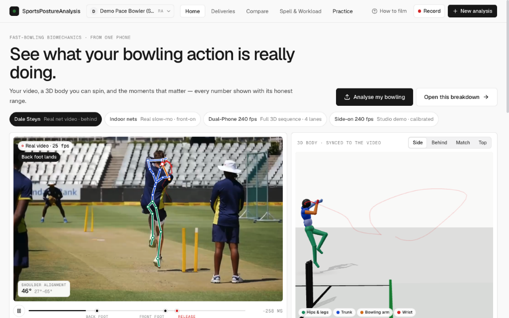
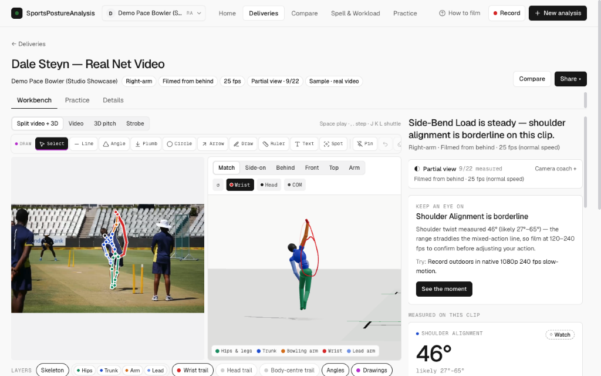
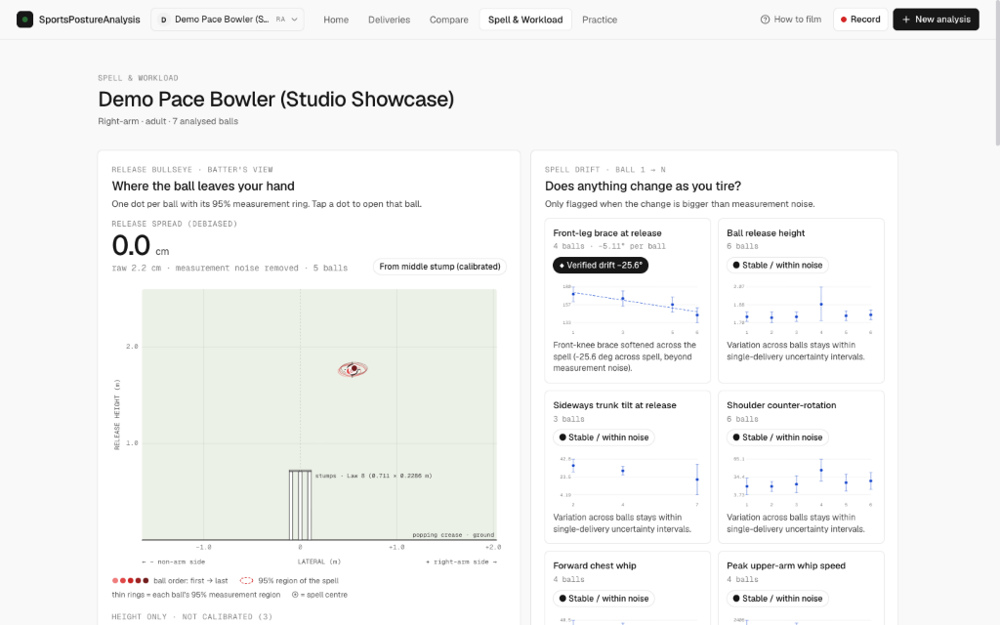
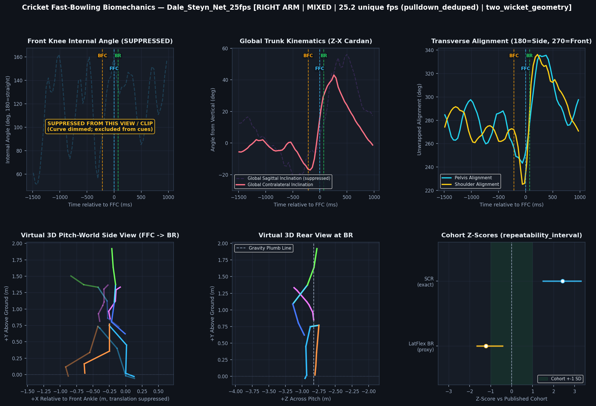

# SportsPostureAnalysis

A scientifically grounded, pitch-calibrated, uncertainty-gated 3D sports biomechanics engine and interactive Coaching Studio.

> **Living Project Ledger:** See **[AGENTS.md](AGENTS.md)** for the global engineering rules, scientific guardrails, and chronological **Experiment & Modification Ledger** (`EXP-001`–`EXP-012`) updated after every experiment, audit, and modification.

---

## Coaching Studio v5 (`v8`, "Paper Instrument" 3D Biomechanics Platform)



Designed from an exhaustive 30-product cross-sport teardown ([docs/research_app_landscape_v5.md](docs/research_app_landscape_v5.md)) and 11-module peer-reviewed biomechanics architecture ([docs/research_biomechanics_v5.md](docs/research_biomechanics_v5.md)), **Studio v5** (`FastAPI + SQLite + Vite/React/Three.js`) combines crisp monochrome light-paper chrome with high-clarity segment-colored data visualizations (`Pelvis emerald · Thorax cobalt · Arm amber · Wrist crimson · Ghost slate · User drawing magenta`) — with **zero buried Pro toggle**:

- **Command Center Home (`Home`, `Deliveries`, `Compare`, `Spell & Workload`, `Practice` + `Record` + `+ New analysis`):** Opens directly into real cricket footage (**Dale Steyn** rear-on net video & **Indoor 120 fps** front-on slow-mo, plus **Dual-Phone 240 fps** full 3D sequence) playing with 2px white-haloed segment skeletons and crimson wrist whip trails synced 1:1 to a studio-lit **sculpted 3D mannequin** on an MCC Law 6–8 pitch with 3D stumps & bails.
- **Interactive Delivery Workbench (Single Clock Across Video, 3D, Telestration, Strobe & Sequence):**
  - **Split Video + 3D Pitch:** 6 Sportsbox-style virtual cameras (`Match`, `Side-on`, `Behind`, `Front`, `Top`, `Arm`), 1-σ uncertainty spheres, 3D wrist/head/COM ribbons, and 4 peer-reviewed **Literature Reference Ghosts** (`Side-On Express`, `Semi-Open`, `Front-On Power`, `High-Arm Bounce`) with explicit Glazier (2010) non-template disclaimers.
  - **10-Tool Magenta Telestration & 3-Mode Strobe:** Line, joint-snapping 2D+3D Angle, calibrated-gravity Plumb, Circle, Arrow, Freehand, calibrated Metre Ruler, Spotlight, Text, Zoom/Minimap; plus pan-stabilized **Photo Strobe** (`/stroboscopic.jpg`), **3D Strobe**, and **2×4 Kinogram Grid**.
  - **4-Lane Kinematic Sequence Waterfall & 7 Deep Cards:** Tactile circular **JogWheel** + staggered **PhaseTimeline** driving synchronized `Pelvis → Thorax → Bowling Arm → Wrist Whip` curves with peak timing CIs (honestly ghosted `<90 fps`), alongside **de Leva (1996) 14-Segment COM & Braking**, **Head Stability**, **Lead-Arm Pull-Down**, **Crease Corridor & Release Tunnel**, **Delivery Tempo**, grounded Coach Copilot, Frame Notes + Audio, and 1080×1350 PNG Breakdown Card / 9:16 Reel / CSV / JSON export.

| Real Cricket Split Workbench (`Dale Steyn` Video + 3D) | Dual-Phone 240 fps (`4-Lane Kinematic Sequence Waterfall`) |
|---|---|
|  |  |

| Compare & Ghost Studio (`Overlaid Sequence + Noise-Gated Deltas`) | Spell & Workload Hub (`TrackMan Release Bullseye + Spell Drift`) |
|---|---|
|  |  |

- **Compare & Ghost Studio, Spell/ACWR Hub, Drill Lab & Live Camera:** FFC-synced Side-by-Side, **Blended Opacity Overlay**, **Dual 3D Ghost**, **Mirror B**, and noise-gated Delta Matrix; **Release-Point Bullseye** (MCC Law 8 scale, 95% confidence ellipses, tap-to-open) + **Verified Spell Fatigue Drift** (`-25.6°` Ball 1→4) + **Morning Daily Loop** + **ECB (2024) / Cricket Australia (2026) Official Limits** FIRST + 28-day Calendar + Secondary **EWMA/Uncoupled/Coupled ACWR** (with Lolli/Impellizzeri caveats) + Lumbar Soreness log; Constraint-led **Practice Drill Lab** (animated schematics, L1–L4 progression); and **4-Mode New Analysis** (`Live Camera` with spirit level & zero live metrics, `Upload Clip` powered by Warm RTX 4090 GPU, `Net Session` auto-clipper, `Two Phones` dual sync).
- **Uncompromising Scientific Guardrails:** Permanent, non-truncating **ICC 15° Elbow Legality Refusal** and **Medical Non-Diagnosis** notices across every view and exported card/reel; zero unvalidated 0–100 composite scores; every metric paired with its uncertainty interval and observability grade.

---

## Core 7-Stage Metrology Pipeline (`src/bowling_biomech/`)

1. **Stage 0 (`stage0_audit.py`):** Timebase integrity (`analyze_frame_cadence`, automatic regular pulldown deduplication, freeze-frame/retimed/scene-cut detection), bowler-ROI sharpness grading (`measure_bowler_roi_blur`), and 4-DOF KLT+RANSAC pan/tilt/zoom motion detection.
2. **Stage 1 (`stage1_pitch_calibration.py`):** Pre-NLF **MCC Laws 6/7/8 PnP** (`SOLVEPNP_IPPE`, larger-side `K`) and zero-annotation multi-frame **Two-Wicket Telephoto Calibration** (`auto_detect_two_wickets`) recovering `K`, extrinsics, and `world_up_vector` *before* 3D pose inference.
3. **Stage 2 (`stage2_nlf_3d.py`, `stage2_event_spotting.py`):** Streaming multi-person 3D SMPL-24 + `bml_movi_87` via pinned `nlf_l_multi.torchscript` passing calibrated `intrinsic_matrix` & `world_up_vector`, GPU repeatability ensemble (`base`/`flip`/`aug3`), Winter (2009) dual-pass Butterworth (`C = 1.2465`), and strict release-sanity-gated event spotting (`BFC < FFC <= UAH < BR < FT`).
4. **Stage 3 (`stage3_kinematics.py`):** Canonical Pitch World Frame (`+X` down pitch, `+Y` gravity-up, `+Z` off-to-leg), Z–X Cardan global trunk inclination, Rician/Jensen near-180° knee debiasing, Savitzky-Golay `~50 ms` arm omega, local front-foot ground reference, and `[60°, 420°)` joint-anchored Portus (2001/2004) AIS alignment & SCR.
5. **Stage 4 (`stage4_uncertainty.py`):** 4-source analytical Jacobian uncertainty (orthogonal `sigma_epistemic` + `sigma_projective`, contact-kink `sigma_temporal`, FD `sigma_calibration`, `sigma_scale`), GPU repeatability intervals (`repeatability_interval` vs `analytical_uncertainty`), hard incomplete/timebase/translation/crop/`<90 fps` gating, and **permanent `REFUSED` status on ICC 15-degree elbow legality**.
6. **Stage 5 (`stage5_evaluator.py`):** Retired 0–100 composite scores (`score=None`), definition-matched primary-source **Cohort Comparisons** (`Worthington 2013`, `Bayne 2016`, `Alway 2021`, `Portus 2001/2004`), **ECB (2024) / Cricket Australia (2026) Workload Guidance**, strict non-straddling printed-interval cues (`inconclusive_observations`), and Pillar 3 multi-ball repeatability.
7. **Stage 6 (`stage6_visualizer.py`, `stage6_coach_llm.py`, `stage6_coach_copilot.py`):** Zero-drift sequential `source_frame_indices` 2×2 keyframe strips, 6-panel dashboards, H.264 freeze videos & 9:16 breakdown reels, and verifier-guarded coaching reports/Q&A.

---

## Verified Baseline Results (`v8`, Studio v5 + Zero-Regression `v4`–`v7` Metrology)

- **Automated Regression Suite (`pytest -v`):** **36 / 36 passed** (`161.95 s`), covering 18 core/real-clip fixture tests + 12 Studio v2–v4 tests + 6 comprehensive Studio v5 non-circular right/left-arm kinematics, de Leva COM, stroboscopic JPEG, 4 Pro Archetypes, ACWR/EWMA, Release Bullseye/Spell Drift, and verifier tests; `cd web && npm run build` passes with **0 TypeScript errors** (`237.61 kB` initial bundle, **0 browser console errors**, **0 failed network requests**).
- **Canonical 22-Metric + Studio v5 Deep-Module AR(1) Benchmarks:**
  - **Canonical 22 / 22 metrics (`docs/results/v4/synthetic_benchmark_results.json`):** **Exact `96.4%`** pooled coverage (`3,003` observable AR(1) evaluations, per-metric `91.1%–100.0%`, `rmse/sigma` in `[0.71, 1.21]`, **`0 / 240`** false incomplete trials, `0.00%` regression).
  - **Studio v5 Deep Modules (`docs/results/v5/v5_modules_benchmark.json`):** **`96.9%`** pooled 95% CI coverage across **`2,596` observable AR(1) evaluations** (96 deliveries, `0°/45°/90°`, `120/240 fps`, right & left arm).
  - **Unmodified `EXP-007` S1–S9 (`docs/results/v4/synthetic_diagnostics.json`):** `S1` 91.7%–100.0% (pooled 97.1%), `S6` 100.0% release-height coverage across 15 lean/approach scenarios, `S8a` `+6.0°`, `S8b` 4/4 pan/tilt/zoom detected, `S9` 100.0% (`34 / 34`) cue precision & recall.
- **RTX 4090 GPU 1 Phase II Verification (`docs/results/v5/phase2_gpu_verification.json`, Dale Steyn net clip):**
  - **Warm GPU Worker (`nlf_l_multi.torchscript`):** Lifespan JIT warmup `26.6 s`, steady-state SMPL-24 + `bml_movi_87` inference **`6.83 s`** (63 frames, 6 tracks), SHA-256 cache hit **`7.84 ms`**, Law-8 `two_wicket_geometry` (`fx = 10,207.6 px`, cam `24.7 m` back) preserved via `auto_cal_json`.
  - **3-DOF Pan Tracker:** **`is_verified = true`**, `median_residual_px = 0.188 px`, `227` min inliers (`95.6%`), `max_pan_deg = 0.91°`, `sigma_pan_deg = 0.008°`.
  - **ISB `bml_movi_87` Anatomy (`rho = 0.85`):** `N_eff_pelvis = 1.127`, `N_eff_thorax = 1.143`; on telephoto rear-on Steyn, sagittal/foot angles are honestly suppressed (`unmeasurable`), while transverse Pelvis/Thorax/SCR are graded `low` with wide CIs.
- **Real-Video `v4` Verification (`docs/results/v4/real_clip_diagnostics.json`):** Steyn `thorax_lat_flex_br_deg = 30.26° [26.8, 36.5]` (`high`, `repeatability_interval`), `SCR = 46.17° [36.9, 55.0]`; Indoor flagged `[UNVERIFIED TIMEBASE]` with 0 contradictory cues; McGrath & Ambrose archival reels cleanly rejected (`is_complete_delivery = False`, 0/23 metrics, 0 false cues).

| Dale Steyn Net (`25.2 unique fps`, Two-Wicket Calibrated) | Dale Steyn `v4` Biomechanics Dashboard & Cohort Z-Scores |
|---|---|
|  |  |

*(Note: Real-video outputs measure NLF repeatability and internal geometric consistency; absolute real-world 3D accuracy awaits future ground-truth validation against IMU/radar/optical mocap.)*

---

## Quickstart

### 1. Install & Run Automated Tests
```bash
python3 -m venv .venv
source .venv/bin/activate
pip install -e ".[dev,server]"

# Run full 36-test unit, real-clip fixture, Studio & v5 biomechanics suite
pytest -v
```

### 2. Launch the Interactive Coaching Studio (Offline Demo Ready!)
```bash
# Build the React/Three.js/uPlot frontend once
cd web && npm install && npm run build && cd ..

# Start local-first FastAPI Coaching Studio (pre-seeds 240 fps Dual-View & Steyn/McGrath demo session)
bowling-biomech serve-studio --host 127.0.0.1 --port 8000
# Open http://127.0.0.1:8000 in your browser!
```

### 3. Connect Optional Warm Remote GPU Worker (for Live Video Uploads)
```bash
# On CUDA GPU server (using non-commercial CC-BY-NC-4.0 NLF TorchScript weights):
export NLF_MODEL_PATH="/path/to/models/nlf/nlf_l_multi.torchscript"
export GPU_WORKER_CACHE_DIR="/path/to/cache/gpu_worker"
bowling-biomech serve-gpu-worker --host 127.0.0.1 --port 8090

# On laptop (via SSH tunnel or local GPU):
export GPU_WORKER_URL="http://127.0.0.1:8090"
bowling-biomech serve-studio --host 127.0.0.1 --port 8000
```

### 4. CLI Single-Clip Analysis
```bash
export NLF_MODEL_PATH="/path/to/models/nlf/nlf_l_multi.torchscript"
bowling-biomech analyze path/to/delivery.mp4 \
  --bowler-id "Bowler_01" \
  --output-dir outputs/bowler_01 \
  --capture-fps 120
```

## Documentation & Evidence
- **[AGENTS.md](AGENTS.md)** — Global agent instructions, scientific guardrails, and living Experiment & Modification Ledger (`EXP-001`–`EXP-012`)
- **[docs/research_app_landscape_v5.md](docs/research_app_landscape_v5.md)** — 30-product cross-sport competitive teardown & Studio v5 "Paper Instrument" UX blueprint
- **[docs/research_biomechanics_v5.md](docs/research_biomechanics_v5.md)** — 11-module Studio v5 biomechanics, kinematic sequence, COM, ACWR, and API specification
- **[docs/results/v5/v5_modules_benchmark.json](docs/results/v5/v5_modules_benchmark.json)** — Studio v5 deep-module AR(1) benchmark (`96.9%` coverage across 2,596 evaluations)
- **[docs/research_report.md](docs/research_report.md)** — First-principles scientific investigation, forensic Reel analysis, and corrected primary-source bibliography
- **[docs/walkthrough.md](docs/walkthrough.md)** — Phase 0–5 build, audit hardening, Coaching Studio v5, and RTX 4090 validation walkthrough
- **[docs/results/v5/phase2_gpu_verification.json](docs/results/v5/phase2_gpu_verification.json)** — RTX 4090 Warm GPU Worker, `bml_movi_87` ISB anatomy, and 3-DOF pan tracking verification on Dale Steyn
- **[docs/results/v4/](docs/results/v4/)** — Per-metric 22/22 synthetic benchmark, S1–S9 diagnostics, and RTX 4090 real-video Fact Sheets
- **[docs/independent_audit_and_improvements.md](docs/independent_audit_and_improvements.md)** — Independent audit (`EXP-007`) documenting all 27 bugs (`B1–B27`) resolved in Phase 1.5
