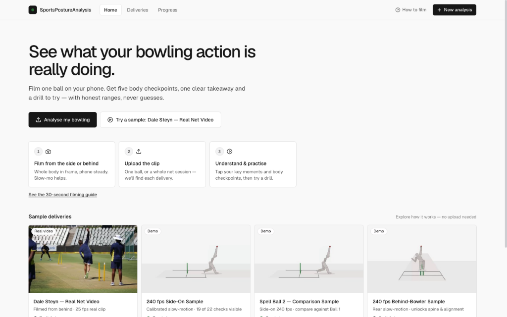
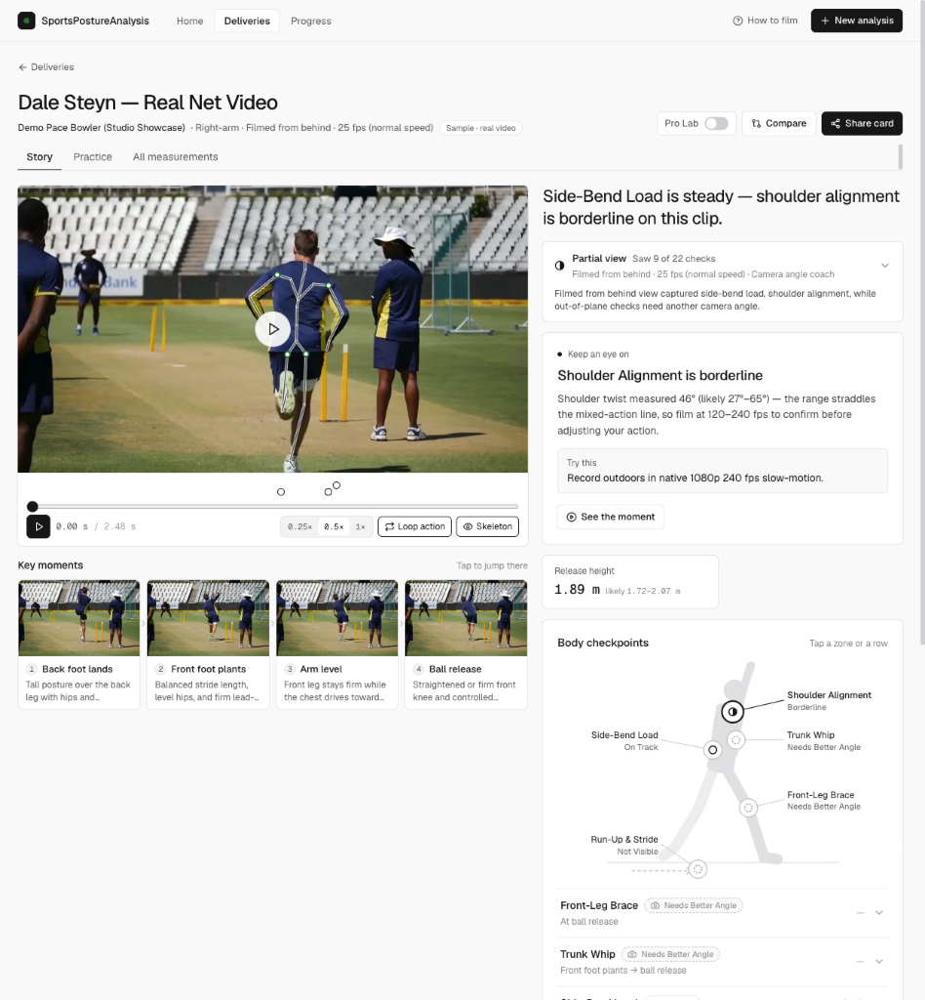
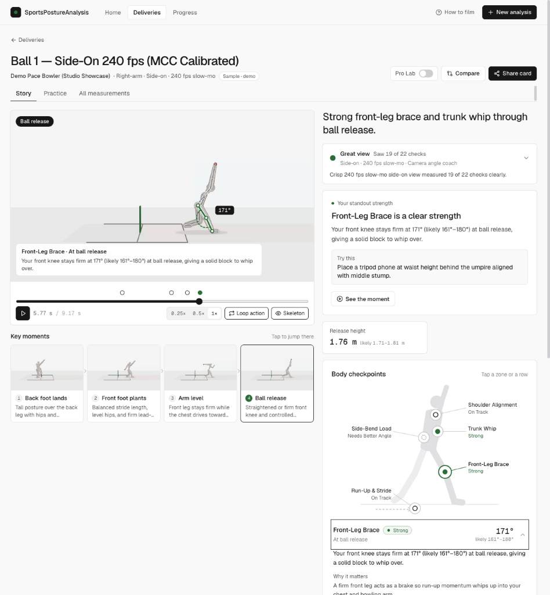
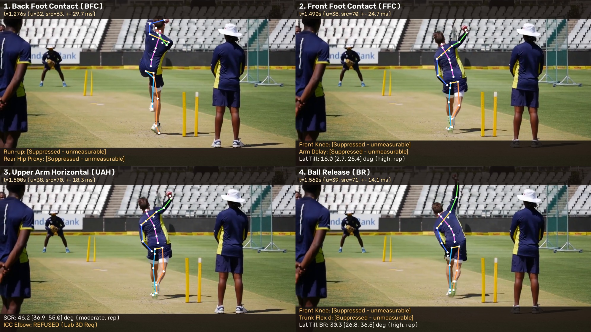

# SportsPostureAnalysis

A scientifically grounded, pitch-calibrated, uncertainty-gated 3D sports biomechanics engine and interactive Coaching Studio.

> **Living Project Ledger:** See **[AGENTS.md](AGENTS.md)** for the global engineering rules, scientific guardrails, and chronological **Experiment & Modification Ledger** (`EXP-001`–`EXP-011`) updated after every experiment, audit, and modification.

---

## Interactive Coaching Studio v4 (`v7`, Consumer-First Guided UX + Pro Lab)



Built atop our verified Phase 0–3 7-stage metrology engine (`v4`–`v6`), **Studio v4** (`FastAPI + SQLite + Vite/React/Three.js/uPlot`) delivers an effortless consumer sports-coaching user journey in a calm Vercel light-paper interface — while preserving every biomechanist power tool behind a 1-click **Pro Lab** toggle:

- **3-Second Start Hub (`Home`, `Deliveries`, `Progress` + `+ New analysis`):** No cluttered session menus or developer jargon. First-time bowlers land on a calm hero (`Analyse my bowling` or 1-click `Try a sample: Dale Steyn — Real Net Video`) with a 3-step guide and 4 curated sample deliveries.
- **Plain-English `CoachingStory` & Interactive Body Map (`Delivery › Story`):** Deterministic, 100% interval-grounded coaching narrative (`coaching_story/1`) pairing the full video player with human moment chips (`Back foot lands → Front foot plants → Arm level → Ball release`), a **Camera Angle Coach** (mini top-down pitch diagram explaining what the angle can/can't see), **Your #1 Takeaway**, and a clickable **Body Map** of 5 everyday checkpoints (`Front-Leg Brace`, `Trunk Whip`, `Side-Bend Load`, `Shoulder Alignment`, `Run-Up & Stride`) that seeks the video and draws Terminal Green joint highlights & angle arcs right on the bowler.

| Real Cricket Net Video (`Dale Steyn Story`) | 240 fps Calibrated Anatomy (`Front-Leg Brace 171°`) |
|---|---|
|  |  |

- **Practice Drills, Compare 2 Balls, Progress Matrix & Shareable Coach Card:** Evidence-grounded **Practice** drills mapped strictly from non-straddling verified limiters (never generic drills), **Compare 2 Balls** (Side-by-Side or Ghost Overlay synced at `Front foot plants` with interval-overlap change verdicts), **Progress** checkpoint dot-matrix + ECB (2024) / Cricket Australia (2026) workload guidance, a 4-step bowler-first **New Analysis** flow (with multi-ball net auto-clipping and live Warm RTX 4090 GPU support), a slide-over **How to film** guide, and a printable white-paper **Coach Card** (`Print / PDF` + 9:16 Truthful Breakdown Reel).
- **Opt-In Pro Lab (Lazy-Loaded `LabTab`, `308 kB` Initial Bundle):** Flipping **Pro Lab** ON unlocks the full v3 biomechanics workbench — light-paper Three.js 3D MCC Pitch Viewport, synchronized `uPlot` waveforms, interactive frame-bound Telestrator, 4-Click MCC Crease Calibration with 4× pixel loupe, 3-DOF SO(3) rotational pan tracking, 87-marker `bml_movi_87` ISB anatomy (`N_eff` correlated-depth guardrail), Dual-Phone 3D ray-precision fusion, causal event nudging, and verifier-guarded Coach AI.
- **Uncompromising Scientific Guardrails:** Permanent, non-truncating plain-English **ICC 15° Elbow Legality Refusal** and **Medical Non-Diagnosis** notices on every Story, Details, Compare, and Coach Card screen; zero unvalidated 0–100 composite scores; every displayed measurement paired with its likely range.

---

## Core 7-Stage Metrology Pipeline (`src/bowling_biomech/`)

1. **Stage 0 (`stage0_audit.py`):** Timebase integrity (`analyze_frame_cadence`, automatic regular pulldown deduplication, freeze-frame/retimed/scene-cut detection), bowler-ROI sharpness grading (`measure_bowler_roi_blur`), and 4-DOF KLT+RANSAC pan/tilt/zoom motion detection.
2. **Stage 1 (`stage1_pitch_calibration.py`):** Pre-NLF **MCC Laws 6/7/8 PnP** (`SOLVEPNP_IPPE`, larger-side `K`) and zero-annotation multi-frame **Two-Wicket Telephoto Calibration** (`auto_detect_two_wickets`) recovering `K`, extrinsics, and `world_up_vector` *before* 3D pose inference.
3. **Stage 2 (`stage2_nlf_3d.py`, `stage2_event_spotting.py`):** Streaming multi-person 3D SMPL-24 + `bml_movi_87` via pinned `nlf_l_multi.torchscript` passing calibrated `intrinsic_matrix` & `world_up_vector`, GPU repeatability ensemble (`base`/`flip`/`aug3`), Winter (2009) dual-pass Butterworth (`C = 1.2465`), and strict release-sanity-gated event spotting (`BFC < FFC <= UAH < BR < FT`).
4. **Stage 3 (`stage3_kinematics.py`):** Canonical Pitch World Frame (`+X` down pitch, `+Y` gravity-up, `+Z` off-to-leg), Z–X Cardan global trunk inclination, Rician/Jensen near-180° knee debiasing, Savitzky-Golay `~50 ms` arm omega, local front-foot ground reference, and `[60°, 420°)` joint-anchored Portus (2001/2004) AIS alignment & SCR.
5. **Stage 4 (`stage4_uncertainty.py`):** 4-source analytical Jacobian uncertainty (orthogonal `sigma_epistemic` + `sigma_projective`, contact-kink `sigma_temporal`, FD `sigma_calibration`, `sigma_scale`), GPU repeatability intervals (`repeatability_interval` vs `analytical_uncertainty`), hard incomplete/timebase/translation/crop/`<90 fps` gating, and **permanent `REFUSED` status on ICC 15-degree elbow legality**.
6. **Stage 5 (`stage5_evaluator.py`):** Retired 0–100 composite scores (`score=None`), definition-matched primary-source **Cohort Comparisons** (`Worthington 2013`, `Bayne 2016`, `Alway 2021`, `Portus 2001/2004`), **ECB (2024) / Cricket Australia (2026) Workload Guidance**, strict non-straddling printed-interval cues (`inconclusive_observations`), and Pillar 3 multi-ball repeatability.
7. **Stage 6 (`stage6_visualizer.py`, `stage6_coach_llm.py`, `stage6_coach_copilot.py`):** Zero-drift sequential `source_frame_indices` 2×2 keyframe strips, 6-panel dashboards, H.264 freeze videos & 9:16 breakdown reels, and verifier-guarded coaching reports/Q&A.

---

## Verified Baseline Results (`v7`, Studio v4 + Zero-Regression `v4`–`v6` Metrology)

- **Automated Regression Suite (`pytest -v`):** **30 / 30 passed** (`72.8 s` macOS, `70.7 s` Linux RTX 4090), covering 18 core/real-clip fixture tests + 12 Studio v3–v4, `CoachingStory` jargon-free contract, verifier, `/api/overview`, `/frame/{idx}.jpg`, `/api/compare`, `/api/bowlers/{id}/progress`, bowler-first upload/scan/jobs, CV, dual-fusion, ISB anatomy, and 1080p ball-speed tests; `cd web && npm run build` passes with **0 TypeScript errors** (`308 kB` initial bundle, **0 browser console errors**, **0 failed network requests**).
- **Phase 1.5 Metrology Zero-Regression (`docs/results/v4/synthetic_benchmark_results.json`):**
  - **All 22 / 22 metrics scored** (3,003 observable AR(1) correlated-noise evaluations): **96.4%** pooled coverage, per-metric **91.1%–100.0%**, `rmse/sigma` in **`[0.71, 1.21]`**, **`0 / 240`** false incomplete trials.
  - **Unmodified `EXP-007` S1–S9 (`docs/results/v4/synthetic_diagnostics.json`):** `S1` 91.7%–100.0% (pooled 97.1%), `S6` 100.0% release-height coverage across 15 lean/approach scenarios, `S8a` `+6.0°`, `S8b` 4/4 pan/tilt/zoom detected, `S9` 100.0% (`34 / 34`) cue precision & recall.
- **RTX 4090 GPU 1 Phase II Verification (`docs/results/v5/phase2_gpu_verification.json`, Dale Steyn net clip):**
  - **Warm GPU Worker (`nlf_l_multi.torchscript`):** Lifespan JIT warmup `26.6 s`, steady-state SMPL-24 + `bml_movi_87` inference **`6.83 s`** (63 frames, 6 tracks), SHA-256 cache hit **`7.84 ms`**, Law-8 `two_wicket_geometry` (`fx = 10,207.6 px`, cam `24.7 m` back) preserved via `auto_cal_json`.
  - **3-DOF Pan Tracker:** **`is_verified = true`**, `median_residual_px = 0.188 px`, `227` min inliers (`95.6%`), `max_pan_deg = 0.91°`, `sigma_pan_deg = 0.008°`.
  - **ISB `bml_movi_87` Anatomy (`rho = 0.85`):** `N_eff_pelvis = 1.127`, `N_eff_thorax = 1.143`; on telephoto rear-on Steyn, sagittal/foot angles are honestly suppressed (`unmeasurable`), while transverse Pelvis/Thorax/SCR are graded `low` with wide CIs.
- **Real-Video `v4` Verification (`docs/results/v4/real_clip_diagnostics.json`):** Steyn `thorax_lat_flex_br_deg = 30.26° [26.8, 36.5]` (`high`, `repeatability_interval`), `SCR = 46.17° [36.9, 55.0]`; Indoor flagged `[UNVERIFIED TIMEBASE]` with 0 contradictory cues; McGrath & Ambrose archival reels cleanly rejected (`is_complete_delivery = False`, 0/23 metrics, 0 false cues).

| Dale Steyn Net (`25.2 unique fps`, Two-Wicket Calibrated) | Dale Steyn `v4` Biomechanics Dashboard & Cohort Z-Scores |
|---|---|
|  |  |

*(Note: Real-video outputs measure NLF repeatability and internal geometric consistency; absolute real-world 3D accuracy awaits future ground-truth validation against IMU/radar/optical mocap.)*

---

## Quickstart

### 1. Install & Run Automated Tests
```bash
python3 -m venv .venv
source .venv/bin/activate
pip install -e ".[dev,server]"

# Run full 30-test unit, real-clip fixture & Studio v4 suite
pytest -v
```

### 2. Launch the Interactive Coaching Studio (Offline Demo Ready!)
```bash
# Build the React/Three.js/uPlot frontend once
cd web && npm install && npm run build && cd ..

# Start local-first FastAPI Coaching Studio (pre-seeds 240 fps Dual-View & Steyn/McGrath demo session)
bowling-biomech serve-studio --host 127.0.0.1 --port 8000
# Open http://127.0.0.1:8000 in your browser!
```

### 3. Connect Optional Warm Remote GPU Worker (for Live Video Uploads)
```bash
# On CUDA GPU server (using non-commercial CC-BY-NC-4.0 NLF TorchScript weights):
export NLF_MODEL_PATH="/path/to/models/nlf/nlf_l_multi.torchscript"
export GPU_WORKER_CACHE_DIR="/path/to/cache/gpu_worker"
bowling-biomech serve-gpu-worker --host 127.0.0.1 --port 8090

# On laptop (via SSH tunnel or local GPU):
export GPU_WORKER_URL="http://127.0.0.1:8090"
bowling-biomech serve-studio --host 127.0.0.1 --port 8000
```

### 4. CLI Single-Clip Analysis
```bash
export NLF_MODEL_PATH="/path/to/models/nlf/nlf_l_multi.torchscript"
bowling-biomech analyze path/to/delivery.mp4 \
  --bowler-id "Bowler_01" \
  --output-dir outputs/bowler_01 \
  --capture-fps 120
```

## Documentation & Evidence
- **[AGENTS.md](AGENTS.md)** — Global agent instructions, scientific guardrails, and living Experiment & Modification Ledger (`EXP-001`–`EXP-011`)
- **[docs/studio_v4_ux_blueprint.md](docs/studio_v4_ux_blueprint.md)** — Studio v4 consumer-first UX architecture & deterministic `CoachingStory` contract
- **[docs/research_report.md](docs/research_report.md)** — First-principles scientific investigation, forensic Reel analysis, and corrected primary-source bibliography
- **[docs/walkthrough.md](docs/walkthrough.md)** — Phase 0–2 build, audit hardening, Coaching Studio, and RTX 4090 validation walkthrough
- **[docs/results/v5/phase2_gpu_verification.json](docs/results/v5/phase2_gpu_verification.json)** — RTX 4090 Warm GPU Worker, `bml_movi_87` ISB anatomy, and 3-DOF pan tracking verification on Dale Steyn
- **[docs/results/v4/](docs/results/v4/)** — Per-metric 22/22 synthetic benchmark, S1–S9 diagnostics, and RTX 4090 real-video Fact Sheets
- **[docs/independent_audit_and_improvements.md](docs/independent_audit_and_improvements.md)** — Independent audit (`EXP-007`) documenting all 27 bugs (`B1–B27`) resolved in Phase 1.5
