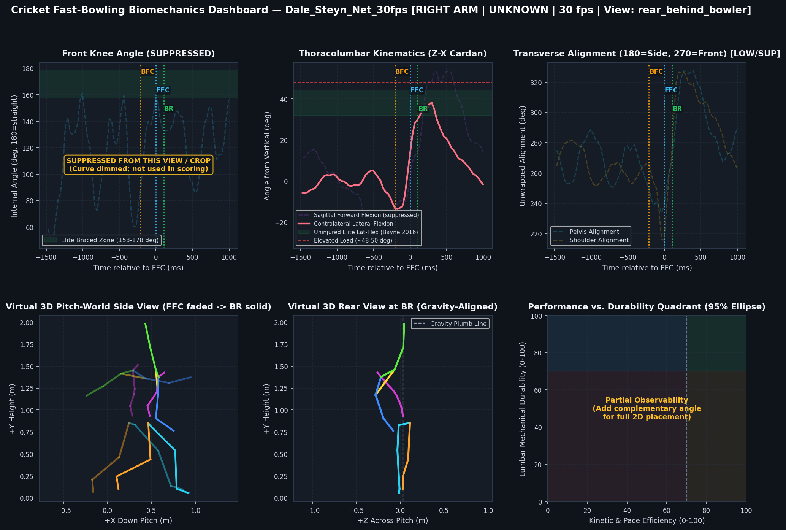

# SportsPostureAnalysis

A scientifically grounded, pitch-calibrated, uncertainty-gated 3D sports biomechanics and posture analysis platform.

> **Living Project Ledger:** See **[AGENTS.md](AGENTS.md)** for the global engineering rules, scientific guardrails, and chronological **Experiment & Modification Ledger** updated after every experiment, finding, and code modification.

---

## Flagship Module (Phase 0–1): Cricket Fast-Bowling Biomechanics Engine (`src/bowling_biomech/`)

Built from first principles on **Neural Localizer Fields (`isarandi/nlf`, NeurIPS 2024)**, **MCC Law 7 Pitch Geometry Calibration**, peer-reviewed fast-bowling biomechanics (`Worthington et al. 2013`, `Bayne et al. 2016`, `Alway et al. 2021`, `Portus et al. 2004`, `Glazier 2010`), and strictly measurement-grounded multimodal coaching explanations.

### Pipeline Architecture (7 Stages)

1. **Stage 0 (`stage0_audit.py`):** Sub-clip resolution, FPS physics (`2300 deg/s` bowling-arm sweep per frame), Laplacian sharpness audit, and Sobel-textured adaptive optical-flow camera panning detection.
2. **Stage 1 (`stage1_pitch_calibration.py`):** MCC Law 7 Pitch PnP Calibration (`1.22 m` crease gap, `2.64 m` return crease width, `0.711 m` stump height, coplanar `SOLVEPNP_IPPE` support) with standing-background / upright-torso gravity self-calibration and geometric panning override when creases are cropped.
3. **Stage 2 (`stage2_nlf_3d.py`, `stage2_event_spotting.py`):** Multi-person metric 3D SMPL-24 pose & native per-joint uncertainties via `nlf_l_multi.torchscript` (CUDA GPU), 3D depth-aware bowler tracking, `(T, 24)` `joint_in_frame` crop bounds checking, handedness inference, and causal sub-frame event spotting (`BFC < FFC <= UAH < BR < FT`).
4. **Stage 3 (`stage3_kinematics.py`):** Zero-lag Butterworth biomechanical filtering, canonical Pitch World Frame (`+X` down pitch, `+Y` gravity-up, `+Z` off-to-leg), exact Z–X Cardan lateral trunk flexion, and BFC-anchored unwrapped 3D transverse alignment / shoulder counter-rotation (SCR).
5. **Stage 4 (`stage4_uncertainty.py`):** Camera-View Observability Matrix, per-metric event-specific crop/uncertainty gating, 3-source 95% confidence interval propagation (`projective + temporal quantization + epistemic/blur`), physical CI clamping, `<90 fps` high-velocity gating, and **permanent `REFUSED` status on ICC 15-degree elbow legality verdicts**.
6. **Stage 5 (`stage5_evaluator.py`):** 4-pillar fast-bowling evaluation (Kinetic Efficiency, two-sided Mechanical Load & Durability Screening, Multi-Delivery Repeatability, 2D Performance–Durability Quadrant), azimuth-gated capture upgrade cues, and Dual-View (Side + Rear) inverse-variance metric fusion.
7. **Stage 6 (`stage6_visualizer.py`, `stage6_coach_llm.py`):** Readable portrait/landscape 2×2 key-phase freeze frames, 6-panel biomechanics dashboards (with virtual 3D pitch-world views and dimmed suppressed waveforms), annotated slow-mo freeze videos, and strictly JSON-grounded coaching reports.

---

## Verified Baseline Results (`v3`)

> Audit note (EXP-007, 2026-11-23). An independent audit qualifies or withdraws several results in this section, including the McGrath keyframes shown below. Read [docs/independent_audit_and_improvements.md](docs/independent_audit_and_improvements.md) first.

- **Automated Unit & Integration Suite (`pytest -v`):** **13 / 13 passed** (`tests/test_core_biomechanics.py`)
- **AR(1) Correlated-Noise Synthetic Metrology Benchmark (`tau = 80 ms`, Right + Left Arms):** **97.0%** empirical 95% CI coverage across 912 observable evaluations; uncalibrated self-calibration (no oracle `K` / no MCC landmarks) achieves `4.49°–4.58°` azimuth MAE and `2.99°` rear lateral-flexion RMSE (`docs/results/v3/synthetic_benchmark_results.json`).

| Dale Steyn Net (`30 fps`, Rear View) | Glenn McGrath Reel (`25 fps`, Side-On Pan) |
|---|---|
|  |  |

---

## Quickstart

```bash
# 1. Create isolated Python 3.10+ environment and install package + dev deps
python3 -m venv .venv
source .venv/bin/activate
pip install -e ".[dev]"

# 2. Run unit & metrology verification suite
pytest -v
python validation/run_synthetic_benchmark.py --out outputs/synthetic_benchmark_results.json

# 3. Point to downloaded NLF TorchScript weights (CC-BY-NC-4.0 non-commercial research weights)
export NLF_MODEL_PATH="/path/to/models/nlf/nlf_l_multi.torchscript"

# 4. Run full 7-stage analysis on a fast-bowling clip
bowling-biomech analyze path/to/delivery.mp4 \
  --bowler-id "Bowler_01" \
  --output-dir outputs/bowler_01 \
  --capture-fps 120
```

## Documentation & Evidence
- **[AGENTS.md](AGENTS.md)** — Global agent instructions, guardrails, and living Experiment & Modification Ledger
- **[docs/research_report.md](docs/research_report.md)** — First-principles scientific investigation, forensic Reel analysis, and full bibliography
- **[docs/walkthrough.md](docs/walkthrough.md)** — Phase 0–1 build, audit hardening, and RTX 4090 validation walkthrough
- **[docs/results/v3/](docs/results/v3/)** — Structured benchmark & real-video JSON Fact Sheet outputs
- **[docs/independent_audit_and_improvements.md](docs/independent_audit_and_improvements.md)**. Independent audit (EXP-007) with a numbered bug list, real-clip evidence, a literature check and a prioritised roadmap.
- **[docs/results/exp007/](docs/results/exp007/)**. Result files behind the audit, produced by `validation/audit_*.py`.
