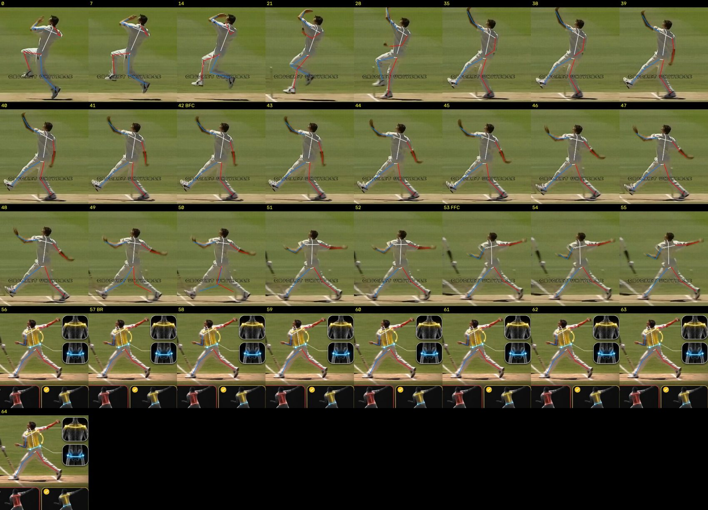
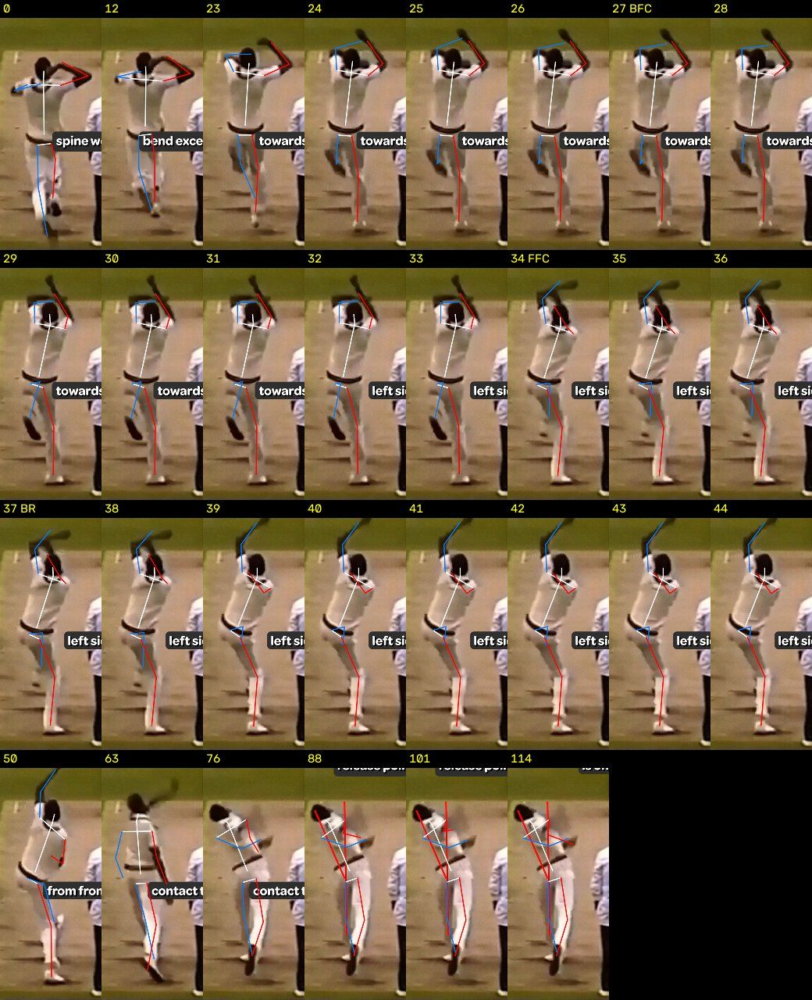
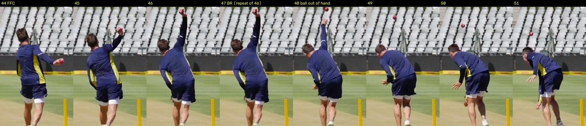
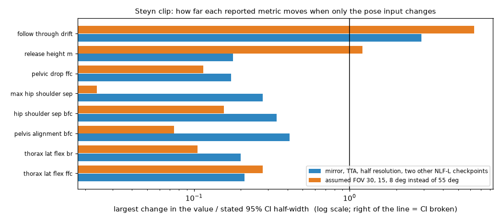
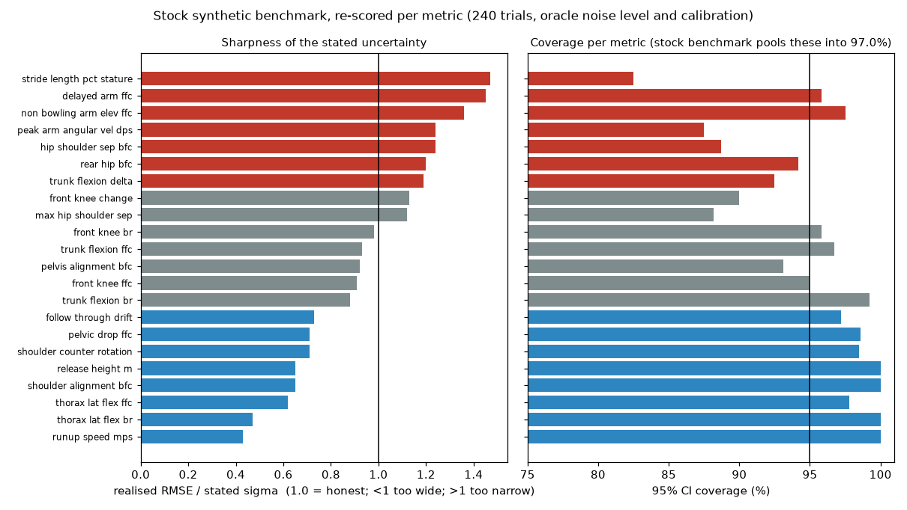

# Independent audit and improvement plan (EXP-007)

Date: 2026-11-23. Audited commit: `ec28cc0`. Line numbers refer to that commit.

I came to this repository cold. I read every module, test and document, reproduced the baseline, wrote three diagnostic scripts, re-ran the pose model on a GPU, looked at the frames behind every reported event, and checked the cited papers against their primary sources. This document says what holds up, what does not, and what I would build next.

Evidence labels used throughout:

- Confirmed. Reproduced by a script in this repository, or visible in a committed artifact.
- Likely. Follows from reading the code or a paper. I built no reproduction.
- Open. A research direction, or a question I could not settle.

Source paths are under `src/bowling_biomech/` unless stated. Result files are in `docs/results/exp007/`.

## 1. The short version

The engineering instincts here are good. The pipeline suppresses what it cannot see, refuses the ICC elbow verdict, gets its sign conventions right for both arms, and forces every number to carry an interval. The measurement claims stacked on top are much weaker than `AGENTS.md` and the README say.

1. **The four "verified" real-video runs are not verified.** None of the four clips has the timebase the pipeline assumed. Two of the four report a ball release that is not a release. McGrath's is a freeze frame carrying the Reel's own graphics, with the arm 46° short of vertical. Ambrose's falls in the back-foot phase, about 40 frames before he lets go. The pipeline issued coaching conclusions from both. Section 3.
2. **The 97.0% coverage figure is correct arithmetic about the wrong question.** The synthetic benchmark never runs the pose model. It hands Stage 4 the exact noise level it injected. It scores 7 of 22 metrics and pools them. Scored per metric, coverage runs from 82.5% to 100%, and several intervals are twice as wide as the error they describe. Double the true noise and pooled coverage falls to 76.8%. Section 4.
3. **The camera model is wrong by a factor of six on the best clip.** The two wickets in the Steyn footage put the camera 27.6 m behind the stumps with a 9.6° field of view. The pipeline assumes 55°. NLF therefore places the bowler 4.2 m away and compresses his run-up to 0.79 m/s. Scaling by the wicket-derived focal length gives 4.9 m/s. Section 3.3.
4. **Reported uncertainty does not track reproducibility.** On the Steyn clip I changed only the pose input: mirrored frames, test-time augmentation, half resolution, two other NLF-L checkpoints. Trunk lateral flexion at release moved by at most 2.1° against a stated ±10.6°. Follow-through drift, graded high with ±8.5°, moved by 24.8°, and by 53.9° when the assumed field of view changed. Section 3.4.
5. **The scoring layer cites papers that do not support it.** The action-class thresholds appear in no source I could find. The timing priors sit about 2.5 SD above published means. The "88% prospective" injury model is an in-sample classification rate against a 78% base rate. The same paper found injured bowlers were less side-flexed at release, and found no link between shoulder counter-rotation and injury. Those two variables carry 58% of the durability pillar's weight. Section 6.
6. **Decisions are fragile even inside the synthetic world.** With oracle calibration and oracle noise, the kinetic pillar's status label matches the one computed from true values in 52.5% of trials. Three limiter cues fired 53 times in total and were right twice. Section 4.6.

What I would do first: validate the input video, calibrate the camera from the pitch instead of from bodies, gate ball release on evidence that a ball was released, stop publishing 0 to 100 scores until something external validates them, and build a real reference set. Sections 7 to 9.

## 2. What I ran

| Experiment | Script | Result file |
|---|---|---|
| Baseline reproduction | `pytest`, `validation/run_synthetic_benchmark.py` | 13 of 13 pass. Benchmark output is identical to the committed JSON (97.0%, 912 evaluations). |
| Synthetic diagnostics S1 to S9 | `validation/audit_synthetic_diagnostics.py` | `synthetic_diagnostics.json` |
| Real-clip diagnostics on the four saved v3 runs | `validation/audit_real_clip_diagnostics.py` | `real_clip_diagnostics.json`, `docs/figures/exp007_*_event_frames.jpg` |
| Pose-model consistency on GPU: mirror, TTA, half resolution, field-of-view sweep, GeoCalib | `validation/audit_nlf_self_consistency.py` | `nlf_consistency_steyn.json`, `nlf_consistency_indoor.json` |
| Second and third NLF-L checkpoints | same script, `--alt-model` | `nlf_checkpoint_{steyn,indoor}_vs_{0.2.2,0.3.2.patch6}.json` |
| Literature check against primary sources | full texts of Worthington 2013, Felton 2019, Alway 2021, Abraham 2025; abstracts of Bayne 2016, Portus 2004, Dobos 2025; MCC Laws | Section 6, source list at the end |

GPU work ran on one RTX 4090 in an isolated directory with its own virtual environment and caches. I changed nothing under `src/`.

## 3. The four real-video runs

### 3.1 None of the clips has the timebase the pipeline assumed (Confirmed)

Stage 0 reads the container frame rate (`stage0_audit.py:38`) and trusts it. It never looks at whether consecutive frames differ. I measured the mean grey-level change between consecutive frames inside the bowler's box.

| Clip | Pipeline assumed | What the frames show |
|---|---|---|
| Steyn | "native 30 fps" | Every 6th frame repeats the one before. 30 repeats in 181 frame pairs, spaced exactly 6 apart with one exception. This is 25 fps footage in a 29.97 fps container. |
| Indoor | 120 fps capture, by manual override on a 30 fps container | Every 5th frame repeats. 24 unique frames per playback second. The frame carries a SloPro watermark and the true capture rate is unknown. |
| McGrath | 25 fps real time | 64% of frame pairs are repeats, longest run 8. Slow-motion replay, then a still. |
| Ambrose | 25 fps real time | 82% of frame pairs are repeats, longest run 33. Slow-motion replay with a zoomed still at the end. |

Every duration, velocity and "ms" figure in the four fact sheets inherits this. McGrath's 478 ms delivery stride is 2.5 times the published mean of 192 ms. It sat 22 ms under the detector's 500 ms slow-motion warning (`stage2_event_spotting.py:326`), so no warning fired.

The material itself is thin. Two of the four clips are segments of the reference Reel, with captions, letterboxing and generative overlays baked in. The indoor clip is a shadow delivery in a living room with no ball and the legs out of frame. Only the Steyn clip is the kind of footage this system is meant for.

### 3.2 Two of four ball releases are not releases (Confirmed)



McGrath, frames 488 to 553 of the Reel. The back foot is down from about frame 28. The pipeline reports BFC at 41.5, which is the edge of its search window, not a detection. From frame 56 the Reel shows a re-rendered still with anatomy insets. The pipeline reports ball release at 56.5, on that still. At that frame the bowling arm is 46° behind vertical and the wrist is 0.37 m above the shoulder, 68% of arm length. The clip contains no release. `is_complete_delivery` is true.

Downstream of that one false event the fact sheet reports `trunk_flexion_delta_deg = 7.9°` at high observability, issues the limiter "Limited Forward Trunk Flexion", and scores Glenn McGrath 23.3 out of 100 for kinetic efficiency with the label "Developing (Major Energy Leaks)". The README shows this keyframe strip as a verified result. Panel 4 of that strip, titled "Ball Release", is the freeze frame.



Ambrose, frames 745 to 860 of the Reel. The pipeline's BFC, FFC and BR at 27, 34 and 37 all fall while he is still on the back foot with the front arm rising. Front-foot contact is near frame 63 and the release near frame 76. From frame 88 the Reel shows a still with the creator's red lines drawn on it, and NLF's skeleton falls apart. The BR came from the fallback branch with the arm 56° past vertical and the wrist at 44% of arm length. The "follow-through peak" is one frame after it.

The numbers this produced: thorax lateral flexion at release of -13.6°, which is ipsilateral and physically odd for a right-arm bowler at release, a durability score of 54.2 with "Elevated Lumbar Load Flag", and the limiter "Excessive Lateral Follow-Through Drift". `AGENTS.md` records the 54.2 as a fix.

Why the detector accepts these. The release gate at `stage2_event_spotting.py:139-143` asks for a wrist 14 cm above the shoulder, an elbow above 115°, and modest arm extension. An arm slightly above horizontal passes. The winner is the argmax of a score (`:150-151`) with no floor, so a frame can win with zero credit for being near vertical. The fallback (`:165-172`) lowers the bar again. The clip is marked incomplete only when no frame at all passes (`:173-183`).



The Steyn clip is the counter-example. BFC 38, FFC 44 and BR 47.3 agree with the frames to about one frame. The ball is in the hand at frame 46, frame 47 is a repeat of 46, and at frame 48 the ball is clear of the hand. A plain colour threshold, which I ran ad hoc and did not commit, followed the ball for ten more unique frames. On clean footage the event logic works, and the ball is there to confirm it.

### 3.3 The camera model on the best clip (Confirmed)

Both wickets are visible in the Steyn footage, 20.12 m apart and 0.711 m tall. Apparent height falls as 1/Z, so two heights give distance and focal length with no other input (`two_wicket_geometry` in the real-clip script).

| Quantity | From the two wickets | Pipeline |
|---|---|---|
| Focal length | 11,400 px, range 10,600 to 12,300 for ±4 px of height error | 1,844 px, from an assumed 55° |
| Field of view, larger side | 9.6° | 55° |
| Camera to bowling-end wicket | 27.6 m, range 25.3 to 30.2 | not estimated |
| Camera height and pitch | 1.52 m, tilted down 1.4° | tilted up 2.5°, rolled 2.1°, elevation clamped to -1° |
| Cross-check: off-to-leg stump spacing | 0.194 m measured, 0.191 to 0.194 m by Law 8 | n/a |

Three consequences.

Depth is compressed sixfold. NLF with a 55° assumption puts the bowler 4.2 m from the camera at back-foot contact. Multiplied by the focal ratio that is 26 m, which matches the wicket distance. His run-up along the camera axis measures 0.79 m/s at 55° and 4.9 m/s after scaling, a plausible figure for a fast bowler. The field-of-view sweep confirms the mechanism on the real model. Pelvis depth went 4.38, 8.44, 17.13, 32.34 m for assumed 55°, 30°, 15°, 8°, tracking the focal ratio to about 1%, while lateral range stayed at 0.23 to 0.24 m.

Gravity from bodies is off by several degrees. The pipeline took gravity from 11 frames of standing background people. Its up-vector is 4.7° from the wicket-derived one, taking camera roll as zero because the stumps stand upright in the image. GeoCalib, a learned single-image calibrator, is 4.3° off in the opposite direction and estimates a 26.7° vertical field of view where the wickets say 5.4°. On telephoto cricket footage neither bodies nor a generic calibrator gets the camera right. The pitch does.

The stored intrinsics do not match what NLF used. NLF applies its field of view to the larger image side. I confirmed `fx = 1844.1` for both a 1920x1080 frame and the same frame rotated to portrait. `default_camera_matrix` applies it to the width (`stage1_pitch_calibration.py:46-52`). For the two 720x1280 Reel clips the fact sheet stores a focal length of 691 px while NLF worked with 1,229 px.

### 3.4 How far the numbers move when only the pose input changes (Confirmed)

This test needs no ground truth. A consistent estimator returns the same body for a mirrored image, for five augmented copies, at half resolution, and from a sibling checkpoint. The spread is a lower bound on error, because mistakes shared by all runs cancel. It can show an interval is too narrow. It cannot show one is right.



| Steyn metric as reported | Stated 95% half-width | Largest change, pose perturbations | Largest change, FOV 30/15/8° |
|---|---|---|---|
| Thorax lateral flexion at BR, 30.3°, high | 10.6° | 2.1° | 1.1° |
| Thorax lateral flexion at FFC, 13.6°, high | 11.8° | 2.5° | 3.3° |
| Pelvis alignment at BFC, 250.0°, low | 24.4° | 10.1° | 1.8° |
| Hip-shoulder separation at BFC, -15.5°, moderate | 20.2° | 6.9° | 3.1° |
| Pelvic drop at FFC, 8.5°, moderate | 19.1° | 3.3° | 2.2° |
| Release height, 2.12 m, moderate | 0.28 m | 0.05 m | 0.34 m |
| Follow-through drift, -4.6°, high | 8.5° | 24.8° | 53.9° |

Two things stand out. Trunk lateral flexion is far more repeatable than its interval suggests, so that interval is wide for a reason other than precision. Follow-through drift is graded high and is not a measurement at all. Its sign flips under test-time augmentation.

The same runs give a check on NLF's own uncertainty output, which Stage 4 treats as a standard deviation in metres.

| Steyn delivery window, median root-relative disagreement (mm) | Hips | Knees | Ankles | Trunk | Shoulders | Elbows | Wrists |
|---|---|---|---|---|---|---|---|
| Mirrored input | 9 | 15 | 17 | 7 | 17 | 14 | 16 |
| Test-time augmentation x5 | 2 | 8 | 12 | 4 | 6 | 8 | 13 |
| NLF-L v0.3.2 patch 6 | 3 | 16 | 29 | 6 | 10 | 19 | 27 |
| NLF-L v0.2.2 | 7 | 36 | 48 | 22 | 25 | 34 | 67 |
| NLF's reported uncertainty | 31 | 50 | 68 | 43 | 57 | 73 | 90 |

By RMS over all joints, NLF's figure is 1.2 to 8 times the spread in every comparison. If it were a calibrated sigma on independent errors, the spread between two runs would be 1.4 times the figure, not a fraction of it. Its rank correlation with the spread is 0.5 to 0.7, close to the 0.54 the NLF paper reports against true error. The training code calls it a "self-gating mechanism" whose "actual value" is "less important" than the relative values between points, and the authors make no calibration claim. It is a reasonable ranking signal and an unvalidated magnitude. Whether Stage 4's intervals are too wide or too narrow on real video cannot be read from it.

Errors are far from isotropic. Under mirroring the pelvis moved 6 mm and 3 mm in the image plane and 37 mm in depth. Stage 4's epistemic term assumes equal error on every axis (`stage4_uncertainty.py:388-398`).

Checkpoint choice matters and is not recorded. The file the pipeline loads has the SHA-256 prefix `52bee28e`, which is `nlf_l_multi_0.3.2.torchscript`. Six patched builds of that release exist. Patch 6 changes Steyn's pelvis alignment by 6.5° and trunk flexion at release by 5.1°. On the indoor clip a checkpoint change dropped the count of usable background-person frames below three, the gravity source silently switched to the bowler's torso, and camera elevation went from 9.9° to 2.8°.

### 3.5 What the four runs delivered

| Clip | Metrics reported | Action class | Kinetic pillar | Durability pillar | Quadrant | Cues |
|---|---|---|---|---|---|---|
| Steyn | 8 of 22 | unknown | none | 89.7 ± 14.0 | partial | one strength |
| Indoor | 9 of 22 | unknown | none | 73.8 ± 16.8 | partial | mixed-action SCR, follow-through drift |
| McGrath | 6 of 22 | unknown | 23.3 ± 28.0, one metric, false BR | none | partial | limited trunk flexion |
| Ambrose | 5 of 22 | unknown | none | 54.2 ± 21.5, wrong events | partial | follow-through drift |

The headline product, a two-axis quadrant with an action class, has never been produced on real video. Four limiter cues were issued across the four runs. Three trace to artefacts and the fourth contradicts the pipeline's own gate:

- McGrath's trunk flexion cue comes from the false release.
- Ambrose's and the indoor clip's follow-through drift cues come from a ratio of sideways to forward pelvis travel with the forward term clamped at 5 cm (`stage3_kinematics.py:264`). Ambrose's pelvis moves 0.20 m in depth over the whole clip. On the indoor clip the value swings from 36° to 5° as the assumed field of view goes from 55° to 8°.
- The indoor clip's mixed-action cue cites SCR of 45.3° with an interval of 20.9° to 69.8° at low observability. The action class was withheld as unknown for exactly that reason (`stage5_evaluator.py:323`), and the cue fired anyway (`:478`).

The blur grade is inverted. The two Reel clips, 1990s broadcast footage letterboxed inside a 720x1280 frame with burned-in captions, are graded "crisp" at Laplacian variance 202 and 258. The 1080p Steyn clip is "moderate_blur" at 104. The Laplacian runs over the whole frame (`stage0_audit.py:86-95`), so captions and overlay edges count as sharpness, and motion blur on the bowling arm does not register. The grade feeds a multiplier on epistemic uncertainty (`stage4_uncertainty.py:385`), which here penalised the best clip.

## 4. The synthetic benchmark

### 4.1 It tests noise propagation, not measurement (Confirmed)

`run_synthetic_benchmark.py` adds Gaussian AR(1) noise to perfect joints and passes Stage 4 a per-joint uncertainty computed from the same sigma (`:119`). The pose model, the dominant error source on real video, is never in the loop. Stage 4 is told the answer to the question it exists to estimate.

S4 scales the true noise while leaving the stated uncertainty alone.

| True noise relative to stated | Pooled coverage, stock 7 metrics | Pooled coverage, all 22 |
|---|---|---|
| 0.5x | 100.0% | 99.7% |
| 1x, the stock benchmark | 97.0% | 95.3% |
| 2x | 76.8% | 74.4% |
| 3x | 60.7% | 58.2% |

Coverage is a property of how well the uncertainty input matches reality. Section 3.4 shows that input is unvalidated on real video.

### 4.2 The generator and the code under test share assumptions (Confirmed)

- Release is defined as the arm 8° past vertical in the generator (`synthetic_ground_truth.py:341`) and detected as the 8° crossing in the detector (`stage2_event_spotting.py:144`, `:153`). The published 0.6 to 2.2 ms release error measures how well the code finds its own constant. In the lab, release is the first frame where the ball-to-wrist distance grows by 20 mm (Worthington 2013). Shoulder angle at release has a standard deviation of 15° across elite bowlers.
- Feet teleport onto the ground. The front ankle moves 0.241 m in the single 240 fps frame at FFC, an implied 58 m/s, from 10 cm up to exactly zero (S3). The rear ankle jumps 7.5 cm at BFC. A threshold detector cannot miss a step function.
- The bowling arm keeps circling after release, 209° in the first 150 ms and 326° by clip end. With the stock timings the second overhead pass lands just outside the clip.
- The detector's timing priors, 270 ms and 130 ms (`stage2_event_spotting.py:294`, `:217`), equal the generator's fixed durations (`synthetic_ground_truth.py:40-42`). Published elite male means are 192 ± 31 ms and 103 ± 11 ms (Felton 2019).
- Ground truth for most metrics is the input parameter, and the extractor inverts the same formula. `AGENTS.md` rule 1.2.4 warns against exactly this.
- The self-calibration arm uses noise-free joints (`run_synthetic_benchmark.py:183`). Its headline `FK_BR RMSE = 0.03°` is the rotation invariance of a three-point angle. Its azimuth error compares absolute values (`:192`), so a camera placed on the wrong side of the pitch would pass.

### 4.3 Pooled coverage hides per-metric miscalibration (Confirmed)

The stock benchmark scores 7 metrics. The other 15, including pelvic drop, follow-through drift, release height and stride length, have never been compared with anything. S1 re-runs the stock trials and scores all 22 against the extractor's own output on clean data at the true event times, the most generous reference available.



| Metric | Reported in | Bias | RMSE | Median CI half-width | RMSE / stated sigma | Coverage |
|---|---|---|---|---|---|---|
| Run-up speed | 120 | -0.02 m/s | 0.17 | 0.75 | 0.43 | 100% |
| Thorax lateral flexion at BR | 180 | -0.5° | 3.5° | 14.7° | 0.47 | 100% |
| Release height | 240 | -0.02 m | 0.05 | 0.16 | 0.65 | 100% |
| Front knee at BR | 120 | -5.6° | 8.7° | 17.4° | 0.98 | 95.8% |
| Trunk flexion FFC to BR | 120 | -1.1° | 7.1° | 11.7° | 1.19 | 92.5% |
| Hip-shoulder separation at BFC | 204 | +1.2° | 13.1° | 20.7° | 1.24 | 88.7% |
| Max hip-shoulder separation | 195 | +5.4° | 13.4° | 23.4° | 1.12 | 88.2% |
| Peak arm angular velocity | 48 | +132°/s | 245 | 389 | 1.24 | 87.5% |
| Stride length, % stature | 120 | +1.5 | 6.5 | 8.6 | 1.47 | 82.5% |

The 97% is an average of intervals that are twice too wide and intervals that are too narrow. Two kinds of bias are structural. Maxima over a noisy series read high: separation by 5.4°, arm speed by 132°/s. Angles near 180° read low: front knee at release by 5.6°, which is the second strongest pace predictor in Worthington's model. Symmetric intervals cannot represent either.

### 4.4 Foot-contact timing is 3 to 5 times worse than stated (Confirmed)

Every event reports half a frame as its timing uncertainty (`stage2_event_spotting.py:71`), whatever method found it. S2 measures the real error, with clips cut 150 ms after release to remove the generator's second arm pass.

| Frame rate | Stated | BFC error, MAE and bias | FFC error, MAE and bias | BR error |
|---|---|---|---|---|
| 240 fps | 2.1 ms | 9.8 ms, -9.2 | 5.5 ms, +5.5 | 1.7 ms |
| 120 fps | 4.2 ms | 12.6 ms, -11.4 | 8.3 ms, +8.3 | 1.5 ms |
| 60 fps | 8.3 ms | 13.5 ms, -13.2 | 13.4 ms, +13.4 | 2.7 ms |

This is on feet that teleport. BFC is early and FFC is late, so stride duration is off by 15 to 27 ms. Drawing durations from the literature instead of the fixed 270 and 130 ms changes these figures little. Leaving the second arm pass in the clip changes them a lot. At 30 fps the detector picks the later, slower pass in 45% of trials and release error averages 133 ms. Release is a global argmax over the clip. Any second raised arm, an appeal or a celebration, can take it.

### 4.5 World-frame errors of the size self-calibration makes (Confirmed)

S5 adds a fixed rotation to the world frame after an otherwise perfect calibration.

| World-frame error | Pooled coverage | Lateral flexion at BR | Trunk flexion at BR | Follow-through drift |
|---|---|---|---|---|
| none | 98.5% | 98.6% | 97.9% | 100% |
| heading 10° | 87.2% | 80.6% | 72.9% | 59.7% |
| heading 15° | 72.1% | 56.9% | 58.3% | 22.2% |
| gravity 5° forward | 93.9% | 98.6% | 89.6% | 100% |

Lateral flexion is defined against the pitch axis (`stage3_kinematics.py:177-179`), so a heading error leaks forward flexion into it. A 5° forward gravity tilt also shifts FFC detection and biases the trunk flexion change by -5.5°.

S6 runs the real self-calibration with the stock noise on approaches the generator does not produce.

| Approach | Heading error, mean | Gravity error, mean and max | Release height bias | Trunk flexion at BR bias |
|---|---|---|---|---|
| Stock: straight, 4° lean | 4.5° to 4.7° | 4.8° to 6.2°, max 9.6° | +0.11 to +0.21 m | -0.8° to -3.5° |
| Straight, 12° sprint lean | 4.4° to 4.7° | 6.3° to 9.4°, max 11.7° | +0.27 to +0.46 m | -5.7° to -7.2° |
| Straight, 18° sprint lean | 4.3° to 4.6° | 6.5° to 10.8°, max 15.7° | +0.26 to +0.55 m | -8.3° to -8.9° |
| 15° angled run-up, bowling-arm side, 12° lean | 9.5° to 9.8° | 6.3° to 9.4°, max 11.7° | +0.27 to +0.48 m | -3.0° to -4.4° |

Release-height coverage is 0% to 6% in every realistic case. The cause is the ground reference, the 5th percentile of ankle height over the whole clip (`stage3_kinematics.py:268`), which turns a small gravity tilt into tens of centimetres across a run-up. With the angled run-up, lateral flexion at release is biased by -6° and its coverage falls to 37.5% from the rear. Heading comes from pelvis travel and the foot-to-foot line (`stage1_pitch_calibration.py:312-315`, `:349-366`, `:393-397`), and neither is the pitch axis.

### 4.6 Decisions (Confirmed)

S9 builds two fact sheets per trial with identical suppression and intervals, one from estimated values and one from true values.

| Output | Agreement with the true-value version |
|---|---|
| Kinetic pillar status label | 52.5% of 120 |
| Durability pillar status label | 79.4% of 180 |
| Action class | 76.7% of 180 |
| Cue "Front-Knee Flexion / Yielding at Release" | issued 22 times, correct 0 |
| Cue "Limited Forward Trunk Flexion" | issued 14 times, correct 0 |
| Cue "Front-Knee Collapse During Delivery" | issued 17 times, correct 2 |
| Cue "Mixed-Action Shoulder Counter-Rotation" | precision 72.7%, recall 76.2% |
| Cue "Strong Front-Leg Bracing at Release" | precision 82.5%, recall 50.0% |

The synthetic bowlers are drawn from healthy elite ranges, so every "yielding knee" and "limited trunk flexion" cue is a false alarm caused by noise and the near-180° bias. Cues compare point estimates with thresholds (`stage5_evaluator.py:343-526`). The intervals the schema works so hard to carry play no part in the decision.

## 5. Confirmed and likely bugs

P0 means a wrong result presented as valid. P1 means degraded accuracy or dishonest reporting of it. P2 is hygiene.

| ID | Sev | Where | What | Evidence |
|---|---|---|---|---|
| B1 | P0 | `stage2_event_spotting.py:139-151`, `:165-183` | Release accepted without the arm reaching vertical. `is_complete_delivery` stays true on truncated or frozen clips. | Confirmed. McGrath, Ambrose, 3.2. |
| B2 | P0 | `stage0_audit.py:38-42` | Container frame rate trusted. No repeated-frame or retiming check. | Confirmed. All four clips, 3.1. |
| B3 | P0 | `stage2_nlf_3d.py:333-340`, `pipeline.py:79-88` | The pose model never receives intrinsics. It assumes 55° on the larger side. The TorchScript API accepts `intrinsic_matrix`. | Confirmed. 6.2x focal error on Steyn. S7: with a true 25° lens and a 45° view, run-up speed reads 1.5 m/s low and stride 16.5 points of stature low. Both are graded high and coverage is 0%. |
| B4 | P0 | `stage1_pitch_calibration.py:204-205`, `pipeline.py:91-104`, `:145` | The landmark path hard-codes `is_panning_camera=False` and `is_metric_calibrated=True`. The pan detector's result is discarded and the kinematic pan check is skipped. | Likely, by reading. No real clip has used this path. |
| B5 | P0 | `stage3_kinematics.py:261-269`, `stage4_uncertainty.py:489`, `:496` | Translation gates list two keys. Follow-through drift and release height also need world-grounded translation and are reported under panning, unknown focal length and depth compression. | Confirmed. 3.4, 3.5, 4.5. |
| B6 | P0 | `stage1_pitch_calibration.py:232-245`, `stage2_nlf_3d.py:197-237` | Gravity from the bowler's torso over the first 45% of frames, or from background people's estimated 3D pose. | Confirmed. S6: 6° to 11° mean error with a sprint lean. Steyn: 4.7° against the wickets. |
| B7 | P0 | `stage2_event_spotting.py:71`, `:77`, `:233-234`, `:308-309` | Event confidence is written and never read. Timing uncertainty is half a frame for every method. Forced events keep their original method label and confidence with no warning. | Confirmed. S2. McGrath's BFC is the window edge, and rear hip at BFC is graded high. |
| B8 | P1 | `stage5_evaluator.py:343-526` | Cues and labels ignore intervals. | Confirmed. S9. |
| B9 | P1 | `stage5_evaluator.py:127` | The 0.22 evidence floor admits a pillar score from one metric of weight 0.24. | Confirmed. McGrath's 23.3. |
| B10 | P1 | `stage3_kinematics.py:165`, `:247-249`, `:259` | Extremum statistics and near-straight angles are biased under noise. Intervals are symmetric. | Confirmed. S1. |
| B11 | P1 | `stage4_uncertainty.py:291-374`, `:398-407` | Projective sigma is a lookup table of unreferenced constants. Unit conversions use bare multipliers of 18, 3.5, 55 and 1.3. | Confirmed. Per-metric ratios from 0.43 to 1.47 in S1. |
| B12 | P1 | `stage2_nlf_3d.py:358-359`, `:403`; `stage4_uncertainty.py:377-407` | NLF's gating signal used as a metric sigma. Interpolated frames inherit their neighbours' uncertainty instead of a larger one. | Confirmed for the first part, 3.4. Likely for the second. |
| B13 | P1 | `stage3_kinematics.py:176-179` | Trunk angles are decomposed in the pitch frame, so heading error becomes lateral flexion error. | Confirmed. S5, S6. |
| B14 | P1 | `stage0_audit.py:175-176`, `:244` | The pan detector reads horizontal median flow from 28 samples. It misses zoom, tilt, and any steady pan in a long clip. | Confirmed. S8: zoom 60% reads 0.0006, tilt reads 0.0, and a 300-frame pan of 3.7 frame widths reads 0.0001. |
| B15 | P1 | `stage1_pitch_calibration.py:250-253`, `:440-444` | Clamps that assume a camera cannot look up. A phone on the ground looking up at the bowler is a normal setup. The position clamp also leaves `camera_position_world_m` inconsistent with `R` and `t`. | Likely, by reading. Steyn's elevation sits on the clamp. |
| B16 | P1 | `stage1_pitch_calibration.py:46-52` | Stored `K` uses width. NLF uses the larger side. Portrait clips disagree by 1.78x. | Confirmed by probing the model. |
| B17 | P1 | `stage4_uncertainty.py:530-533` | Branch order. A high-view metric at 83% to 100% of its suppression limit is graded moderate, while a moderate-view metric at 83% is graded low. | Confirmed. Indoor lateral flexion at BR, sigma 9.6 against a limit of 11.5, graded moderate. |
| B18 | P1 | `stage3_kinematics.py:182-184` | Pelvis and shoulder alignment are unwrapped and anchored separately. Lines 6° apart that straddle the 90° anchor report a separation of -354°. | Confirmed. S8. |
| B19 | P1 | `pipeline.py:246-346` | "Dual-view fusion" picks or averages per-metric values from two fact sheets. Nothing checks they are the same delivery. Events and azimuth come from the side view, and fused intervals skip the physical clamp. | Likely, by reading. |
| B20 | P1 | `stage2_nlf_3d.py:313-319` | Every frame is decoded into memory before inference. 6.2 MB per 1080p frame, 14.9 GB for 10 s at 240 fps. | Likely. Arithmetic. |
| B21 | P2 | `stage5_evaluator.py:598-636`, `:671`; `stage3_kinematics.py:271-274`; `stage6_coach_llm.py:14-32`; `stage4_uncertainty.py:307-316`; `pyproject.toml:18-19`, `:28-31` | Unreachable code: the repeatability pillar, the crunch-factor proxy, the LLM prompt, the dual-fused sigma branch. Six unused dependencies. | Confirmed by search. |
| B22 | P2 | `README.md:46`, `validation/run_synthetic_benchmark.py:220-222` | The README passes `--out` to a script with no argument parser. | Confirmed. |
| B23 | P2 | `stage2_nlf_3d.py:19` and four other modules | Production code imports `JOINT_IDX` from the synthetic generator. | Confirmed. |
| B24 | P2 | `stage1_pitch_calibration.py:28-31` | Off and leg stump centres at ±0.1143 m. That is the outer edge. Centres are at 0.095 to 0.097 m. The wickets are Law 8 and the pitch is Law 6. | Confirmed against the Laws. |
| B25 | P2 | `synthetic_ground_truth.py:321-340` | Twenty lines of abandoned reasoning in comments and a dead assignment at `:337`. | Confirmed. |
| B26 | P2 | repository | NLF checkpoint version and hash are not recorded. | Confirmed. 3.4. |
| B27 | P2 | `stage2_event_spotting.py:20-36` | A 4th-order Butterworth through `filtfilt` is an 8th-order zero-lag filter with its -3 dB point at 0.90 of nominal. The docstring calls it the Winter convention, which is 2nd-order twice with a corrected cut-off. | Likely. Arithmetic. |

Test coverage has the same shape as the benchmark. All 13 tests run on the synthetic generator. Nothing exercises `analyze_delivery_video`, and no cached real trajectory exists to regress against, because `.gitignore` excludes `*.npz`.

Things I checked that hold up: the world-to-camera convention and its inverse, transverse alignment signs for both arms, lateral flexion sign for both arms and for cameras on either side of the pitch, the IPPE cheirality and above-ground checks, the interval scan over non-monotonic scoring curves, and the unit handling of NLF output. I found no credentials, addresses or personal paths in tracked files.

## 6. Literature and thresholds

I read the full texts where I could get them and say so where I could not.

| Claim in the repository | What the source says | Verdict |
|---|---|---|
| Detector priors of 270 ms BFC to FFC and 130 ms FFC to BR | Felton 2019, 20 elite men: 191.9 ± 31.3 ms and 103.3 ± 11.2 ms. Women: 172.3 ± 27.6 and 127.7 ± 11.0. | Both priors about 2.5 SD high for men. |
| Alway 2021 "correctly predicted 88% of prospective LBSI outcomes" (`docs/research_report.md:19`, `:129`) | 50 bowlers, 39 injured, so 78% by always guessing "injured". The 88% is in-sample classification with no hold-out. The one-variable model scores 76%. Nagelkerke r² 0.41. | Overstated. |
| Rear hip angle scoring (`stage5_evaluator.py:193`, `:526`) | Pelvis-to-thigh joint angle at BFC: injured 146 ± 10°, uninjured 156 ± 9°. More flexed is riskier. | Direction right. The curve gives 146°, the injured mean, 90 points out of 100, and the cue fires only below 125°. The code measures trunk-to-thigh (`stage3_kinematics.py:168`), a different angle. |
| Lumbopelvic angle at FFC | The other variable in Alway's model: injured 176 ± 5°, uninjured 172 ± 6°. | Not computed. |
| Lateral flexion band "uninjured elite norm 32 to 44°, elevated risk from 48 to 50°" (`stage4_uncertainty.py:165`, `stage6_visualizer.py:312-313`) | Bayne 2016: 25 adolescents aged 14 to 19, 12 with low back injury of any kind. 50 ± 6° against 40 ± 8°. The abstract does not give the reference frame. Alway 2021, elite adults: "injured bowlers less contralaterally side flexed" at release, thoracolumbar joint angle 17° against 20°. | "Elite" is wrong. The bands are not in the source. The elite study points the other way. The code measures a third quantity, whole-trunk inclination from vertical. |
| Shoulder counter-rotation as a load marker, weight 0.24 | Portus 2004: higher in bowlers reporting stress fractures, 42 bowlers, retrospective. Alway 2021: "found no link between shoulder-counter rotation, pelvis-shoulder separation at BFC or the shoulder twist orientation at BFC, and LBSI". | The cited sources disagree. The newer prospective one finds nothing. |
| Action classes at 205°, 215°, 225°, 245°, "AIS convention" (`stage3_kinematics.py:111-117`, `stage4_uncertainty.py:175`) | Portus 2001, same AIS data: side-on below 210°, semi-open 210° to 240°, front-on above 240°, mixed if separation or counter-rotation reaches 30°. I could not get the 2004 full text. | Thresholds unsourced. |
| Trunk flexion and delayed arm compared with Worthington's ranges (`stage3_kinematics.py:176`, `:194-198`) | Worthington measures upper trunk relative to lower trunk, and shoulder angle relative to the trunk, 331 ± 22° at FFC. The code measures both against global vertical. | Different quantities. |
| Kinetic pillar weights (`stage5_evaluator.py:92-97`) | Worthington's coefficients times cohort SD: run-up 0.89 m/s per SD, knee at BR 0.79, shoulder angle 0.62, trunk flexion 0.58. | The code gives run-up speed the smallest weight of the four, 0.12, and knee metrics 0.40. |
| OpenCap cricket study: "two synchronized iPhones", *Sports Biomechanics* (`docs/research_report.md:16`, `:417`) | Three iPads at 240 Hz. *International Journal of Sports Science & Coaching* 20(6). 217 of 473 trials usable. Trunk lateral flexion RMSE 9.1°. | Citation and setup wrong. The trunk figure matters. Three calibrated 240 Hz cameras manage 9.1°. |
| pitchAI, "Bench et al. 2022" | Dobos et al., baseball, 10 pitchers. Numbers as quoted. | First author wrong. |
| Peak arm angular velocity 35 to 45 rad/s | No primary source found. | Unverified. |

The durability pillar puts 0.34 of its weight on lateral flexion at release and 0.24 on counter-rotation. The best study the repository cites does not support either as coded. Its two actual predictors carry 0.06 and zero.

### 6.1 Claims to withdraw or reword now

- The 97.0% coverage figure (`README.md:28`, `AGENTS.md` section 3). Say that it is synthetic, pooled over 7 metrics, and computed with the true noise level supplied.
- The 240 fps release timing error of 0.6 to 2.2 ms. The detector and the generator share the constant being found.
- `FK_BR RMSE = 0.03°` for self-calibration. The input had no noise and the angle does not depend on calibration.
- The heading "Verified RTX 4090 Real-Video Runs". The McGrath and Ambrose events are wrong, the Steyn clip is 25 fps footage, and the indoor clip's 120 fps is a guess.
- "correctly classify 88% of prospective lumbar bone stress injuries" (`docs/research_report.md:19`). In-sample, against a 78% base rate.
- "inverse-variance metric fusion" of two views (`README.md:20`). The code selects per metric between two unsynchronised clips.
- "MCC Law 7 Pitch PnP Calibration" as a pipeline stage (`README.md:16`). It needs a hand-made landmark file and no real clip has used it.
- "FINAL SIGN-OFF APPROVED (zero remaining P0, P1, or P2 issues)" in EXP-005.

## 7. Architecture critique from first principles

### 7.1 Treat the video as untrusted

The pipeline's first act should be to establish what it is looking at. Count repeated frames and their cadence. Drop exact repeats and rebuild timestamps when the cadence is regular. Refuse time-dependent metrics when it is not, unless the user supplies the slow-motion factor. Detect cuts, freeze frames and overlay graphics. Measure blur on the bowling arm near release, not across the frame. The check that caught all four clips is about 40 lines of OpenCV.

One open idea is to use gravity as a clock. During the bound before back-foot contact the body is in free flight, and once metric scale is known its vertical acceleration must be 9.81 m/s². That gives an independent estimate of true frame rate from the footage itself. I have not tested how well it works at 120 fps.

### 7.2 Calibrate from the pitch, not from bodies

A cricket pitch is a calibration target that is always in shot. Two wickets give focal length and distance in closed form, and Section 3.3 shows that is enough to turn an unusable run-up speed into a plausible one. Stump edges give the vertical. The crease lines and the wicket-to-wicket line give the ground plane and the true pitch axis, which no amount of watching the bowler's feet can supply. Per-frame registration of the same features gives pan, tilt and zoom, which makes world-frame translation measurable under a tracking camera instead of suppressed.

It needs a detector for stumps and crease lines. I found no public cricket field-registration dataset. The closest is an unreviewed proposal with 14 keypoints on 670 images. An open-vocabulary detector plus line fitting is a reasonable first attempt, with a few hundred labelled frames for evaluation. Football has solved the same problem with PnLCalib and TVCalib.

It costs a second model and labelling effort, and it has no answer indoors or when the wickets are out of shot. For those clips, fall back to an image-based gravity estimate and say plainly that translation metrics are unavailable. On the indoor phone clip GeoCalib and the body-based gravity differ by 4.2°, with no reference to say which is closer. On the telephoto clip GeoCalib's field of view was five times too wide.

Whatever supplies `K`, pass it to the pose model. NLF's `detect_smpl_batched` takes `intrinsic_matrix` and `world_up_vector`.

### 7.3 The pose backbone

NLF was a defensible choice in 2024. Three facts argue for revisiting it.

It is per-frame by design. The authors say so. All temporal structure comes from a Butterworth filter applied to each coordinate.

It is no longer the strongest single-image model. SAM 3D Body (CVPR 2026) reports MPJPE of 62.9 mm on EMDB against NLF's 68.4, and 54.0 against 84.9 on Harmony4D, a sports-interaction set neither trained on. It predicts feet and hands, which matter for contact and release. Its licence permits commercial use and its weights need an access request.

Its outputs are underused. The pipeline reads fitted joints and discards the SMPL pose parameters, the shape parameters, and the non-parametric joints.

| Candidate | What it would add | Licence and access | Caveat |
|---|---|---|---|
| NLF-L v0.3.2 patch 6, with `K` passed in | Free. Same API. | Non-commercial weights, open download | Still per-frame. Moved reported metrics on the two test clips by up to 9.5°, so re-baseline. |
| SAM 3D Body | Better out-of-domain accuracy, feet and hands, MHR rig | Commercial use allowed, gated download | Per-frame. Needs external field of view. |
| GEM-X (NVIDIA, Oct 2026) | Temporal, world-space, contact handling | Apache-2.0 code, NVIDIA Open Model License | World-frame error on EMDB-2 worse than PromptHMR-Vid. |
| PromptHMR-Vid | World-grounded, per-joint contact confidence | Non-commercial | Drifts under fast broadcast camera motion unless scale-corrected, per the 2026 K-Pop stress test. |

I would not pick on MPJPE. The test that matters is joint-angle error at BFC, FFC and BR on overarm motion, which needs the reference set in 7.7.

### 7.4 Kinematics

Three-point angles between joint centres cannot express the variables the cited papers use. Alway's predictors are a pelvis-to-thigh angle and a lumbopelvic angle. Worthington's are upper trunk relative to lower trunk and humerus relative to trunk. All need segment frames. SMPL pose parameters give a pelvis orientation and hip rotations directly. A fitted biomechanical skeleton such as SKEL or an OpenSim model driven by virtual markers on the mesh gives lumbar and thoracic segments with real joint definitions.

Until definitions match, the fact sheet should not print a published range next to a number measured differently.

For extremum metrics, estimate the extremum of a fitted curve and subtract the expected noise contribution. For release height, reference the ground under the front foot at release.

### 7.5 Events

Order of work:

1. Sanity gates. A release needs the arm within a tolerance of vertical, the wrist near full arm length above the shoulder, and a preceding front-foot contact. Without those the delivery is incomplete. This alone fixes B1.
2. Independent cues. The ball is the definition of release. In the Steyn clip a colour threshold tracks it for ten frames. Small-ball detectors with open licences exist: WASB, TOTNet and BlurBall, the last built for motion-blurred balls. Foot keypoints from a model with feet give heel and toe contact.
3. A learned spotter trained on labelled bowling clips. E2E-Spot and AdaSpot have permissive licences and report 97% mAP within one frame on tennis. Labelling BFC, FFC and BR takes a minute or two per clip. A few hundred clips would also be the first real event benchmark this project has.
4. Timing uncertainty measured on that benchmark, per method, and propagated by re-evaluating each metric at sampled event times.

### 7.6 Uncertainty

Replace the lookup table with sampling. For each clip run the ensemble this audit already built: mirror, augmentation, a second checkpoint. Sample calibration from its own posterior and event times from their measured error. Recompute each metric. The spread is a precision estimate with no hand-set constants. Call it a repeatability interval.

It becomes a confidence interval only after calibration against references. Split-conformal calibration on a held-out reference set gives per-metric coverage with no distributional assumption. Until that set exists, the honest label is repeatability, and the README should not say "95% CI".

### 7.7 Validation without a lab

Four tiers, cheapest first.

- Tier 0, in place now. The consistency suite from this audit, run on cached real clips as a regression gate.
- Tier 1, public data. AthleticsPose is openly downloadable. SportsPose includes baseball pitching and tennis serves and is available on request. AthletePose3D has javelin and other throws under a licence agreement. None is cricket. All contain fast overarm motion with 3D reference.
- Tier 2, phones. Three or four phones at 240 fps around a net, calibrated from the pitch they can all see, triangulated with Pose2Sim. This is a better-than-monocular reference, not truth. The OpenCap cricket study shows three cameras still carry 7.9° at the knee and 9.1° in trunk lateral flexion.
- Tier 3, instruments that are truth for specific quantities. A phone strapped between the shoulder blades logs trunk inclination from gravity at 100 Hz or more, which is close to what this pipeline calls lateral flexion. Use its fused attitude stream and expect it to be least reliable around foot strike. A radar gun gives ball speed. A tape measure on foot marks gives stride length and front-foot position. An inclinometer on held poses gives view-dependent bias directly.

Tier 3 is the one I would do first. One afternoon with one bowler and a strapped phone would say more about the lateral flexion number than the entire synthetic benchmark.

### 7.8 Scoring and coaching

I would remove the 0 to 100 pillars, their status labels and the quadrant until something external supports them. Section 6 is the reason. In their place:

- Each measured value shown against a published cohort distribution with a matching definition, as a percentile.
- For pace, the change in expected ball speed from Worthington's coefficients relative to his cohort mean, labelled as a 20-bowler population regression.
- For injury context, Alway's two predictors when they are measurable, the governing-body workload limits for the bowler's age, and no composite.
- Cues issued only when the probability of being past the threshold is high, 90% for instance, and reported as inconclusive otherwise.

An LLM narrator is fine once a verifier checks every number in its text against the fact sheet. Today the prompt exists and nothing calls it.

## 8. New capabilities worth building

Ranked by value to a bowler or coach against effort, given the fixes above.

1. Release point and ball speed. Track the ball from release to the far wicket. Transit time over a known 20.12 m gives average speed with no depth estimate. At 25 fps one frame of timing error is 10%, so this needs 120 fps or more. Fulltrack's single-phone speed has been compared with radar on 783 pace deliveries, with ICC 0.87 to 0.90. Bounce position on the pitch homography gives line and length.
2. Front-foot no-ball check and a foot-placement map. Needs only crease detection and the ground homography.
3. Run-up speed profile and braking. Horizontal velocity at BFC, FFC and BR. Felton reports 5.76, 5.23 and 3.69 m/s for elite men.
4. Front-knee behaviour across the whole contact phase: flexor, extender, flexor-extender or constant brace, from the knee curve at 120 fps or more.
5. Alway's actual predictors from segment frames: rear hip at BFC, lumbopelvic angle at FFC, front hip and pelvic tilt at FFC.
6. Session mode. Segment a net session into deliveries, report the mean and its standard error per metric, and show drift across a spell. Averaging ten deliveries cuts random error by a factor of three. Repeatability needs measurement variance subtracted first, or it reports the pose model's jitter as the bowler's inconsistency.
7. Workload context. Count deliveries per session and show the ECB and Cricket Australia limits for the bowler's age band. No risk score.
8. Visual explanation drawn from the measurements: angle arcs and plumb lines reprojected through the calibrated camera, a ghost overlay of two deliveries aligned at front-foot contact, a 3D viewer with low-confidence segments faded.
9. A capture assistant that checks frame rate, shutter, wickets in shot, bowler size in pixels and camera stillness before recording. Most of what Stage 4 suppresses could be prevented at capture.
10. Two-phone mode. If both phones see the wickets, extrinsics come from the pitch and no checkerboard is needed.
11. Kinematic sequence timing, pelvis then thorax then arm. Needs high frame rate and a view that resolves rotation.
12. Ground reaction force and lumbar moment proxies from physics-based fitting. OpenCap Monocular reports usable forces for walking and says it does not yet handle jumping. Long term.

The ICC elbow refusal stays.

## 9. Prioritised roadmap

| Pri | Item | Effort | What it buys | Risk or trade-off | Done when |
|---|---|---|---|---|---|
| 1 | Timebase and edit check in Stage 0 (B2) | days | Stops analysis of retimed or frozen clips. | Rejects some clips users want analysed. | All four v3 clips are flagged. |
| 2 | Release sanity gates, incomplete-delivery logic, event confidence into Stage 4 (B1, B7) | days | Removes the false McGrath and Ambrose outputs. | More "incomplete" results on short clips. | Both Reel clips return incomplete. Steyn is unchanged. |
| 3 | Gate drift and release height as translation metrics. Local ground reference. (B5) | days | Removes two of the four limiter cues issued so far. | Fewer reported metrics. | S6 release-height coverage above 90% or suppressed. |
| 4 | Retract or reword claims in README and `AGENTS.md` | hours | Honest baseline. | None. | Section 3 of `AGENTS.md` matches this audit. |
| 5 | Per-metric benchmark scoring, bias reporting, non-oracle noise, physical foot contact in the generator | 1 week | A benchmark that can fail. | Numbers will look worse. | Per-metric table in CI. No metric unscored. |
| 6 | Cached real trajectories as fixtures, consistency suite in CI, pinned checkpoint hash (B26) | days | Regression safety on real data. | Fixture size, about 100 kB per clip. | CI fails if a v3 metric moves more than its repeatability. |
| 7 | Pitch detection and calibration: wickets, creases, focal length, gravity, axis. Pass `K` to NLF. (B3, B4, B6, B13, B16) | 3 to 5 weeks | Correct scale, heading and gravity. Unlocks run-up speed, stride, release point, no-ball. | Needs labelled frames. No answer without wickets in shot. | Focal within 10% and gravity within 2° on 50 hand-checked frames. |
| 8 | Tier 3 reference capture: trunk IMU, radar, tape | 1 to 2 weeks plus a bowler | First ground truth for lateral flexion, speed and stride. | Small sample. Sync care needed. | Bland-Altman limits for three metrics on 30 or more deliveries. |
| 9 | Labelled event set and spotter, ball cue for release | 3 to 4 weeks | Measured event error on real video. | Labelling time. | BFC, FFC and BR error distributions on 200 or more clips. |
| 10 | Sampling-based repeatability intervals, then conformal calibration on the reference set | 2 to 3 weeks | Intervals with a stated meaning. | Compute cost of the ensemble, about 5x. | Per-metric coverage reported on held-out references. |
| 11 | Backbone comparison on Tier 1 and Tier 2 data: NLF patch 6, SAM 3D Body, GEM-X | 3 to 4 weeks | An evidence-based backbone choice. | Gated weights, new body models. | Angle error at events, per model, per view. |
| 12 | Segment-frame kinematics and Alway's predictors | 4 to 6 weeks | Metrics that mean what the papers mean. | Skeleton licence terms. More failure modes. | Definitions documented against each source. |
| 13 | Replace pillars with cohort percentiles and interval-aware cues | 1 to 2 weeks | Output that can be defended. | Loses the single shareable score. | No cue fires on an interval that straddles its threshold. |
| 14 | Session mode, ball speed, no-ball, visuals, capture assistant | ongoing | The product. | Each depends on 7 and 9. | n/a |
| 15 | Two-phone mode, physics | months | Transverse metrics, kinetics. | Complexity. | n/a |

Items 1 to 6 need no new model and no new data. I would not start 11 or later before 8 exists, because without a reference there is no way to tell whether a change helped.

## 10. Reproducing this audit

```bash
pip install -e ".[dev]"

# Synthetic diagnostics, about 80 s on a laptop, deterministic
python validation/audit_synthetic_diagnostics.py --out outputs/exp007_synthetic_diagnostics.json

# Real-clip diagnostics from finished runs (fact_sheet.json + trajectory_3d.npz + source video)
python validation/audit_real_clip_diagnostics.py \
  --run steyn=outputs/v3_steyn_native30:data/public_clips/uiZN5FHWjJk.mp4 \
  --run mcgrath=outputs/v3_mcgrath_side:data/reference_reel.mp4 \
  --sheets-dir outputs/exp007_sheets --two-wickets steyn:85

# Pose-model consistency, needs CUDA and the NLF TorchScript file
pip install "geocalib @ git+https://github.com/cvg/GeoCalib"
python validation/audit_nlf_self_consistency.py data/public_clips/uiZN5FHWjJk.mp4 \
  --start 25 --end 100 --arm right --panning --geocalib \
  --alt-model models/nlf/nlf_l_multi_0.2.2.torchscript
```

The NLF file audited has SHA-256 prefix `52bee28edb6ea914` and is release asset `nlf_l_multi_0.3.2.torchscript`.

## 11. Limits of this audit

- I had no ground truth. Section 3.4 measures repeatability. A metric that is stable can still be biased.
- The wicket geometry assumes regulation stumps and a regulation pitch length, and a pitch roughly along the optical axis. The measured stump spacing falls inside the regulation range, which supports the first two. The gravity comparison in 3.3 also assumes zero camera roll.
- I judged the true events on the two Reel clips by eye from the contact sheets. The frames are in `docs/figures/` so anyone can check.
- S6 adds a sprint lean and an angled run-up by editing the synthetic trajectory. The size of those edits is my estimate of realistic values, not a measurement.
- Bayne 2016 and Portus 2004 are paywalled. I worked from abstracts and from a 2001 conference paper on the same dataset.
- Accuracy figures for SAM 3D Body, GEM-X, PromptHMR and GeoCalib are quoted from their papers and model cards. I ran GeoCalib and three NLF checkpoints. I ran none of the others.
- I did not exercise the manual-landmark calibration path on real video, the dual-view fusion, or the Stage 6 renderers beyond reading their outputs.

## Sources

Biomechanics and laws

- Worthington, King and Ranson 2013. [PubMed](https://pubmed.ncbi.nlm.nih.gov/22813926), [author PDF](https://ndownloader.figshare.com/files/17265872)
- Felton, Lister, Worthington and King 2019. [PubMed](https://pubmed.ncbi.nlm.nih.gov/30244646), [author PDF](https://ndownloader.figshare.com/files/17261132)
- Alway, Felton, Brooke-Wavell, Peirce and King 2021. [accepted manuscript](https://drpaulfelton.com/wp-content/uploads/2022/01/2021-alway-et-al.-cricket-fast-bowling-technique-and-lumbar-bone-stress-injury.pdf)
- Bayne, Elliott, Campbell and Alderson 2016. [PubMed](https://pubmed.ncbi.nlm.nih.gov/25794969)
- Portus et al. 2004. [PubMed](https://pubmed.ncbi.nlm.nih.gov/15552585). Portus et al. 2001, [ISBS proceedings](https://ojs.ub.uni-konstanz.de/cpa/article/download/3896/3614)
- Abraham, Feros and Fox 2025. [journal page](https://journals.sagepub.com/doi/10.1177/17479541251348081), [PDF](https://ndownloader.figshare.com/files/59785814)
- Dobos et al. 2025, pitchAI validation. [PubMed](https://pubmed.ncbi.nlm.nih.gov/36409062)
- MCC Laws of Cricket, 2017 Code, 4th edition. [PDF](https://www.lords.org/getmedia/a4ef9f77-2a25-4f5b-a286-4601f08e6334/Laws-of-Cricket-2017-Code-4th-Edition-(2026)_5.pdf)
- ECB junior fast bowling guidance 2024. [PDF](https://resources.ecb.co.uk/ecb/document/2024/06/14/292038a2-ac47-4655-bdf7-454c79d285eb/Recreational-Fast-Bowling-Guidance-2024.pdf). Cricket Australia junior pace bowling guidelines 2026. [PDF](https://resources.playcommunity.pulselive.com/playcommunity/document/2026/04/16/c6ec26ff-62b0-43fe-bd74-18f58c8e8e1e/Junior-Bowling-Guidelines.pdf)
- Fulltrack AI ball speed against radar. [PDF](https://researchmgt.monash.edu/ws/portalfiles/portal/709775762/709775366-oa.pdf)

Models, calibration, data

- NLF. [repository](https://github.com/isarandi/nlf), [releases](https://github.com/isarandi/nlf/releases)
- SAM 3D Body. [arXiv 2602.15989](https://arxiv.org/abs/2602.15989)
- GEM-X. [model card](https://huggingface.co/nvidia/GEM-X)
- PromptHMR. [repository](https://github.com/yufu-wang/PromptHMR)
- World-space recovery under fast camera motion. [arXiv 2610.19729](https://arxiv.org/abs/2610.19729)
- GeoCalib. [repository](https://github.com/cvg/GeoCalib)
- OpenCap Monocular. [arXiv 2603.24733](https://arxiv.org/abs/2603.24733)
- Pose2Sim. [repository](https://github.com/perfanalytics/pose2sim)
- E2E-Spot. [arXiv 2207.10213](https://arxiv.org/abs/2207.10213). AdaSpot. [arXiv 2602.22073](https://arxiv.org/abs/2602.22073)
- WASB. [arXiv 2311.05237](https://arxiv.org/abs/2311.05237). TOTNet. [arXiv 2508.09650](https://arxiv.org/abs/2508.09650). BlurBall. [arXiv 2509.18387](https://arxiv.org/abs/2509.18387)
- AthletePose3D. [arXiv 2503.07499](https://arxiv.org/abs/2503.07499). SportsPose. [project page](https://christianingwersen.github.io/SportsPose/). AthleticsPose. [arXiv 2507.12905](https://arxiv.org/abs/2507.12905)
- Cricket pitch keypoint proposal. [roboflow/sports issue 74](https://github.com/roboflow/sports/issues/74)
