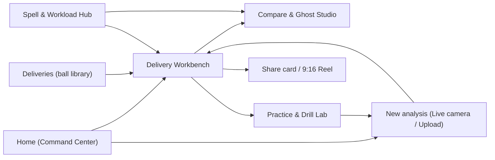
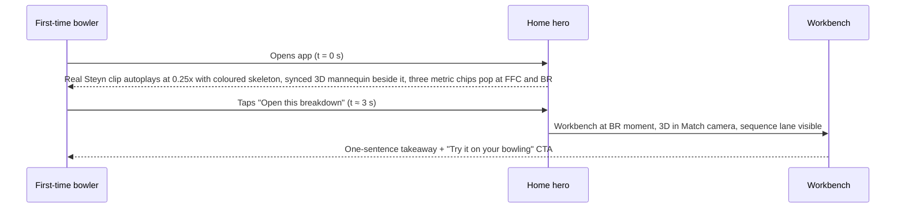

# SportsPostureAnalysis Studio v5: Competitive Landscape Teardown & Product/UX Blueprint

> **Status:** Research & Blueprint phase (no app code changed). **Author:** `app-researcher` (Lead Product Designer & Competitive Intelligence). **Date:** 2026-11-27.
> **Inputs:** Studio v4 screenshots (`docs/figures/studio_v4_home.png`, `studio_v4_steyn_story.png`, `studio_v4_ball1_story.png`), the v4 frontend (`web/src/`, about 10.3k LOC), the v4 data contracts (`web/src/types.ts`, `src/bowling_biomech/schemas.py`, `stage3_kinematics.py` `series`), and a web teardown of 30 products across cricket, baseball, golf, tennis, running, multi-sport video and lab biomechanics.
> **Audience:** `@coordinator`, `@biomech-researcher`, and the frontend/backend authors who will build v5.

> [!IMPORTANT]
> Every v5 feature in this document has to keep the `AGENTS.md` §1.2 guardrails: the **permanent `REFUSED` ICC 15° elbow verdict** on phone video, the **medical non-diagnosis** wording, **no fabricated 0–100 composites or injury-risk percentages**, and an **`(value, ci_low, ci_high, observability)` tuple or an explicit `suppressed=True` + reason** for every number on screen. §9 lists what v5 will refuse to build, even though competitors ship it.

---

## Contents

1. [Executive summary](#1-executive-summary)
2. [Brutal teardown of Studio v4](#2-brutal-teardown-of-studio-v4)
3. [Competitive landscape: 30-product teardown](#3-competitive-landscape-30-product-teardown)
4. [Feature coverage heat-matrix & the gaps we can own](#4-feature-coverage-heat-matrix--the-gaps-we-can-own)
5. [Analysis expansion: what more we can honestly measure](#5-analysis-expansion-what-more-we-can-honestly-measure)
6. [Studio v5 design system: "Paper Instrument"](#6-studio-v5-design-system-paper-instrument)
7. [Navigation & user journey](#7-navigation--user-journey)
8. [Screen-by-screen wireframes & component architecture](#8-screen-by-screen-wireframes--component-architecture)
9. [Guardrails: what v5 refuses to build](#9-guardrails-what-v5-refuses-to-build)
10. [Data contracts & API additions](#10-data-contracts--api-additions)
11. [Prioritised build plan & swarm work breakdown](#11-prioritised-build-plan--swarm-work-breakdown)
12. [Acceptance criteria & verification gate](#12-acceptance-criteria--verification-gate)
13. [Sources & research caveats](#13-sources--research-caveats)

---

## 1. Executive summary

**Diagnosis.** Studio v4 is *correct* but not *compelling*. It treated "plain language for beginners" as if it meant "less to see". We compute a full 24-joint 3D skeleton for every frame, 12 kinematic time series, per-joint uncertainties, a calibrated pitch frame and a 3D viewport. v4 hid almost all of it behind a **Pro Lab** switch and showed beginners a page of text cards, a gray silhouette and four tiny thumbnails. On the flagship real clip (Steyn, 25 fps from behind), **3 of the 5 body checkpoints read "Needs better angle" or "Not visible"**. The page spends most of its space telling the user what it *cannot* see.

**What the market teaches.** The best products across every sport make the **visual instrument the plain language**:
- **Sportsbox 3D** shows a beginner a rotatable 3D avatar with 6 virtual camera angles, from one phone video.
- **Dartfish** made **Stromotion** (a stroboscopic sequence) and **SimulCam** (a ghost overlay) into signature features.
- **K-Vest / PitchAI / Uplift / KinaTrax** put the **kinematic-sequence chart** at the centre.
- **TrackMan / Rapsodo** made **release-point scatter plots** the default consistency view.
- **V1 / OnForm / CoachNow** made **telestration + voice-over + side-by-side/overlay** a basic expectation.
- **Driveline TRAQ / Pulse** turned **workload and ACWR** into a calendar people actually use.
- **Ludimos / FullTrack AI** set the cricket baseline: auto-clipping net sessions, plus per-ball speed and pitch maps from one phone.

**What nobody does, and v5 can own:** *uncertainty-honest*, *calibrated 3D* fast-bowling biomechanics from a phone, with these as default views:
- a synchronized **video ↔ 3D mannequin ↔ kinematic waterfall**;
- a **release-point bullseye relative to the stumps**, in calibrated pitch metres with error ellipses;
- **noise-gated** ball-to-ball comparison and spell-drift views;
- a cricket-specific **workload hub** built on ECB/CA limits rather than an injury-risk score.

Every competitor ships at least one number it cannot defend: 0–100 technique scores (FastBowlingLab, Ochy, Mustard report cards), wicket probabilities, or "injury risk" tags. **Our moat is the instrument-grade honesty plus a pro-level depth of visuals.**

**Blueprint in one line:** a **Command Center Home** that plays real analysed cricket in its first second, leading to a **Delivery Workbench** where video, the 3D mannequin, telestration, trails, strobe and the kinematic waterfall all share **one clock**. Around it sit a **Compare & Ghost Studio**, a **Spell / Release Tunnel / Workload Hub**, a **Practice & Drill Lab**, and a **Live Camera & Guided Upload Studio**. The design language is light paper and monochrome, with a disciplined set of segment colours (Pelvis emerald, Thorax cobalt, Arm amber, Wrist crimson, Ghost slate) used **only inside the canvases and charts**.

---

## 2. Brutal teardown of Studio v4

### 2.1 What the screenshots actually show

| Screen | What a first-time user sees | Why it lands as "thin / flat / underwhelming" |
|---|---|---|
| **Home** (`studio_v4_home.png`) | Large headline, two buttons, three generic "1-2-3" onboarding cards, then four sample cards. Three of them are **gray stick mannequins on blank gray planes**. | About 60% of the first viewport is whitespace and text. **Nothing moves, there are zero numbers and zero visuals of analysis.** The "1-2-3 steps" block is SaaS boilerplate. The demo thumbnails look like placeholders, and the only real clip is a cropped still. There is no spell, no progress, no "last ball", and nothing to *touch*. |
| **Steyn Story** (`studio_v4_steyn_story.png`) | Video at about 55% width with a thin white skeleton, an unlabeled scrubber with floating circles, tiny mono speed chips, four small keyframe thumbs with **truncated captions**, then a right-hand stack of text cards, an orphaned "Release height 1.89 m" card and a gray silhouette body map. | The skeleton is **almost invisible** on the white kit. The event dots carry no label or colour, so they mean nothing. The bottom-left quadrant is **empty** (below "Key moments"). The body map is low-fidelity and **3 of 5 checkpoints are "Needs better angle / Not visible"**. All 12 kinematic series, the 3D skeleton and every chart are hidden. The page reads, it does not *show*. |
| **Ball 1 Story** (`studio_v4_ball1_story.png`) | Synthetic gray mannequin on a gray plane with a "171°" chip; the same card stack. | The mannequin looks like a 2005 physics demo: no shading cue on the bowling arm, a thin pitch wireframe, and a knee arc you can barely see. A **"Try this" under a *strength*** tells the user to *"Place a tripod phone at waist height…"*: capture advice shown as a drill (copy/contract bug). The "Release height 1.76 m" card is orphaned again. |

### 2.2 Root causes (structural, not cosmetic)

1. **The instrument is behind a toggle.** `PitchViewport3D.tsx` (382 LOC), `WaveformPanel.tsx`, `LabTelemetryPanel.tsx` and the telestrator types (`TelestratorTool = line | plumb | angle | circle`) all exist. They sit behind `Pro Lab` (`route.tab === "lab"`). Calling it **"Pro Lab"** also tells beginners that the good material is not for them.
2. **Plain language was taken to mean "remove visuals".** The `coaching_story/1` jargon purge was right for *words*. It wrongly removed *pictures*, which are the most beginner-friendly way to explain biomechanics. Sportsbox and GolfFix show 3D/skeleton visuals to total beginners.
3. **Passive, read-only cards.** You cannot draw, measure, mark, compare in place, loop a phase, step frames with a jog wheel, rotate the body or leave a note. Every competitor from Kinovea (free) to V1 has these.
4. **No time dimension in the analysis.** We have `kin_series` (12 series), events and `time_rel_ffc_ms`, yet v4 shows **no time-series, no sequence chart and no phase timeline**. Biomechanics *is* timing; K-Vest, PitchAI and KinaTrax all centre the kinematic sequence.
5. **One colour for everything.** A monochrome UI, monochrome skeleton and monochrome charts leave nothing to pull the eye. TrackMan, Sportsbox and K-Vest use colour coding by segment or pitch type so a pattern is readable in under a second.
6. **Demos undermine trust.** Gray synthetic mannequins on the Home page suggest "this is a mock-up". Real footage (Steyn + Indoor 120 fps) has to lead, and synthetic demos must look like a sculpted, shaded instrument.
7. **The data hierarchy is upside-down for poor captures.** When a clip is partial, v4 fills the page with "Not visible" rows. v5 should **show what *was* measured, large**, collapse the unmeasured items into one "Unlock with a side-on 120 fps clip" strip, and *still render* the 3D body and the sequence chart (shown in a ghosted, labelled "not measurable here" state, never hidden).
8. **Weak navigation.** The top nav is `Home · Deliveries · Progress`. Compare, Workload, Practice and Live Camera have no home, which hides half the product. Progress shows dots without connecting lines and has a workload card buried inside it.
9. **Desktop space is wasted.** The 1320 px max-width with a 55/45 split leaves big dead zones. A workbench needs a **stage + inspector + timeline dock** layout, as in pro NLEs and Dartfish.
10. **No reasons to come back.** There is no spell view, streak, release-point tightness challenge, drill checklist or coach share loop. Ludimos (skill challenges), GolfFix (monthly reports) and Whoop (daily loop) are all built around the return visit.

### 2.3 What v4 got right (and v5 must keep)

- The `coaching_story/1` deterministic, backend-derived status hierarchy (`focus > watch > strong > on_track > not_visible`) and interval-only wording.
- Jargon-free headline plus "one takeaway, one drill".
- The non-truncating ICC 15° and medical notices.
- Real Dale Steyn footage, the All-Intra scrub proxy (frame-accurate seeking), the `/frame/{idx}.jpg` API, and the warm GPU worker.
- The numeric verifier for Coach Copilot (9/9 adversarial bypasses blocked).
- The lazy-split bundle (308 kB initial). v5 must keep the 3D/chart code split while still making it *visible by default*: preload on idle, with skeleton placeholders.

---

## 3. Competitive landscape: 30-product teardown

Legend for the "Lesson for v5" column: **STEAL** = adopt directly, **ADAPT** = adopt with guardrails, **AVOID** = anti-pattern.

### 3.1 Cricket

| Product | Capture | Core analysis | Killer visual / interaction | Compare | Workload | Drills / content | Share | Lesson for v5 |
|---|---|---|---|---|---|---|---|---|
| **Ludimos** | 1 phone; Ludimos Pulse wristband | AI auto-clipping of 60-min net/match footage into per-ball clips; phone ball speed; ball tracking → pitch map, line/length; BFC/FFC/release frame-by-frame; run-up stride & approach | Auto-clipped session reel; pitch map; per-ball speed trend; **skill challenges** (hit zones, "replicate a legendary delivery") | Week-to-week & vs. pro/coach reference | Pulse logs ball counts + wrist speed at release | Skill targets / gamified challenges | Player profile as a selector "showcase" | **STEAL** the net-session auto-clipper UX (we already have `stage0_net_clipper.py`) and the *player profile as a showcase*. **ADAPT** challenges into measurable, CI-backed targets (e.g. release-point spread < X cm). |
| **FullTrack AI** | 1 phone on a tripod behind the stumps | 3D ball trajectory, speed, line/length, swing/seam/spin, DRS-style replay | **Pitch map + beehive**, ball-by-ball cloud library sortable by line/length/speed | Session vs. session | — | — | Cloud clips | **ADAPT** the "sortable ball library" (sort by any measured metric). Ball flight is *out of scope* for v5 (no ball-tracking stage); see §9. |
| **PitchVision (PV/One)** | Sensor mat + HD video | Pitch map, trajectory, speed, **front-foot no-ball monitoring**, multi-angle synced video, drawing tools | Auto-tagged clip ↔ data point; session reports ("40% missed length leg-side") | Historical profile | — | Coach markup + remote review | Cloud export | **STEAL** "every ball is a data row linked to its clip". **ADAPT** front-foot crease proximity from our calibrated ankle position (§5). |
| **CricViz** | Broadcast Hawk-Eye feed | Release point (height, width, crease), pitch maps, beehives, **expected wickets (xW)** | Pitch map filtered by phase/batter; release-point clouds | Bowler vs. bowler | — | — | Broadcast graphics | **STEAL** release-point cloud *as a picture of consistency*. **AVOID** outcome models (xW) on phone video: no ball tracking, no outcome data. |
| **Hawk-Eye** | 6–10 high-speed calibrated cameras | Triangulated release point, swing (deviation from the gravity parabola), seam deviation, pitch point, predicted path | Glowing 3D trajectory over a rendered pitch; release-height/crease-position graphics | — | — | — | Broadcast | **STEAL** the *visual idiom*: a 3D calibrated pitch with stumps and a glowing path. For us the path is **wrist/ball-hand trajectory and COM**, not ball flight. |
| **PaceLab (Steffan Jones)** | Remote upload links (e.g. PitchWolf) | Four coactive pillars: technical, physical, tactical, psychological; constraint-led drills; force profiling, over/under-load | Course portal (100+ lessons), community feed | — | Program periodisation | **Constraint-led drill progressions** | Community | **STEAL** constraint-led progressions and a "four pillars" framing for the Drill Lab. **ADAPT**: drills must link to measured evidence, not generic content. |
| **Cricket Lab / FastBowlingLab / PitchWolf / CricketIQ / BowlFast AI** (cricket long tail) | Phone slow-mo upload | Pose landmarks (2D, e.g. 33-point), BFC/FFC/BR, front-knee brace, trunk flexion, arm speed (rpm), run-up rhythm | Annotated overlay video, **technique scorecard out of 100**, 4-week drill plan | Some | CricketIQ pairs volume with technique | Multi-week plans | PDF | **AVOID** the 0–100 scorecards and "injury-risk indicators" from 2D landmarks. **STEAL** the multi-week plan shape, attached to *our* evidence. Note: the "Cricket Lab" name is ambiguous on the web (cricketlab.co appears as a PitchVision-ecosystem site); treat it as part of this long tail. |
| **Quintic Biomechanics** (cricket labs, e.g. county clubs) | Multi high-speed cams | Phase segmentation (gather → mid-bound → BFC → FFC → BR → follow-through), front-knee, lateral flexion, hip-shoulder separation, approach speed, 2D digitisation, velocities | Multi-camera sync; overlays of "ideal" templates; interactive graphs | Template overlay | With force plates | — | Reports | **STEAL** the *six-phase* timeline (we already detect BFC/FFC/UAH/BR/FT), plus the template overlay → our **Reference Ghost**. |

### 3.2 Baseball / pitching (closest biomechanical analogue to fast bowling)

| Product | Capture | Core analysis | Killer visual / interaction | Compare | Workload | Drills | Share | Lesson for v5 |
|---|---|---|---|---|---|---|---|---|
| **Mustard (Tom House)** | Phone, front + open-side views | Auto-slicing per pitch; key frames (first move, max leg lift, footstrike, release); skeleton overlay | **Mechanical Report Card**; auto-sync comparison | **Auto-sync pitch-to-pitch** | Team workload views | **AI-personalised drill roadmap** (NPA method), arm care | Coach/team platform | **STEAL** auto-synced comparison at footstrike (our FFC) and "diagnosis → roadmap". **AVOID** opaque report-card grades. |
| **Driveline TRAQ + Pulse** | Forearm IMU (Pulse) + integrations | Elbow-valgus-torque-based arm stress; **ACWR**; prescribed vs. performed throws; integrates Rapsodo/TrackMan/Blast | **Calendar overlay** of throw counts & stress vs. the plan; dashboard over custom ranges | Level benchmarks | **Core feature** | Program builder | Coach dashboards | **STEAL** "prescribed vs. actual" calendar overlay for bowling loads. **ADAPT** ACWR with the Lolli/Impellizzeri caveats (§5.4). |
| **PitchAI (3Motion AI)** | Phone video (3DNeuroNet) | Markerless 3D; **kinematic sequence** (pelvis → trunk → upper arm → forearm angular velocities); hip-shoulder separation at stride foot contact | **Multi-coloured angular-velocity chart** with peak ordering; out-of-order flags | Database percentiles (youth → MLB) | Recovery suggestions | Linked drill programs | Reports | **STEAL** the coloured kinematic-sequence chart + peak-order strip. **ADAPT**: percentiles only where a definition-matched primary-source cohort exists (we already do `CohortComparison`). |
| **Rapsodo PRO 3.0** | 3 cameras + 2 radars | Release height, **release side**, extension, release angle; per pitch-type filters; synced video | **Release-point scatter** + session averages; tap an outlier to open its video | Session-to-session SD | — | — | Cloud | **STEAL** "tap an outlier dot to open that ball's video" in the Release Tunnel. |
| **TrackMan Baseball** | 3D Doppler radar | RelHeight/RelSide/Extension, plate location, movement; trajectories | **Release footprint scatter**, colour by pitch type; **tunnel** overlays at the decision point | Pitch vs. pitch | — | — | Portal | **STEAL** the footprint scatter idiom (axes: lateral offset from middle stump × release height). **ADAPT** "tunnel" to *release-point consistency across a spell* (no ball flight). |
| **KinaTrax (Hawk-Eye/Sony) Dugout** | 300+ Hz multi-cam markerless arrays | ~230 metrics / 90 graphs per pitch; trunk tri-axial, hip-shoulder separation, peak segment velocities; Statcast merge | **Time-series graphs synchronized with multi-angle video + 3D skeleton**; C3D/BVH/CSV export | Multi-player, longitudinal, home vs. away | Fatigue across outings | — | Org portal | **STEAL** "graph ↔ video ↔ skeleton on one clock" and **C3D/BVH/CSV export** for researchers. |
| **Uplift Labs** | 2 iPhones (240 fps) | Kinematic sequencing, X-factor, stride, **arm drag**, **forearm flyout** | **Web 3D visualizer** (rotate skeleton); "signals" summary | — | — | — | Raw export | **STEAL** "signals" (short, evidence-linked flags). **ADAPT**: our signals must carry intervals and observability. |
| **Blast Motion** | Bat IMU + phone video | Bat speed, time to contact, attack angle | **Smart Video Capture**: auto-clipped video with the **metric overlay burned in, synced at impact** | Side-by-side | — | — | Voice-over, drawing | **STEAL** "metrics burned into the clip at the event" for our Share Card / Reel (already partly in `stage6_visualizer`). |

### 3.3 Golf

| Product | Capture | Core analysis | Killer visual / interaction | Compare | Drills / training | Lesson for v5 |
|---|---|---|---|---|---|---|
| **Sportsbox 3D Golf** | 1 phone video (face-on) | Markerless 3D avatar; turn, bend, side-bend, sway, lift; kinematic sequence; trace sets | **Rotatable 3D avatar with 6 virtual camera angles from one video**; elite **reference ranges**; **custom goal ranges**; **auto-swing-detect practice mode** | Benchmarks by handicap/body type | Goal ranges + monitor mode | **STEAL** 3D avatar visible *by default*, plus virtual camera presets (Side-on, Behind, Front, Top, Batter's view, Umpire's view). **STEAL** user-set goal ranges *drawn on the charts*. |
| **V1 Golf** | Phone | Frame-by-frame, skeletal tracking, ball tracing | **Drawing tools** (lines, circles, boxes, angles), **side-by-side + adjustable-opacity overlay**, **flip/mirror**, huge pro model library, **voice-over lessons** | Pro library | Tips & drills; remote coach | **STEAL** overlay opacity slider + **mirror** (left-arm vs. right-arm comparisons) + voice-over notes. |
| **GolfFix** | Phone | Auto-detect swing; 45+ faults; **tempo phases** (backswing time, pause, downswing) | **"Focus Drill"** mapped to the detected fault; daily/monthly AI reports | vs. pros / past self | Shot-fix lessons with drill videos | **STEAL** tempo-phase bar (our BFC→FFC→BR timing) and "fault → focus drill" mapping. **AVOID** 45 fault labels with no intervals. |
| **HackMotion** | Wrist IMU | Wrist flexion/extension | **Real-time audio biofeedback**: tone + screen turns green at target | — | Focus modes at key positions | **ADAPT** audio/visual "hit the target" feedback for *drill rehearsal* in Live Camera (P2, framing/rep counting only; never measurement claims from 2D). |
| **K-Motion / K-Vest** | 3 IMUs (pelvis, thorax, lead arm) | Kinematic sequence graph; posture faults; programmable targets | **Kinematic sequence graph** (peak speed + order); **biofeedback** tones | TPI benchmarks | Biofeedback-driven training | **STEAL** the canonical sequence graph layout (pelvis → thorax → arm → hand, peaks marked, order strip). |

### 3.4 Tennis, running, multi-sport video & labs, recovery

| Product | Category | Killer features | Lesson for v5 |
|---|---|---|---|
| **SwingVision** | Tennis, 1 phone | Shot speed, landing heatmaps, **dead-time removal** highlight reels, filtered highlights, line calling, Apple Watch challenge | **STEAL** dead-time removal (= net-session auto-clipper) and filters ("show me only balls where front knee was measured"). |
| **OnForm** (ex-Ubersense founders; successor to **Hudl Technique**) | Multi-sport video coaching | AI skeleton with tap-a-joint angles, segment toggles, side-by-side & overlay (time-synced at a key moment), lines/arrows/angles/freehand, voice-over, stopwatch, ruler, 240 fps multi-angle capture, chat | **STEAL** tap-a-joint live angle, segment toggles, stopwatch/ruler (ours *calibrated in metres* when MCC calibration exists). |
| **CoachNow** | Coaching platform | **Spaces** per athlete (timeline of media + feedback), skeleton, **Versus mode**, annotations, voice-over, **CoachCam** PiP, Live MultiCam | **ADAPT** a lightweight per-bowler "Notebook" timeline of balls, notes, drills and coach comments (local-first). |
| **Dartfish** | Pro video analysis | **Stromotion** (stroboscopic composite), **SimulCam** (overlay of two performances with pan/tilt/zoom compensation), live/post tagging, 4-angle sync | **STEAL** both signature features. Our verified 3-DOF pan tracker (`stage1_pan_tracker.py`, 0.188 px median residual) makes **pan-compensated strobe and ghost overlays** possible on handheld clips. This is a real differentiator. |
| **Kinovea** | Free 2D analysis | Trajectory tracking, angle/goniometer tools, plane calibration, **kinogram** grid, CSV export | **STEAL** kinogram grid (our Sequence Strip) + export. Baseline: anything Kinovea does for free, we must do in-browser. |
| **Quintic** | Lab 2D/3D | Covered in §3.1 | — |
| **Simi Reality Motion (Simi Shape 3D)** | Lab markerless | Silhouette-based multi-cam 3D, hybrid marker/markerless, sync with force plates/EMG | Positioning reference: we are the **phone-grade** tier and must say so (observability badges). |
| **OpenCap (Stanford)** | Research | 2+ iPhones (or monocular), OpenSim musculoskeletal kinematics & kinetics, free | **ADAPT**: offer an **OpenSim-compatible export** (TRC/MOT) for researchers (P2). Cite the Abraham, Feros & Fox (2025) three-iPad OpenCap cricket benchmark (already in `research_report.md`) when explaining accuracy limits. |
| **Ochy** | Running | 10-s clip → report in < 60 s; joint angles, symmetry, cadence; exercises; **overall gait score** | **STEAL** the speed of the first result (< 60 s perceived). **AVOID** the overall score. |
| **Whoop** | Recovery wearable | Daily **Strain/Recovery loop**, Strength Trainer muscular-load logging, coach chat | **STEAL** the *daily loop* design (one glanceable ring/strip each morning) for workload logging. **AVOID** proprietary 0–21/0–100 composites. Use raw balls, overs and days vs. official limits. |
| **Hudl Technique** | Legacy mobile video (now superseded by OnForm) | Slow-mo, drawing, side-by-side | Baseline expectation; nothing unique left. |

**Total surveyed:** 30 named products/services (Ludimos, FullTrack AI, PitchVision, CricViz, Hawk-Eye, PaceLab, Cricket Lab, FastBowlingLab, PitchWolf, CricketIQ, BowlFast AI, Quintic, Mustard, Driveline TRAQ/Pulse, PitchAI/3Motion, Rapsodo, TrackMan, KinaTrax, Uplift, Blast, Sportsbox, V1, GolfFix, HackMotion, K-Vest, SwingVision, OnForm, Hudl Technique, CoachNow, Dartfish, Kinovea, Simi, OpenCap, Ochy, Whoop).

---

## 4. Feature coverage heat-matrix & the gaps we can own

`●` strong / signature, `◐` present, `·` absent. "v4" = Studio v4 default experience (not Pro Lab). "v5" = this blueprint.

| Capability | Ludimos | FullTrack | PitchVision | Mustard | PitchAI | KinaTrax | Rapsodo/TrackMan | Sportsbox | V1 | OnForm/CoachNow | Dartfish | Kinovea | K-Vest | TRAQ | **v4** | **v5** |
|---|---|---|---|---|---|---|---|---|---|---|---|---|---|---|---|---|
| Auto-clip session into balls/reps | ● | ● | ● | ● | ◐ | ● | ● | ● | · | ◐ | ◐ | · | · | · | ◐ (upload flow) | ● |
| Skeleton overlay on video | ◐ | · | · | ● | ● | ● | · | ● | ◐ | ● | ◐ | · | · | · | ◐ (thin, white) | ● (segment-coloured, thick, per-segment toggles) |
| 3D avatar, rotatable, default-visible | · | · | · | · | ◐ | ● | · | ● | · | · | · | · | ◐ | · | · (Pro Lab only) | ● |
| Virtual camera presets | · | · | · | · | · | ◐ | · | ● | · | · | · | · | · | · | · | ● |
| Telestration (line/angle/circle/arrow/freehand) | · | · | ● | · | · | · | · | ◐ | ● | ● | ● | ● | · | · | · (Pro Lab) | ● |
| Calibrated ruler / plumb / protractor | · | · | · | · | · | · | · | · | ◐ | ◐ | ● | ● | · | · | · | ● (metres when MCC-calibrated) |
| Frame-step jog wheel, 0.1×–1× | ◐ | ◐ | ● | ◐ | · | ● | · | ◐ | ● | ● | ● | ● | · | · | ◐ (0.25/0.5/1) | ● |
| Joint trajectory trails | · | · | · | · | · | ◐ | · | ● | ◐ | · | ◐ | ● | · | · | · | ● |
| Stroboscopic / kinogram sequence | · | · | · | ◐ | · | · | · | · | · | · | ● | ● | · | · | ◐ (4 keyframes) | ● (pan-compensated video + 3D strobe) |
| Kinematic sequence chart | · | · | · | · | ● | ● | · | ● | · | · | · | · | ● | · | · | ● (noise-gated) |
| Synced time-series ↔ video ↔ 3D | · | · | · | · | ◐ | ● | · | ◐ | · | · | ◐ | ◐ | ◐ | · | · | ● |
| Side-by-side synced at an event | ● | · | ◐ | ● | · | ● | · | ◐ | ● | ● | ● | ◐ | · | · | ● (Compare) | ● |
| Opacity overlay / ghost (SimulCam) | · | · | · | · | · | · | · | · | ● | ● | ● | · | · | · | ◐ (dashed outline) | ● (video blend + dual 3D) |
| Reference / pro ghost | ◐ | · | · | ◐ | ◐ | · | · | ● | ● | ◐ | ◐ | · | ● | · | · | ● (labelled literature archetype + personal best) |
| Release-point scatter vs. target | · | · | · | · | · | ◐ | ● | · | · | · | · | · | · | · | · (single "release height") | ● (calibrated, error ellipses) |
| Spell / session drift | ◐ | ◐ | ● | ◐ | · | ● | ● | · | · | · | · | · | · | ◐ | · | ● |
| Workload log + ACWR + calendar | ◐ | · | · | ◐ | ◐ | · | · | · | · | · | · | · | · | ● | ◐ (buried card) | ● (ECB/CA first, EWMA ratio with caveats) |
| Drill roadmap linked to diagnosis | ◐ | · | · | ● | ● | · | · | ◐ | ● | · | · | · | ● | ● | ◐ (1 drill) | ● (phase-targeted, progressive, checklist) |
| Voice / text notes on a frame | · | · | ◐ | · | · | · | · | · | ● | ● | ◐ | · | · | · | ◐ (Lab notes) | ● |
| Share card / reel export | ● | ◐ | ◐ | ◐ | ◐ | · | ◐ | ◐ | ● | ● | ● | ◐ | · | ◐ | ◐ (card + reel backend) | ● |
| Live filming assistant (framing, level) | · | ◐ | · | ◐ | · | · | · | ● | ◐ | ◐ | · | · | · | · | · (static guide) | ● |
| Uncertainty intervals on every number | · | · | · | · | · | · | · | · | · | · | · | · | · | · | ● | ● |
| Honest observability / refusals | · | · | · | · | · | · | · | · | · | · | · | · | · | · | ● | ● |
| Research export (CSV/C3D/BVH/TRC) | · | · | · | · | · | ● | ◐ | · | · | · | ◐ | ● | ◐ | ◐ | · | ◐ (P2) |

**Gaps v5 can own outright (no competitor combines them):**
1. **Calibrated 3D + uncertainty everywhere.** Error ellipses on the release bullseye, CI bands on the sequence chart, and noise-gated deltas.
2. **Pan-compensated Stromotion & SimulCam on handheld phone clips**, using our verified SO(3) pan tracker.
3. **Cricket-native workload hub** built on governing-body limits (ECB match directives, CA "1-3-5 / 2-4-6"), *not* a risk score.
4. **Refusal as a feature**: an "Unlock" strip that turns every unmeasurable item into a concrete filming instruction.

---

## 5. Analysis expansion: what more we can honestly measure

The user asked "what we can put into it to increase the analysis more". Below, every proposed addition is mapped to **data we already compute** (or a small, defensible extension) and its **observability gate**. Items marked **🔬** need `@biomech-researcher` sign-off on definition, citation and gating before build.

### 5.1 New derived analyses (per delivery)

| # | Analysis | Derivation from existing data | Observability gate (else render ghosted + Unlock hint) | Display |
|---|---|---|---|---|
| A1 | **Kinematic sequence** (pelvis ω, thorax ω, bowling-arm ω, wrist linear speed) 🔬 | `d/dt` of `kin_series.pelvis_yaw_deg`, `shoulder_yaw_deg` (Savitzky-Golay ~50 ms, as for `bowling_arm_omega_dps`); arm ω already exists; wrist speed from `joints3d_world_m` | `fps ≥ 90` (same rule as `velocity_high`); transverse yaw needs a non-pure-side-on view or the ISB transverse estimate; suppress peaks whose time CI spans > 1 inter-peak gap | Waterfall chart, one lane per segment, peak marker ± timing CI, **order strip** (P→T→A→W). Peak-order claims only when the CIs don't overlap. |
| A2 | **Release point 3D** (height, lateral offset from middle stump, distance behind the popping crease) | Bowling wrist joint at `events.br` in the Canonical Pitch World Frame; σ from `joint_uncertainties_m` + calibration σ | `is_metric_calibrated` (MCC PnP / two-wicket) else height only (existing `release_height_m`) | Bullseye in a stumps-referenced frame; 95% error ellipse |
| A3 | **Front-foot landing vs. popping crease** (no-ball proximity, cm) 🔬 | Front ankle/toe at `events.ffc` vs. the MCC crease line | Metric calibration + ankle in frame + `ffc` confidence ≥ moderate | Top-down crease inset, dot + ellipse; never a "no-ball" verdict, only "likely behind / straddles / likely over" |
| A4 | **Delivery tempo** (run-up end → BFC → FFC → BR ms; ratio) | Event timestamps (Felton 2019 priors already in place) | `timebase_status` OK; event confidences | Tempo bar (GolfFix-style), segment widths in ms ± CI |
| A5 | **Head stability** (head path drift FFC → BR, lateral & vertical cm) 🔬 | Head joint in world frame | Head in frame; metric calibration for cm, else normalised to stature % | Head trail on video + 3D; a single drift number with CI |
| A6 | **Lead (non-bowling) arm action** (elevation at FFC, pull-down timing rel. BR) | `nb_arm_elev_deg` series (exists) + a time-of-max-descent velocity | fps ≥ 60 for timing | Mini trace with FFC/BR markers |
| A7 | **COM path & braking** (horizontal COM velocity drop FFC → BR) 🔬 | Segment-mass-weighted COM (de Leva 1996 fractions) from SMPL-24 | `is_metric_calibrated`, not panning-unverified, fps ≥ 90 | COM trail (graphite crosshair) + velocity mini-trace |
| A8 | **Stride alignment** (front foot lateral offset vs. back-foot line: open/closed, cm) | Ankles at BFC and FFC in world frame | Metric calibration; behind/front view preferred | Top-down foot-plant inset |
| A9 | **Bowling-elbow angle trace** *(visual only)* | `kin_series.bowling_elbow_deg` (exists) | Shown as a trace with the permanent banner "Not a legality test: ICC 15° needs ≥ 250 Hz 3D lab" | Trace only. **Never** a flexion-change number, threshold line at 15° or verdict. |
| A10 | **Follow-through drift** (exists: `follow_through_drift_deg`) | — | existing | Top-down arrow |

### 5.2 New derived analyses (across deliveries)

| # | Analysis | Rule |
|---|---|---|
| S1 | **Release-point consistency** (spread of A2 across a spell, cm) | Report the spread with a bootstrap CI over balls; per-ball ellipses stay visible. Only "tighter / looser than last session" when the CIs don't overlap. |
| S2 | **Spell fatigue drift** (ball 1 → N trend per metric) | Show per-ball interval dots. Flag a trend only when ball-1 and ball-N intervals don't overlap *and* a robust slope's CI excludes 0. |
| S3 | **Personal best ghost** | The user selects (never auto-crowned by a composite) a reference ball; the ghost is drawn in slate. |
| S4 | **Session ↔ session delta matrix** | Δ shown only if `|Δ| > 1.96·√(σa² + σb²)`, else "within noise". The existing non-straddling cue logic extends naturally. |

### 5.3 Reference archetypes (the "pro ghost"): honest version

We have **no licensed 3D motion capture of named professionals**. Rendering a "Dale Steyn ghost" from a single 25 fps broadcast-style clip at the precision a ghost implies would be a hallucination. v5 therefore offers three ghost sources, each labelled on screen:

1. **Personal Best:** one of the user's own balls (S3).
2. **Your analysed clip of a pro:** e.g. our real Steyn analysis. Shown with its *own* observability badges (it inherits "partial view"); joints with high uncertainty are drawn faded.
3. **Literature archetype (synthetic):** generated by `synthetic_ground_truth.py`, parameterised by published group means (e.g. Worthington 2013 front-knee / trunk norms, Portus 2004 side-on / front-on / mixed SCR classes). Always labelled **"Synthetic archetype: not a real player"** 🔬.

### 5.4 Workload science, with the critique built in

- **Primary view = absolute load vs. official limits** (balls, overs, spells, bowling days):
  - **ECB Fast Bowling Match Directives**, per day / per spell by age: U11 4/8, U12–13 5/10, U14–15 5/12 *(some regional variants list 6 per spell)*, U16–17 6/15, U18–19 7/18. Rest equal to the spell length from the same end.
  - **Cricket Australia junior guidelines**: **U17 "1-3-5"** (≤ 5-over spells, ≤ 3 bowling days/week, 1 bowling day then a rest day) and **U19 "2-4-6"** (≤ 6-over spells, ≤ 4 days/week, ≤ 2 consecutive days). Plus 8–10-week pre-season build-ups and 5–10-day breaks every 6–12 weeks.
  - These must reconcile with the existing `WorkloadGuidance` source strings ("ECB (2024) / Cricket Australia (2026)"). `@biomech-researcher` to confirm the exact edition tables 🔬.
- **Secondary view = load-change indicator.** Show the **uncoupled EWMA acute:chronic ratio** (acute λ for 7 days, chronic for 28 days, acute days excluded from chronic). Shade 0.8–1.3 "typical progression" and > 1.5 "sharp spike (Hulin et al. 2014)". The note must stay visible: *"ACWR is a contested heuristic (Lolli et al. 2019; Impellizzeri et al. 2021). It describes how fast your load changed; it does not predict injury."* No risk %.
- **Back-soreness self-report** (0–10 + "pain when bowling?" yes/no): any "yes" or a score ≥ a configurable threshold triggers a non-diagnostic notice: *"Cricket Australia advises young fast bowlers with low-back pain to stop bowling and see a sports physiotherapist or doctor. This app cannot assess injuries."*
- Remind users that load is cumulative across **matches *and* nets**.

---

## 6. Studio v5 design system: "Paper Instrument"

**References:** Vercel Geist (type, hairlines, restraint) × Apple Fitness+ (bold, confident hero numerals, motion that rewards) × Teenage Engineering (tactile controls, mono labels, a jog wheel that feels physical) × TrackMan (instrument-grade data plots on a calm ground).

### 6.1 Principles

1. **Paper outside, colour inside.** Chrome (nav, cards, buttons) stays monochrome on paper. **Colour lives only inside canvases, the 3D viewport and charts**, so analysis visuals carry all the saturation and pop immediately.
2. **One clock.** Every visual on a delivery screen subscribes to one `playhead` (frame index plus fractional time). Scrub anything and everything moves.
3. **Show the measured, collapse the unmeasured.** Measured items render large. Unmeasurable items collapse into a single **Unlock strip**. Panels are never removed; they show a ghosted, labelled "not measurable on this clip" state.
4. **Every number wears its interval.** Display format is `171°` with a **range rail** beneath (a hairline from ci_low to ci_high with a dot at the value) plus an observability glyph.
5. **Touch everything.** Tap a joint → live angle. Tap a chart peak → seek. Tap a scatter dot → open that ball. Drag the jog wheel → frame-step.

### 6.2 Colour tokens

**Chrome (unchanged v4 base, tightened):**

| Token | Hex | Use |
|---|---|---|
| `paper` | `#FAFAFA` | App ground |
| `surface` | `#FFFFFF` | Cards, panels |
| `hairline` | `#EBEBEB` | 1 px borders (stacked-hairline elevation, no drop shadows) |
| `ink` | `#171717` | Primary text, primary buttons |
| `graphite` | `#8F8F8F` | Secondary text |
| `positive` | `#297A3A` | The *only* chrome accent: "strong" status, success |

**Segment palette (canvas/chart only; WCAG ≥ 3:1 against `#FFFFFF` and against the mid-gray video luminance; each also gets a 2 px white halo on video):**

| Segment | Token | Hex (solid) | Hex (tint 15%) | Where |
|---|---|---|---|---|
| Pelvis & lower body (hips, legs, feet) | `seg-pelvis` (emerald) | `#059669` | `#D1FAE5` | Skeleton bones below the pelvis, pelvis ω lane, pelvis axis line, foot plants |
| Thorax & trunk (spine, shoulders girdle, head link) | `seg-thorax` (cobalt) | `#2451D6` | `#DBE4FB` | Trunk bones, shoulder-axis line, thorax ω lane, lateral-flexion arc |
| Bowling arm (shoulder → elbow) | `seg-arm` (amber) | `#D97706` | `#FEF3C7` | Bowling upper arm/forearm, arm ω lane, arm-circle trail |
| Wrist / ball hand / release | `seg-wrist` (crimson) | `#DC2626` | `#FEE2E2` | Wrist joint, wrist-whip trail, release dot, bullseye points |
| Non-bowling (lead) arm | `seg-lead` (cobalt-300) | `#7C9BEA` | — | Lead arm bones, lead-arm trace |
| Head path | `seg-head` (ink) | `#171717` dashed | — | Head trail, plumb reference |
| Centre of mass | `seg-com` (graphite) | `#525252` + crosshair | — | COM trail |
| Reference ghost | `ghost` (slate) | `#64748B` @ 45% | `#E2E8F0` | Ghost mannequin, ghost traces, compare "B" in overlay |
| Telestration (user ink) | `tele` (magenta) | `#C026D3` | — | User drawings: deliberately outside the science palette so a drawing is never mistaken for a measurement |

**Status is encoded by glyph + words, not segment hues** (to avoid amber "watch" colliding with amber "arm"):

| Status | Glyph | Chrome treatment |
|---|---|---|
| strong | `●` filled | `positive` text |
| on_track | `●` ink | ink text |
| watch | `◆` hollow | ink text, hairline-dashed border |
| focus | `◆` filled | inverted chip (ink bg, white text) |
| not_visible | `○` dashed | graphite text + camera icon |

**Observability glyphs** (always next to a number): `▮▮▮` high, `▮▮▯` moderate, `▮▯▯` low, `⊘` unmeasurable, `🔒` refused (ICC only).

### 6.3 Typography & numerals

- **Geist Sans** for UI; **Geist Mono** for numbers, timestamps and labels on instruments. `font-variant-numeric: tabular-nums` everywhere.
- Hero numeral (Fitness+ cue): 56/60 Geist Sans 500, tracking −0.02em, e.g. `171°`. The interval sits beneath in 13 px mono graphite: `likely 161–180°`.
- Section labels (TE cue): 11 px mono uppercase, +0.06em tracking, graphite, e.g. `KINEMATIC SEQUENCE · 240 FPS · SIDE-ON`.

### 6.4 Components (primitives)

| Primitive | Spec |
|---|---|
| `RangeRail` | 120×10 px. Hairline track, segment-coloured span ci_low → ci_high, 6 px dot at the value, optional cohort band (slate tint) and user goal band (dashed magenta). |
| `ObsBadge` | Glyph + 1-word label; tooltip explains the source of uncertainty (`sigma_epistemic`, `sigma_projective`, ...) in plain words. |
| `MetricTile` | Label (mono), hero value, RangeRail, ObsBadge, "see it" button (seeks the playhead to the metric's event and highlights the joints). |
| `JogWheel` | 120 px circular dial (TE-style knurled ring). Drag = ±1 frame per 6°; flick = inertial scrub; centre button = play/pause; long-press = loop the current phase. Keyboard: `,` `.` frame step, `J K L` shuttle, `[` `]` phase jump. |
| `SpeedDetent` | Segmented 0.1× · 0.25× · 0.5× · 1×, with real-time "capture-time" readout (e.g. `0.25× of 240 fps → 60 fps on screen`). |
| `PhaseTimeline` | Horizontal bar with coloured phase segments: Run-up · Gather · **BFC** · Delivery stride · **FFC** · **UAH** · **BR** · Follow-through. Event ticks are labelled; their width is the event time CI. |
| `UnlockStrip` | One row: camera icon + "3 more checks unlock with a side-on 120 fps clip" + "How to film" button. |
| `Sheet` | Right inspector on desktop, bottom sheet on mobile (snap points 25/60/95%). |

### 6.5 Motion

- 160–220 ms ease-out for UI. Number tickers roll on first reveal (Fitness+), at most once per view.
- The 3D camera eases between presets over 600 ms (cubic). Never auto-orbit during analysis; a slow idle orbit is allowed **only** on the Home hero.
- `prefers-reduced-motion` disables tickers and orbits.

### 6.6 3D mannequin art direction ("sculpted, not stick")

- Capsule-and-sphere **sculpted mannequin**: tapered capsules per bone, ellipsoid torso and pelvis blocks, matcap shading (soft studio light), segment tints applied to the bone material. It must *read as a body* from a thumbnail.
- **Pitch scene:** 20.12 m strip in a pale grass tint, crease lines (popping, bowling, return) as 2 px ink lines, **stumps + bails as 3D geometry** (MCC Law 8 dimensions from `constants.py`), soft contact shadow under the feet, and a subtle grid only in Top view.
- **Uncertainty in 3D:** each joint gets a translucent sphere scaled to its `joint_uncertainties_m` (toggle "Show uncertainty", default ON for low-observability clips).
- **Virtual cameras** (Sportsbox-style): `Side-on`, `Behind (umpire)`, `Front (batter)`, `Top-down`, `Bowling-arm close-up`, `Match camera` (the real phone pose from `camera_position_world_m`, so the 3D view lines up exactly with the video).

---

## 7. Navigation & user journey

### 7.1 Information architecture



**Top nav (desktop):** `[Bowler ▾]  Home · Deliveries · Compare · Spell & Workload · Practice` … `How to film` `[● Record] [+ New analysis]`

- That is five destinations. Each one is a noun the user already understands. The bowler switcher scopes everything.
- **Mobile:** a bottom tab bar (Home, Balls, Compare, Spell, Practice) plus a floating `+` (New analysis / Live camera).

### 7.2 The 3-second first visit (no account, no upload)



### 7.3 Depth ladder (simple → expert without a "Pro" switch)

| Layer | Who | What they see | How they get there |
|---|---|---|---|
| L0 Glance | Anyone | Headline + 3 hero tiles + video/3D playing | Default |
| L1 Explore | Curious bowler | Tap joints, scrub, switch 3D cameras, open the sequence lane | Direct interaction (no toggle) |
| L2 Coach | Coach / serious bowler | Telestration tools, trails, strobe, compare, notes, export | Toolbar always visible; tools are one tap away |
| L3 Science | Biomechanist | Raw series, σ breakdown, calibration diagnostics, ISB anatomy, CSV/JSON export | "Details" tab (renamed from Pro Lab; never labelled "Pro") |

---

## 8. Screen-by-screen wireframes & component architecture

> Wireframes are 1440×900 desktop unless noted. `▣` = video, `◈` = 3D viewport, `≋` = chart.

### 8.1 Command Center Home

```
┌────────────────────────────────────────────────────────────────────────────────────────────┐
│ ● SportsPostureAnalysis  [Demo Bowler ▾]  Home  Deliveries  Compare  Spell&Workload  Practice  ⓘ How to film  [● Record] [+ New] │
├────────────────────────────────────────────────────────────────────────────────────────────┤
│  HERO (live, real cricket)                                                                    │
│ ┌───────────────────────────────────────┬────────────────────────────────┐                    │
│ │ ▣ Dale Steyn · real net video          │ ◈ Sculpted mannequin, synced   │  See what your     │
│ │   coloured skeleton, trails at 0.25×   │   slow idle orbit, stumps       │  bowling action    │
│ │   chips pop: FFC  "Side-bend 30°" ▮▮▮  │   wrist trail in crimson        │  is really doing.  │
│ │   ───●──────── phase timeline ───────   │                                │  [Analyse my bowling]│
│ │   [▶ Steyn 25fps] [▶ Indoor 120fps]     │   [Side][Behind][Top]           │  [Open this breakdown]│
│ └───────────────────────────────────────┴────────────────────────────────┘                    │
│                                                                                              │
│  YOUR LAST SESSION (or "Sample session" until the first upload)                               │
│ ┌──────────────┬──────────────┬──────────────┬──────────────────────────────────────────┐    │
│ │ 6 balls       │ Release spread│ This week     │ Release bullseye mini (6 dots + ellipses)│    │
│ │ 4 fully       │ 9 cm [6–13]   │ 3 bowling days│  ·  ·●·  ·                               │    │
│ │ measured      │ ▮▮▯           │ 64 balls      │  stumps outline                          │    │
│ └──────────────┴──────────────┴──────────────┴──────────────────────────────────────────┘    │
│                                                                                              │
│  INSTANT ACTIONS   [Analyse a clip] [Clip a net session] [Compare last 2 balls] [Log today's load] [Today's drill] │
│                                                                                              │
│  BALL STRIP (horizontal, real frames at BR with coloured skeleton)  ▸ ▸ ▸ ▸ ▸ ▸                 │
│                                                                                              │
│  FOOTER NOTICE (never truncated): ICC 15° elbow legality needs an accredited ≥250 Hz 3D lab;    │
│  this app never judges legality. Load guidance is not a medical diagnosis.                     │
└────────────────────────────────────────────────────────────────────────────────────────────┘
```

**Components:** `HeroLiveDuo` (`HeroVideo` + `HeroMannequin`, sharing a `usePlayhead`; source toggle Steyn ↔ Indoor 120 fps), `SessionSnapshot` (4 `MetricTile`s + `MiniBullseye`), `InstantActions`, `BallStrip`, `GuardrailFooter`.
**Rules:**
- The hero assets preload (frames JPEG sprite + compact `telemetry` slice, under 600 kB).
- 3D mounts on `requestIdleCallback`; a static matcap render is the poster.
- Gray synthetic demos are **removed from Home**. They live in "Samples" inside Deliveries, re-rendered with the sculpted mannequin.

### 8.2 Interactive Delivery Workbench (flagship)

```
┌───────────────────────────────────────────────────────────────────────────────────────────────┐
│ ← Deliveries   Dale Steyn · Real net video   Right-arm · Behind · 25 fps   ◐ Partial view (9/22)    [Compare] [Share ▾] │
│ Story | Practice | Details                                                                      │
├──────┬───────────────────────────────────────────────────────────────┬────────────────────────┤
│TOOLS │  STAGE  [ Split ▣|◈ ]  [ Video ]  [ 3D ]  [ Strobe ]            │ INSPECTOR              │
│ ↖    │ ┌──────────────────────────────┬────────────────────────────┐  │ "Side-bend is steady;  │
│ ／ line│ │ ▣ VIDEO                        │ ◈ 3D PITCH                  │  shoulder alignment is │
│ ∠ angle│ │  segment-coloured skeleton    │  sculpted mannequin          │  borderline."          │
│ ⊥ plumb│ │  wrist trail (crimson)        │  stumps, creases, shadow      │                        │
│ ○ circle│ │  head trail (ink, dashed)     │  joint σ spheres              │ ┌ HERO TILES ─────────┐│
│ → arrow│ │  tap joint → live angle chip  │  [Match][Side][Behind][Top]   │ │ Side-bend   30°  ▮▮▮ ││
│ ✎ free │ │  telestration layer (magenta) │  [Ghost: none ▾] [σ ☑]        │ │ ━━●━━ 27–37          ││
│ ⌗ ruler│ │                                │                              │ │ Shoulder twist 46° ▮▮▯││
│ ⌕ zoom │ └──────────────────────────────┴────────────────────────────┘  │ │ ━━━━●━━━━ 37–55 ◆watch││
│ ◎ spot │  LAYERS: [Skeleton ☑] [Trails: wrist ☑ head ☑ COM ☐] [Angles ☑] [Ghost ☐] │ Release ht 1.89 m ▮▮▯ ││
│ T text │                                                                 │ └──────────────────────┘│
│ 🎙 note│                                                                 │ BODY MAP (sculpted, tap)│
├──────┴───────────────────────────────────────────────────────────────┤ DEEP CARDS (accordion): │
│ TIMELINE DOCK (one clock)                                              │  Action type · Tempo ·  │
│  Phase: Run-up | Gather | BFC | Stride | FFC | UAH | BR | Follow-thru   │  Head · Lead arm · COM ·│
│  ≋ Kinematic sequence  pelvis ━  thorax ━  arm ━  wrist ━  (peaks ±CI)  │  Foot plant · Release   │
│     └ at 25 fps: ghosted lanes + "Needs ≥90 fps slow-mo to time peaks"   │ UNLOCK STRIP: 3 checks  │
│  ≋ Angle traces (choose): front knee · side-bend · hip-shoulder sep      │  need side-on 120 fps   │
│  ◉ JogWheel  [0.1×|0.25×|0.5×|1×]  ⟲ loop phase  frame 39/75 · +12 ms rel FFC │ COACH COPILOT (grounded)│
│                                                                          │ NOTES (voice/text @frame)│
└──────────────────────────────────────────────────────────────────────────┴────────────────────────┘
│ GUARDRAIL STRIP (always): ICC elbow legality: 🔒 refused on phone video (needs ≥250 Hz lab 3D). Not a medical diagnosis. │
```

**Stage modes:**
- **Split** (default ≥ 1280 px): video and 3D side by side, both on the same playhead.
- **Video**: full stage with all overlays.
- **3D**: full stage; drag to orbit, wheel to zoom, double-click a joint to focus.
- **Strobe** (Stromotion):
  - (a) *Video strobe*: N frames (default 8, evenly spaced BFC → FT, or "events only") composited onto one background. For panning clips the background is registered with the **verified pan-tracker rotation** (`H_t = K·R_t·K⁻¹`). If `pan_summary.is_verified = false`, video strobe is disabled with a reason and 3D strobe stays available.
  - (b) *3D strobe*: semi-transparent mannequins along the pitch, opacity rising toward BR, colours by segment.
  - (c) *Kinogram grid*: Kinovea-style 2×4 grid of `source_frame_indices` frames with the skeleton (extends today's 2×2 strip).

**Telestration toolkit** (magenta ink, per-frame or "pinned for all frames"):

| Tool | Behaviour | Calibrated upgrade |
|---|---|---|
| Line | 2-point, shows on-screen angle to horizontal | — |
| Angle / protractor | 3-point or **snap to joints** (hip-knee-ankle, etc.) | When snapped, it shows the **3D measured angle with CI** next to the 2D drawn angle, labelled "drawn (2D)" vs "measured (3D)" |
| Plumb line | Vertical through a point, using the **gravity vector from calibration** (true vertical, not the image's vertical axis) | Shows lean in degrees vs. true vertical when calibrated |
| Circle | Free circle, or snap around a joint | — |
| Arrow | Direction cue | — |
| Freehand | Smoothed path | — |
| Ruler | Image distance; **metres when `is_metric_calibrated`** (projected onto the pitch plane), with ±σ | ✓ |
| Zoom / pan | Pinch / wheel; minimap when zoomed > 2× | — |
| Spotlight | Darken everything except a circle | — |
| Text / note | Pinned label at a frame | — |

- Drawings persist as `TelestratorShape` (extend the union: `arrow | freehand | text | ruler | spotlight`) through the existing annotations store.
- Undo/redo and a "clear frame" action are included. Drawings export into the Share card.

**Trails:**
- Wrist (crimson, fading 0.6 s tail).
- Head (ink dashed).
- COM (graphite crosshair; only when A7's gate passes, else the toggle is disabled with a tooltip).
- Bowling-arm circle (amber arc in 3D).
- Trails render in both video (2D projection) and 3D.

**Kinematic Sequence Waterfall (`SequenceDock`):**
- Four lanes (pelvis emerald, thorax cobalt, arm amber, wrist crimson), each showing ω(t) or speed(t) normalised to its own peak, with an absolute value on hover.
- Peak marker with a horizontal timing-CI whisker. Event verticals (BFC/FFC/UAH/BR).
- **Order strip** above the lanes: `P → T → A → W`, rendered as "confirmed" only when adjacent peak CIs don't overlap; otherwise `P ≈ T → A → W` with "too close to call" text.
- **Gate:** fps < 90 → the lanes render as ghosted placeholders with the copy *"Peak timing needs 120–240 fps slow-mo. This clip is 25 fps."* plus a How-to-film link. **Never hidden.**

**Inspector:**
- Takeaway headline (from `coaching_story`).
- Hero tiles: the top 3 *measured* metrics, ranked by story priority.
- Sculpted `BodyMap`: tap a zone → seek + highlight.
- **Deep cards** (accordion, each with a mini-visual and one sentence):
  - *Action type*: Portus side-on / front-on / semi-open / mixed, with an SCR rail and class bands. Mixed-action only when the interval is fully above 30°.
  - *Tempo*: A4 bar.
  - *Head*: A5.
  - *Lead arm*: A6.
  - *COM & braking*: A7.
  - *Foot plant & crease*: A3, A8.
  - *Release*: A2 mini-bullseye.
- `UnlockStrip`, **Coach Copilot** (existing `verify_coach_response`-gated chat, suggested prompts from non-suppressed facts only), and **Notes** (text + voice via `MediaRecorder`, stamped with `frame_idx`, shown as pins on the timeline).

**Share ▾:** Breakdown Card PNG (1080×1350: hero frame with skeleton, 3 tiles with rails, takeaway, guardrail footer), 9:16 Truthful Reel (existing backend), "Copy coach summary" (Markdown), and JSON/CSV export.

**Mobile (375×812):**
- Sticky stage (video / 3D toggle pill) at 56% height.
- Jog wheel + speed under the stage.
- Bottom sheet with tabs: `Story · Sequence · Tools · Notes`.
- Telestration uses a floating tool palette.

**Component tree:**

```
DeliveryWorkbench
├─ WorkbenchHeader (title, capture badge, Compare, ShareMenu)
├─ PlayheadProvider (frame, t_rel_ffc_ms, rate, loop range)  ← single source of truth
├─ ToolRail (TelestrationTools)
├─ Stage
│  ├─ VideoStage (VideoCanvasPlayer v2: SkeletonLayer, TrailLayer, AngleChipLayer, TelestrationLayer, SpotlightLayer)
│  ├─ PitchStage3D (Mannequin, PitchScene, Stumps, TrailMeshes, SigmaSpheres, GhostMannequin, CameraRig presets)
│  └─ StrobeStage (VideoStrobe | Strobe3D | KinogramGrid)
├─ LayerBar
├─ TimelineDock (PhaseTimeline, SequenceDock, AngleTraceDock, JogWheel, SpeedDetent, NotePins)
├─ Inspector (Takeaway, HeroTiles, BodyMap, DeepCards[], UnlockStrip, CoachCopilot, NotesPanel)
└─ GuardrailStrip
```

### 8.3 Compare & Ghost Overlay Studio

```
┌────────────────────────────────────────────────────────────────────────────────────────┐
│ Compare   A [Ball 3 · 12 Nov ▾]   B [Ball 6 · 26 Nov ▾]   Sync at [FFC ▾]  Mode [Side | Blend | 3D Ghost] [Mirror B ⇄] │
├────────────────────────────────────────────────────────────────────────────────────────┤
│ SIDE:   ▣ A (skeleton)            ▣ B (skeleton)          one clock, FFC-locked          │
│ BLEND:  ▣ A with B @ [opacity ━━●━━ 50%], pan-registered (SimulCam) when both pans verified │
│ 3D:     ◈ A solid + B slate ghost, aligned at pelvis @ sync event; camera presets          │
├────────────────────────────────────────────────────────────────────────────────────────┤
│ SEQUENCE A vs B (overlaid lanes, B dashed)          │ DELTA MATRIX (noise-gated)          │
│ ≋ pelvis  ≋ thorax  ≋ arm  ≋ wrist                  │ Metric        A        B      Δ      │
│                                                     │ Front knee BR 171±10  176±9  within noise │
│                                                     │ Side-bend BR  30±4    38±4   +8° ◆   │
│                                                     │ Release ht    1.89±.1 1.86±.1 within noise │
├─────────────────────────────────────────────────────┴───────────────────────────────────┤
│ Reference: [Personal best ▾ | Your Steyn analysis | Literature archetype (synthetic)]   │
└────────────────────────────────────────────────────────────────────────────────────────┘
```

**Rules:**
- Default pair = the two latest balls by the same bowler (A older, B newer), matching the current `CompareView` / `difference` contract.
- **Mirror B** lets a left-arm bowler compare with a right-arm reference. The label must say "mirrored".
- Blend mode needs both clips pan-verified *or* static. Otherwise it falls back to skeleton-aligned overlay (the current dashed outline) with a note.
- The 3D ghost aligns pelvis position and heading at the sync event; it never scales the body to fake a match (the scale factor is shown).
- Delta cells use S4's rule. "Within noise" is a first-class, calm state, not an error.
- Ghost source chips always state provenance (§5.3).

**Components:** `CompareHeader`, `DualStage` (`SidePair` | `BlendStage` | `GhostStage3D`), `SequenceOverlay`, `DeltaMatrix`, `ReferencePicker`.

### 8.4 Spell, Release Tunnel & Workload Hub

```
┌──────────────────────────────────────────────────────────────────────────────────────────┐
│ Spell & Workload   [Session: Nets 26 Nov ▾]   [This week | 4 weeks | Season]                │
├───────────────────────────────────┬──────────────────────────────────────────────────────┤
│ RELEASE BULLSEYE (batter's view)   │ SPELL DRIFT  ball 1 → 6                               │
│   stumps & bails drawn to scale     │ ≋ front knee BR   ●─●─●─●─●─●  (interval dots)         │
│   ● per ball + 95% ellipse          │ ≋ side-bend BR    ●─●─●─◆─◆─◆  trend: +6° [2,10] ◆     │
│   colour = ball order (light→dark)  │ ≋ release height  ●─●─●─●─●─●  stable                  │
│   spread: 9 cm [6–13]  ▮▮▯          │ ≋ tempo FFC→BR    …                                    │
│   tap dot → opens that ball         │ only flags when intervals separate (noise-gated)        │
│   [Top-down crease inset: FFC dots] │                                                        │
├───────────────────────────────────┴──────────────────────────────────────────────────────┤
│ WORKLOAD                                                                                     │
│ ┌ Calendar (Driveline-style) ─────────────────────────────┐ ┌ Limits (age band U17) ─────────┐ │
│ │ M  T  W  T  F  S  S   ■ = bowling day, number = balls    │ │ Spell ≤ 5 overs   today max 4 ✓ │ │
│ │ 36 ·  42 ·  ·  48 ·   planned ▢ vs done ■                │ │ Days/week ≤ 3     this week 3 ✓ │ │
│ └──────────────────────────────────────────────────────────┘ │ Rest after bowling day   ✓    │ │
│ ┌ Load change (EWMA acute:chronic, uncoupled) ─────────────┐ │ Source: CA / ECB (edition)    │ │
│ │ ≋ ratio line; band 0.8–1.3 shaded; >1.5 "sharp spike"     │ └───────────────────────────────┘ │
│ │ note: contested heuristic, describes change, not risk      │ ┌ Back soreness (0–10) ─────────┐ │
│ └──────────────────────────────────────────────────────────┘ │ ▁▁▂▁▁▃  [log today]           │ │
│ [+ Log today: balls / overs / spells / match or nets / RPE]   │ pain when bowling? → notice    │ │
└──────────────────────────────────────────────────────────────────────────────────────────────┘
```

**Rules:**
- The bullseye appears only for balls with `is_metric_calibrated`. Uncalibrated balls are listed as "height only" in a side column.
- Axes: lateral offset from middle stump (m, + = off side for the bowler's arm, labelled) × release height (m). Stumps drawn to Law 8 dimensions (0.711 m height, 0.2286 m width).
- Spell drift uses S2. The Workload uses §5.4 (limits first, ratio second, soreness notice).
- Logging is two taps: preset chips for common counts, and the last entry is remembered.
- Morning "daily loop" card (Whoop cue): *"Yesterday: 42 balls. This week: 2 of 3 bowling days used. Today: rest day suggested by the CA 1-3-5 guideline."* Guideline language only; no prescription beyond the cited rule.

**Components:** `ReleaseBullseye`, `CreaseInset`, `SpellDrift`, `WorkloadCalendar`, `LimitsPanel`, `LoadChangeChart`, `SorenessLog`, `DailyLoopCard`.

### 8.5 Personalised Practice & Drill Lab

```
┌──────────────────────────────────────────────────────────────────────────────────────┐
│ Practice   Focus this week: Shoulder alignment (watch · 46° [37–55])  from Ball 6     │
├──────────────────────────────┬───────────────────────────────────────────────────────┤
│ PHASE FILTER                  │ DRILL CARD                                             │
│ Run-up · Gather · BFC ·       │ ┌ animated 3D form schematic (mannequin loop, 4 s) ──┐│
│ Stride · FFC · Release ·      │ │ segment highlight = target segment colour          ││
│ Follow-through                │ └────────────────────────────────────────────────────┘│
│                               │ Why: links to the measured evidence (tap → workbench) │
│ PROGRESSION LADDER            │ Constraint: e.g. "hips & shoulders aligned at back-   │
│ L1 Walk-through ✓             │   foot landing" (constraint-led, PaceLab cue)          │
│ L2 Jog-in, 50% ●              │ Dose: 3 × 6 reps · counts toward workload? [no]        │
│ L3 Short run, 75% ○           │ Success check: re-film side-on 120 fps → re-measure   │
│ L4 Full run, match intent ○   │ [Start session ▶]  [Film a check ball ●]               │
├──────────────────────────────┴───────────────────────────────────────────────────────┤
│ TODAY'S CHECKLIST  ☐ warm-up  ☐ L2 drill 3×6  ☐ film 2 check balls  ☐ log load  ☐ soreness │
└──────────────────────────────────────────────────────────────────────────────────────┘
```

**Rules:**
- Drills come from `build_corrective_drills` and `CorrectiveDrill`. Each card must cite the triggering fact (key + value + interval) or say *"General technique drill (not triggered by a measurement)"*.
- **Fix the v4 contract bug.** Capture advice (`capture_upgrades`) never renders as a "Try this" drill under a strength. Capture advice belongs in the `UnlockStrip` and `How to film`.
- Progression moves up a level when the user ticks a level, or when a re-filmed check ball shows the target metric's interval inside the goal band. Never on a composite.
- A drill's "dose" is separate from bowling workload unless the user marks it as full-intensity bowling.

**Components:** `FocusBanner`, `PhaseFilter`, `DrillCard` (with `FormSchematic3D` reusing the mannequin with scripted keyframes), `ProgressionLadder`, `SessionChecklist`.

### 8.6 Live Camera & Guided Upload Studio

```
┌──────────────────────────────────────────────────────────────────────────────────────┐
│ New analysis   [● Live camera] [⇪ Upload clip] [✂ Net session] [⇆ Two phones]          │
├──────────────────────────────────────────────────────────────────────────────────────┤
│ LIVE CAMERA (getUserMedia)                                                             │
│ ┌──────────────────────────────────────────────┐  CHECKLIST (live)                     │
│ │ ▣ camera feed                                  │  ✓ Whole body in frame (feet→hand)    │
│ │   ghost silhouette target box (side-on pose)   │  ✓ Phone level  ◉ spirit level −1.2°   │
│ │   horizon line from DeviceOrientation          │  ◐ Distance: step back ~2 m           │
│ │   stumps-in-view hint (for MCC calibration)    │  ✓ 120 fps available on this device?  │
│ │   framing coach: "Move left so the crease is   │  ✓ Light OK (exposure)                │
│ │   visible"                                     │  [● Record] [Use phone slow-mo app ↗] │
│ └──────────────────────────────────────────────┘                                        │
│ UPLOAD: drag & drop  ·  NET SESSION: auto-clip (~6 fps scan) → pick balls → batch analyse  │
│ TWO PHONES: pair A (side) + B (behind) → spline-NCC sync preview (ms) → fused 3D          │
│ CAMERA ANGLE COACH: top-down pitch SVG with the phone placement + what each angle unlocks  │
└──────────────────────────────────────────────────────────────────────────────────────┘
```

**Rules:**
- Live mode uses **on-device lightweight 2D pose only for framing checks** (body in frame, rough distance) and DeviceOrientation for level. It *never* produces metrics. Analysis always goes through the calibrated NLF pipeline (local or warm GPU worker).
- Browser recording frame rate is device-limited (often 30/60 fps). The UI must say so and recommend the native slow-mo camera + upload for 120–240 fps. It reads the actual recorded fps back from the audit.
- The upload flow reuses the existing bowler-first `scan-video` / `upload` / `from-scan` / `jobs` APIs, with a live progress view showing pipeline stages (Audit → Calibrate → 3D pose → Events → Kinematics → Uncertainty → Story) and an ETA.
- Two-phone mode surfaces the existing `stage2_dual_sync_fusion` sync error and collinearity gate in plain words.

**Components:** `CaptureModeTabs`, `LiveCamera` (`FramingOverlay`, `SpiritLevel`, `FramingChecklist`), `DropZone`, `NetSessionClipper`, `DualPhonePairing`, `CameraAngleCoach`, `PipelineProgress`.

### 8.7 Deliveries (ball library)

A SwingVision/FullTrack-style sortable, filterable grid. Each card shows a real BR frame with the coloured skeleton, the date, the capture badge and 3 metric rails. Filters: bowler, session, view, fps, "only fully-measured", and any metric range. Sorting works on any measured metric (unmeasured balls sort last, labelled). Multi-select → Compare (2) or Spell view (N).

---

## 9. Guardrails: what v5 refuses to build

| Competitor pattern | Why we refuse | v5 alternative |
|---|---|---|
| 0–100 technique / form / efficiency score (FastBowlingLab, Ochy, Mustard report card, GolfFix-style grades) | Fabricated composite; violates §1.2.3 | Per-metric values with intervals + the deterministic story hierarchy |
| "Injury risk: High" tags or risk % from video | Medical claim; cohort data don't support individual prediction | Load vs. official limits + soreness referral notice (§5.4) |
| Elbow legality verdict / "your arm straightens 12°" / a 15° threshold line | ICC test requires an accredited ≥ 250 Hz 3D lab; `REFUSED` is permanent | Elbow trace shown only as a visual, with the 🔒 banner |
| Ball speed from any phone angle | Our estimator is calibrated **side-on** only (`stage2_ball_release`) | Show speed only when its gate passes, else `⊘` + film hint |
| Pitch maps / beehives / line & length / swing & seam (FullTrack, Hawk-Eye, CricViz) | No ball-flight tracking stage exists | Out of scope for v5; candidate Phase 3 research item. No placeholders that imply it exists. |
| Expected wickets / outcome models | No outcome data | — |
| "Pro ghost" of a named player rendered as ground truth | No licensed 3D pro data | Provenance-labelled ghosts (§5.3) |
| ACWR "danger zone = injury" | Contested science | Ratio labelled as load change, with citations |
| Auto-crowned "best ball" | Implies a hidden composite | User-chosen personal best |

**Visual guardrails:** the ICC and medical notices appear on Home (footer), Workbench (strip), Compare, Spell & Workload, Share Card and Reel. They are **never truncated** (wrap, don't ellipsize), carry a minimum 12 px text size, and are included in exported PNG/MP4.

---

## 10. Data contracts & API additions

The existing contracts stay (`CoachingStory`, `DeliveryCardSummary`, `CompareStory`, `/api/overview`, `/frame/{idx}.jpg`, `/api/compare`, `/api/bowlers/{id}/progress`, upload/scan/jobs). Proposed additions (backend owner + `@biomech-researcher` for science fields):

| Endpoint / schema | Payload (sketch) | Notes |
|---|---|---|
| `GET /api/deliveries/{id}/workbench` → `WorkbenchBundle` `workbench_bundle/1` | `{ telemetry_slim, events, phases[], sequence, release_point, tempo, head, lead_arm, com, foot_plant, trails: {wrist, head, com}, observability: {...}, unlock_hints[] }` | One request powers the whole Workbench. `telemetry_slim` = joints3d/2d + σ, downsampled for > 240 frames |
| `SequenceAnalysis` | `{ lanes: [{segment: "pelvis"|"thorax"|"arm"|"wrist", series: number[], unit, peak: {value, ci_low, ci_high, t_ms, t_ci_low, t_ci_high}, observability, suppressed, suppression_reason}], order: {labels: string[], confirmed: boolean[]}, gate: {fps_ok, view_ok} }` | §5 A1 |
| `ReleasePoint` | `{ height_m, lateral_m, behind_crease_m, cov_2x2, ellipse95, frame_world, observability, suppressed, suppression_reason }` | §5 A2 |
| `GET /api/sessions/{id}/spell` → `SpellSummary` | `{ balls: [{id, order, release_point?, metrics: {key: MetricEstimate}}], drift: [{key, slope, slope_ci, flagged, reason}], release_spread_m: {value, ci_low, ci_high} }` | §5 S1/S2 |
| `GET /api/deliveries/{id}/strobe.jpg?n=8&mode=events` | Server-side pan-registered composite | Returns 409 with a reason if the pan is unverified |
| `GET/POST /api/bowlers/{id}/workload` | `{ days: [{date, balls, overs, spells, kind: "match"|"nets"|"drill", rpe?, planned?}], limits: WorkloadGuidance, load_change: {ewma_acute, ewma_chronic_uncoupled, ratio, series[]}, notes: string[] }` | §5.4 |
| `GET/POST /api/bowlers/{id}/soreness` | `{ entries: [{date, score_0_10, pain_when_bowling}], notice?: string }` | Notice text is fixed, non-diagnostic |
| `TelestratorShape.type` | add `arrow | freehand | text | ruler | spotlight`; add `pinned_all_frames?: boolean`, `snap_joints?: number[]` | Extends the existing annotations |
| `POST /api/deliveries/{id}/notes` | add `audio_url?`, `duration_s?` | Voice notes stored locally under `data/` (gitignored) |
| `GET /api/deliveries/{id}/export?format=csv|json|bvh|trc` | Research export | P2; licensing note for NLF weights in the export header |

All science fields follow the `MetricEstimate` tuple convention. The frontend must render `suppressed` items as ghosted with the `suppression_reason`, never omit them.

---

## 11. Prioritised build plan & swarm work breakdown

### 11.1 Priorities

| Priority | Feature | Effort | Depends on |
|---|---|---|---|
| **P0** | Design tokens + primitives (`RangeRail`, `ObsBadge`, `MetricTile`, `JogWheel`, `SpeedDetent`, `PhaseTimeline`, `UnlockStrip`) | M | — |
| **P0** | `PlayheadProvider` single clock + Workbench shell (Stage / Inspector / TimelineDock / ToolRail) | L | tokens |
| **P0** | Split video ↔ sculpted 3D mannequin default-visible, camera presets incl. Match camera, σ spheres | L | shell |
| **P0** | Segment-coloured skeleton on video + tap-a-joint live angle chips + wrist/head trails | M | shell |
| **P0** | Sequence dock with gating + ghosted state (A1) | M | backend `SequenceAnalysis` |
| **P0** | Command Center Home with live hero duo (Steyn + Indoor 120 fps) + session snapshot | M | 3D + video layers |
| **P0** | Fix capture-advice-as-drill bug; Unlock strip replaces "Not visible" rows | S | — |
| **P0** | New top nav (5 destinations) + mobile tab bar | S | — |
| **P1** | Telestration toolkit v2 (arrow, freehand, ruler-calibrated, plumb-true-vertical, snap-angle 2D vs 3D) | M | shell |
| **P1** | Strobe stage: 3D strobe + kinogram grid; pan-registered video strobe | M | pan tracker endpoint |
| **P1** | Compare & Ghost Studio: blend/opacity, 3D ghost, mirror, noise-gated delta matrix, sequence overlay | L | Workbench layers |
| **P1** | Release bullseye + spell drift + crease inset (A2/A3/S1/S2) | M | backend `ReleasePoint`, `SpellSummary` |
| **P1** | Workload hub: calendar, limits, EWMA uncoupled ratio with caveats, soreness log, daily loop card | M | backend workload/soreness |
| **P1** | Deep cards (Action type, Tempo, Head, Lead arm, COM, Foot plant, Release) | M | A4–A8 science sign-off |
| **P1** | Practice & Drill Lab (phase filter, progression ladder, checklist, 3D form schematic) | M | mannequin |
| **P1** | Live Camera framing assistant + spirit level + pipeline progress | M | — |
| **P2** | Voice notes, coach Notebook timeline, research export (CSV/BVH/TRC), audio rehearsal feedback | M | — |

### 11.2 Suggested swarm split (file ownership to avoid collisions)

| Workstream | Owns (new/changed files) |
|---|---|
| **design-system** | `web/src/index.css` tokens, `web/src/components/ui/*` (RangeRail, ObsBadge, MetricTile, JogWheel, SpeedDetent, PhaseTimeline, UnlockStrip, Sheet) |
| **workbench-stage** | `web/src/workbench/PlayheadProvider.tsx`, `Stage/*` (VideoStage + layers, StrobeStage), `ToolRail/*` (telestration) |
| **workbench-3d** | `web/src/workbench/Stage/PitchStage3D/*` (Mannequin, PitchScene, Stumps, Trails, SigmaSpheres, Ghost, CameraRig); refactors `PitchViewport3D.tsx` |
| **workbench-dock** | `web/src/workbench/TimelineDock/*` (SequenceDock, AngleTraceDock, NotePins), `Inspector/*` |
| **home-compare** | `web/src/views/HomeView.tsx`, `CompareView.tsx`, `components/compare/*` |
| **spell-workload-practice** | `web/src/views/SpellView.tsx`, `PracticeView.tsx`, `components/spell/*`, `components/practice/*` |
| **capture** | `web/src/views/UploadFlowView.tsx` → `NewAnalysisView.tsx`, `components/capture/*` |
| **backend-v5** | `src/bowling_biomech/server/app.py` (new endpoints), `src/bowling_biomech/schemas.py` (`WorkbenchBundle`, `SequenceAnalysis`, `ReleasePoint`, `SpellSummary`, workload/soreness), `stage5_evaluator.py` (drift, deltas), tests in `tests/test_phase2_studio.py` |
| **biomech-researcher** | Definitions, citations and gates for A1–A10, S1–S4, §5.3 archetype parameters and §5.4 limit tables; non-circular tests in `tests/test_core_biomechanics.py` |

---

## 12. Acceptance criteria & verification gate

**First impression**
- [ ] Home's first viewport at 1440×900 shows **moving real cricket footage with a coloured skeleton and a synced 3D mannequin within 1.5 s** on a warm cache. Zero gray-stick demos on Home.
- [ ] "Open this breakdown" lands on the Workbench with video + 3D + sequence dock visible **without any toggle**.

**Workbench**
- [ ] One clock: scrubbing the jog wheel, chart, phase timeline or 3D keeps all views within ±1 frame.
- [ ] Every number on screen has a RangeRail + ObsBadge, or a ghosted `suppressed` state with a reason (automated DOM test: no `.metric-value` without a sibling `.range-rail` or `.suppressed-reason`).
- [ ] At 25 fps (Steyn) the sequence dock renders ghosted lanes with the fps explanation. At 240 fps (`del_demo_side_240`) it renders four lanes with peak CIs.
- [ ] Telestration: all 10 tools work with mouse, touch and keyboard. Snap-angle shows "drawn (2D)" vs "measured (3D)" with a CI.
- [ ] Video strobe is disabled with a reason when `pan_summary.is_verified = false`.

**Compare / Spell / Workload / Practice / Capture**
- [ ] Delta matrix shows "within noise" whenever `|Δ| ≤ 1.96·√(σa² + σb²)` (unit test on the backend).
- [ ] Bullseye shows only metric-calibrated balls, with Law 8 stumps to scale and 95% ellipses.
- [ ] Workload shows limits before the ratio. The ratio caption with citations is present. The soreness notice appears on "pain when bowling = yes".
- [ ] No capture advice renders as a drill.
- [ ] Live camera never displays a metric.

**Guardrails & quality**
- [ ] ICC 🔒 and medical notices are present and un-truncated on Home, Workbench, Compare, Spell & Workload, Share Card and Reel. A grep test confirms the full strings are in the exported PNG/MP4 metadata/overlay.
- [ ] `pytest -v` 100% pass. `validation/run_synthetic_benchmark.py` unchanged or re-verified if any kinematics or uncertainty code changes.
- [ ] `npm run build`: 0 TS errors. Initial JS ≤ 350 kB (3D, charts and strobe lazy-loaded but **auto-preloaded on idle**, so nothing is "hidden").
- [ ] Browser pass at 1440×900 and 375×812: 0 console errors, 0 failed requests, screenshots saved to `docs/figures/studio_v5_*.png`.
- [ ] `AGENTS.md` EXP entry appended with the v5 results.

---

## 13. Sources & research caveats

**Method.** Web research (`search_web`) on 2026-11-27 across vendor sites, App Store listings, peer-reviewed literature and coaching press. Feature descriptions reflect **vendor or third-party descriptions as surfaced by search**, not hands-on testing. Treat the matrix as "claimed capability". Some searches hit transient capacity errors and were retried; all products in §3 have at least one sourced summary.

**Vendor / product sources (domains as surfaced):**
- **Cricket:** ludimos.com (+ App Store), fulltrack.ai (via App Store / reviews; a tandfonline validation study is referenced), pitchvision (redbull.com, cricketworld.com, digit.in coverage), cricviz.com, hawkeyeinnovations.com (+ Wikipedia), pacelabglobal.com, pitchwolf.ai, cricketiq.co, quinticsports.com.
- **Baseball:** teammstrd.com (Mustard), drivelinebaseball.com (TRAQ / PULSE), 3motionai.com / pitch-ai.app, rapsodo.com, trackmanbaseball.com, kinatrax.com, has-motion.ca, uplift.ai, blastmotion (via App Store / mlb.com).
- **Golf:** sportsbox.ai, v1sports.com, golffix.io, hackmotion.com, K-Vest (golfwrx.com, fitgolf.com, thehumangarage.com).
- **Tennis / multi-sport / labs / recovery:** swing.vision, onform.com, coachnow.com / coachnow.io, dartfish.com, kinovea.org (+ readthedocs), simi.com, opencap.ai (+ Stanford / NIH / arXiv), ochy.io, whoop.com.

**Science & governance sources:**
- Hulin et al. (2014), *BJSM*: acute workload spikes and injury in elite cricket fast bowlers.
- Gabbett (2016): the training–injury paradox.
- Lolli et al. (2017/2019) and Impellizzeri et al. (2021), *Sports Medicine*: ACWR coupling critique and "Time to dismiss ACWR".
- ECB Fast Bowling Match Directives (ecb.co.uk).
- Cricket Australia junior pace bowling guidelines, "1-3-5" (U17) and "2-4-6" (U19) (cricket.com.au).
- Worthington et al. (2013), Portus et al. (2004), Felton (2019), Abraham, Feros & Fox (2025): already in `docs/research_report.md`.
- de Leva (1996): segment inertia parameters (for A7 COM). 🔬 `@biomech-researcher` to confirm.

> [!NOTE]
> **`@biomech-researcher` decisions (board #52; full maths in `docs/research_biomechanics_v5.md`):**
> 1. **A1 approved.** `d/dt` of the unwrapped transverse angles is continuous on both arms. Label it as *global transverse rotational velocity about +Y_world*, not spinal torsion. Use the ISB pelvis/thorax yaw when it is not suppressed. Wrist whip uses the body-centric ‖d×ḋ‖/‖d‖² formula. Hard-gated at `fps < 90` or `timebase_unreliable`.
> 2. **A3 approved, with conditions.** Only with `mcc_law7_pnp` calibration, metric-calibrated, not panning, and side-view factor ≥ 0.50, using the heel markers. Fully suppressed on two-wicket and self-calibration.
> 3. **A7 approved.** de Leva 14-segment weights mapped onto SMPL-24, correlated covariance ρ = 0.75. Horizontal COM speeds need metric calibration and no panning. Vertical sink (% stature) and front-leg plant angle are valid on single-camera views.
> 4. **Workload:** ECB (2024) / CA (2026) absolute limits come first. The coupled, uncoupled and EWMA ratios ship in P1 as secondary indicators, flagged `low_chronic_base` when the chronic load is under 30 balls/week, and with the critique caveat shown.
> 5. **§5.3 approved:** four synthetic archetypes (`side_on_express`, `semi_open_all_round`, `front_on_power`, `high_arm_bounce`) carrying Glazier (2010)'s "not a template" disclaimer and no similarity scores.
> 6. **Strobe (amends §8.2):** side-on clips (> 14% horizontal travel) get a panoramic multi-exposure. Rear and front clips (Steyn, Indoor) automatically switch to a 4-column chronophotographic strip.
