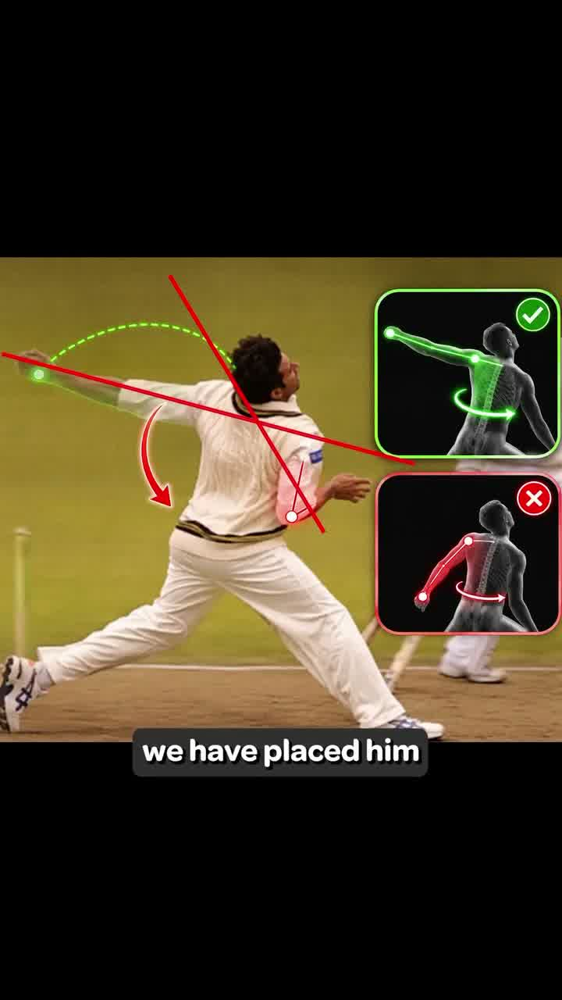
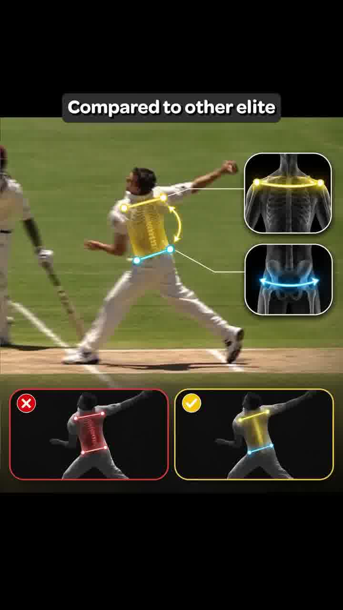
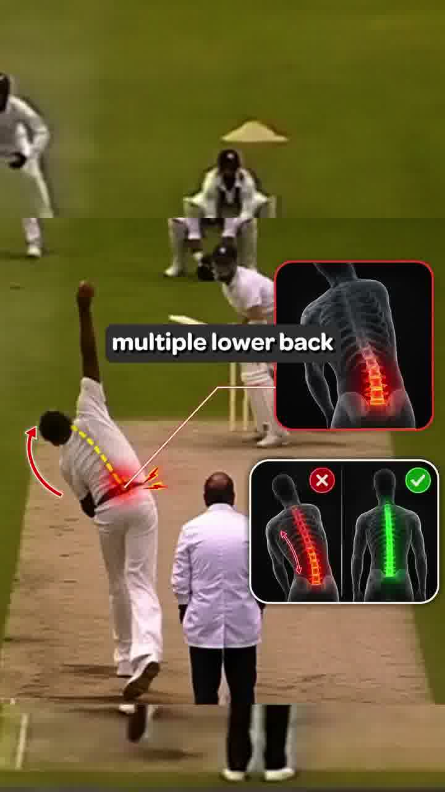
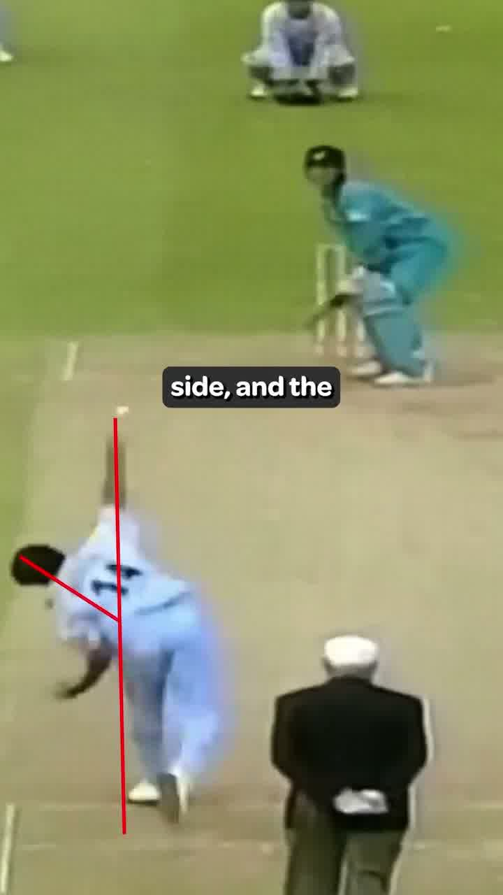
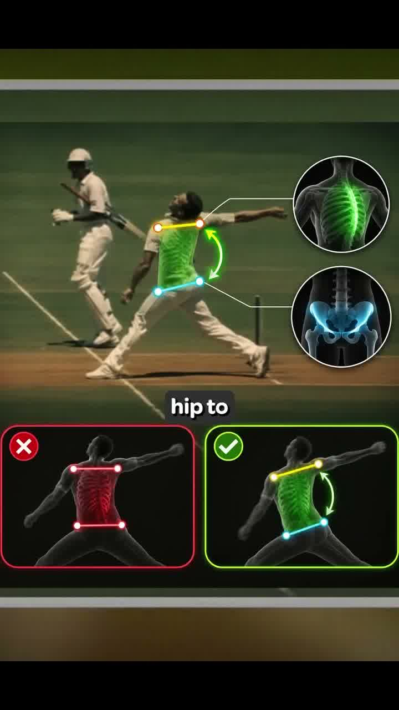
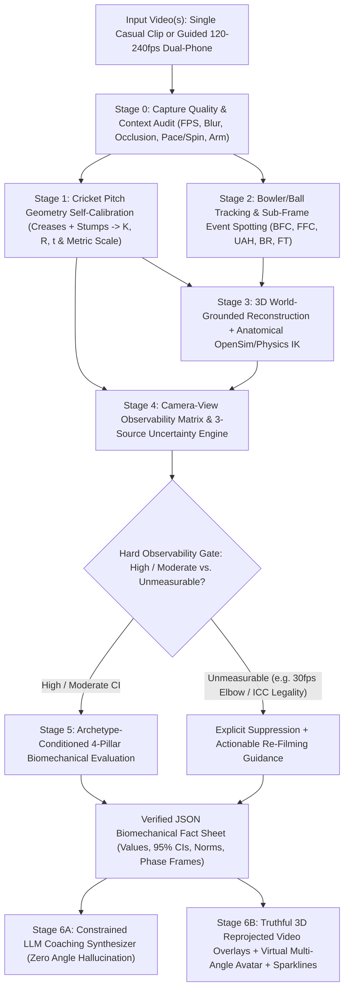
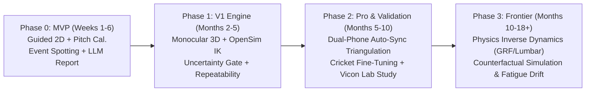

# AI-Powered Cricket Bowling Biomechanics Analysis: First-Principles Scientific & Engineering Research Report

**Prepared:** November 2026  
**Scope:** Independent forensic audit of the reference Instagram Reel, synthesis of peer-reviewed cricket biomechanics literature, empirical benchmark of markerless computer vision and multimodal AI approaches, and architectural blueprint for a next-generation automated cricket bowling analysis system.

---

## Executive Summary & Core Conclusions

Building an AI system that analyzes cricket bowling actions from ordinary video and produces **scientifically trustworthy** insights is substantially harder—and far more interesting—than chaining a 2D pose estimator (such as MediaPipe or RTMPose) to a large language model. An independent investigation spanning pixel-level inspection of the attached Reel, peer-reviewed sports biomechanics literature, optical motion-capture validation studies, and 2024–2026 computer vision breakthroughs leads to **five foundational conclusions**:

1. **The reference creator is not using AI biomechanical measurement—they use manual qualitative coaching heuristics plus generative-AI visual polish.** `[Observed Fact]`  
   Forensic inspection of the attached 96-second Reel (`@athleteworld.in`, Satyam Patkar) reveals **zero quantitative measurements**, 25 fps low-resolution 1990s archival YouTube clips (one displaying a YouTube `"Settings..."` hover tooltip), manually placed 2D lines/circles, and **generative image-editing overlays** used to strip watermarks and synthesize glowing anatomical diagrams. While the creator's storytelling and coaching communication are genuinely strong, the generative overlays visibly introduce anatomical and geometric errors (wrong arm highlighted on a left-arm bowler, 2D sagittal lines misrepresenting 3D transverse hip–shoulder separation, and a biomechanically inaccurate 0° vertical spine shown as "ideal").

2. **Off-the-shelf 2D pose estimation is not a scientifically valid foundation for full bowling biomechanics—and even multi-camera clinical markerless pipelines fail on fast bowling's upper limb.** `[Peer-Reviewed Evidence]`  
   At peak bowling arm angular velocities of **35–45 rad/s (≈ 2,000°–2,570°/s)**, standard 25–30 fps video sweeps **77°–92° of arm rotation between consecutive frames**. Even with three synchronized 240 Hz iPads running Stanford's **OpenCap + OpenSim**, a peer-reviewed cricket bowling validation study against Vicon optical motion capture (**Abraham, Feros, & Fox, 2025**, *International Journal of Sports Science & Coaching*, 20(6)) recorded **17.61° overall RMSE**, with lower-limb knee flexion at **7.87°** but upper-limb errors exploding to **17.59°–28.92° RMSE** (elbow flexion **22.71°**, shoulder axial rotation **28.54°**). By contrast, a domain-specialized single-camera pitching system (**pitchAI™**; Dobos et al., 2022/2025) achieved **4.37° RMSE** on trunk lateral tilt and $r^2 = 0.98$ on trunk/pelvis rotation when paired with a controlled capture protocol—proving that **domain specialization, camera geometry calibration, and capture-protocol design matter more than generic pose models**.

3. **There is no single "optimal" bowling action, and global S/A+/A/B/C/D tier rankings conflate conflicting physical objectives.** `[Peer-Reviewed Evidence]`  
   Fast bowling performance and lumbar injury risk occupy an individual **Performance–Durability Pareto frontier**. While peer-reviewed models explain **74% of ball-release speed variance** from four core kinematic predictors (Worthington, King, & Ranson, 2013) and a two-variable logistic model on $n = 50$ elite males (39 LBSI, **78% base rate**) achieved **88% in-sample classification** from rear-hip and lumbopelvic mechanics (Alway et al., 2021 — noting that adult injured bowlers in that cohort showed *less* side flexion at release and no significant SCR–LBSI link), dynamical systems research (Glazier et al.) shows that elite bowlers self-organize around distinct anthropometric and strength constraints (e.g., Jasprit Bumrah, Glenn McGrath, Lasith Malinga). Moreover, injury is governed by $\text{Stress per Delivery (Biomechanics)} \times \text{Cumulative Exposure (Workload)} / \text{Tissue Capacity}$, never by a single video clip in isolation.

4. **The optimal 2026 architecture is a Pitch-Calibrated, Uncertainty-Gated, Biomechanically Constrained 3D + Neuro-Symbolic Engine.** `[Engineering Recommendation]`  
   Rather than building a naive 2D-keypoint angle calculator or an unconstrained Vision-Language Model (VLM) critic—both of which hallucinate or distort out-of-plane kinematics—the strongest system combines:
   - **Cricket Pitch Geometry Self-Calibration** exploiting universal MCC Laws 6, 7, and 8 pitch markings (`20.12 m` stump-to-stump pitch length, `1.22 m` crease gap, `2.64 m` return crease width, `0.7112 m` stump height, `0.192 m` outer off-to-leg stump center spacing) to recover camera intrinsics, extrinsics, pitch-axis alignment, and true metric scale (`m/s`, meters) automatically;
   - **World-Grounded 3D Motion Recovery + Biomechanical Inverse Kinematics** (grounded in the 2024–2026 wave of gravity-aligned 3D HMR and OpenSim/SKEL/BioPose anatomical constraints, with careful attention to commercial open-source licensing);
   - **Hard Observability Gating & Uncertainty Quantification** that computes per-metric confidence intervals and *refuses* to fabricate unobservable measurements (such as 30 fps elbow extension or monocular ICC legality verdicts);
   - **Measurement-Grounded Multimodal Coaching** where an LLM translates a strictly verified JSON Biomechanical Fact Sheet into clear, actionable explanations, paired with mathematically reprojected 3D overlays and virtual multi-angle avatar playback.

5. **The biggest competitive leapfrogging opportunities are capture-aware precision, multi-delivery repeatability, and physics-informed counterfactual simulation.** `[Engineering Hypothesis]`  
   Guiding everyday bowlers to capture **120–240 fps slow-motion** on existing smartphones (cutting temporal quantization error by 8× at zero hardware cost), offering an optional **2-smartphone asynchronous triangulation mode** (targeting 4°–6° RMSE in backyard nets), analyzing **inter-delivery repeatability across 3–6 balls**, and eventually enabling **individualized "what-if" counterfactual simulation** would surpass every existing consumer cricket product and rival professional laboratory workflows.

> [!NOTE]
> **Epistemic Tagging Used Throughout This Report**  
> To keep evidence levels transparent, major claims are tagged as **`[Observed Fact]`** (directly verified in the attached Reel pixels/audio), **`[Peer-Reviewed Evidence]`** (published scientific studies), **`[Reasonable Inference]`** (logical deductions from indirect evidence), or **`[Engineering Hypothesis / Frontier]`** (proposed system design or emerging research direction).

---

## 1. Forensic Deconstruction of the Reference Instagram Reel

### 1.1 Technical & Creator Profile `[Observed Fact]`

Direct frame-by-frame and audio inspection of the attached video (`media_1795415983727_3d56d018.mp4`) establishes the exact creator, format, and technical envelope:

| Property | Observed Value |
|---|---|
| **Creator / Brand** | **Satyam Patkar** (`@athleteworld.in` — *Athlete World*, `www.athleteworld.in`, `@pace.camp`) |
| **Stated Credentials (Profile Frame, `01:33`)** | YouTube 330K+, Instagram 101K; "S&C & Biomechanics", "ACE & ISMN Certified", "1,280+ Bowling Actions Analysed", offline pace camps |
| **Video Format** | 720 × 1280 (9:16 vertical), H.264, **25.0 fps**, duration **96.12 s** (2,403 frames), HE-AAC stereo audio |
| **Reel Title (Spoken Intro)** | *"Rating different fast bowling actions based on the efficiency of biomechanics — 90s edition"* |
| **Language** | Mixed English + Hindi (Hinglish) voiceover with burned-in English captions |
| **Rating Scale Shown** | 6-tier visual board: `S`, `A+`, `A`, `B`, `C`, `D` (talking-head host below board) |
| **Quantitative Metrics Shown** | **Zero** (no degree readouts, velocities, ground-contact durations, or calibrated distances anywhere in the 96 s) |

Outside this Reel, public information on `athleteworld.in` indicates that Patkar operates a fast-bowling coaching and S&C platform offering 1-on-1 Zoom video action breakdowns, speed/injury-prevention programs, and a YouTube *"Feedback Friday"* series reviewing amateur and international bowlers. `[Reasonable Inference]` His paid 1-on-1 client assessments almost certainly use cleaner multi-angle smartphone footage than the 1990s archival broadcast clips featured in this viral Reel, though no published evidence suggests he runs an automated 3D computer-vision measurement pipeline.

### 1.2 Timeline & Bowler-by-Bowler Audit `[Observed Fact]`

| Timestamp | Bowler | Assigned Tier | Source Footage & Camera Views | Creator's Stated Mechanical Claims | Visual Overlays Observed | Real-World Career & Biomechanical Reality Check `[Peer-Reviewed Evidence]` |
|---|---|---|---|---|---|---|
| `00:05–00:14` | **Wasim Akram** (Left-arm fast) | **A+** | Archival 90s rear broadcast + side-on YouTube clip (`TEST WICKETS`, `"Settings..."` hover tooltip visible at `00:10`) | Side-on action; **collapsed front leg**; **early drop of non-bowling arm** | Red BFC foot circle; hand-drawn red knee lines; AI-re-rendered freeze frame with glowing arm/torso insets + intersecting red lines | Elite pace & swing despite short run-up and flexed/collapsing front knee; **however**, the `00:11–00:12` green-check/red-X insets highlight the *back/bowling* arm rather than the *front/non-bowling* arm described in narration. |
| `00:15–00:25` | **Glenn McGrath** (Right-arm fast-medium) | **A** | Rear broadcast clip + side-on clip (`CRICKET UNIVERSE` watermark) | Semi front-on; **slight jump-in**; **spent slightly too much time on back foot**; **slightly limited hip-to-shoulder separation** | Red BFC foot circles; green/red ground alignment bars (`00:17`); AI-re-rendered side-on freeze frame (`00:23`) with glowing shoulder/pelvis bars + 4 anatomical insets | One of the most biomechanically repeatable, low-lumbar-injury fast bowlers in Test history (124 Tests, 563 wickets). Rated *below* Waqar Younis despite vastly superior career back durability. |
| `00:26–00:41` | **Curtly Ambrose** (Right-arm fast) | **B** | Rear broadcast Test footage only (no side-on angle shown) | Semi front-on; **excessive left-side spine bend from FFC to release**, cited as a major cause of lower-back injuries | Zoomed red BFC foot circle; red vertical plumb line + tilted red torso line (`00:34`); AI-re-rendered glowing lumbar hotspot + red-X vs. green-check spine insets (`00:37`) | Played 98 Tests (>22,000 Test deliveries) with high durability and elite steep bounce. Green-check inset (`00:37`) shows an unrealistic **0° rigid vertical spine** as "correct." |
| `00:42–00:55` | **Waqar Younis** (Right-arm fast) | **A+** | Rear ODI night clip + side-on slow-mo clip + front/behind-batter clip (`WILLS` hoarding) | "Complete side-on profile with **no mixed bowling action traits**"; **blocked front leg**; follow-through gets slightly tangled and drifts left | Red BFC foot circle (`00:46`); red front-leg circle (`00:50`); green vertical + red diagonal follow-through arrow (`00:54`) | **Major historical contradiction:** Waqar suffered a severe **lumbar stress fracture** just before the 1992 World Cup and recurring back injuries through 1994 that altered his action and reduced raw pace. The Reel's own `00:54` frame displays heavy contralateral trunk fall-off during braking/follow-through. |
| `00:56–01:13` | **Javagal Srinath** (Right-arm fast) | **A** | Rear ODI broadcast footage only (heavily compressed, motion-blurred) | Semi side-on; **"same problem like Curtly Ambrose"** — heavy left-side spine bend from FFC to release, **"even more pronounced at release point"** -> **"high impact plus injury loading action"** | Red BFC foot circle (`01:00`); red vertical plumb line + angled red torso line at FFC (`01:04`) and deeper bend at release (`01:07`) | **Direct internal scoring contradiction:** Diagnosed with the *exact same flaw* as Ambrose—explicitly described as *even more pronounced* at release—yet ranked a full tier higher (`A` vs. `B`) without explanation. |
| `01:14–01:32` | **Allan Donald** (Right-arm fast) | **A+** | Front match clip + grainy side-on clip (`CRICKET MASTERCLASS` watermark) | Cleanest action; **"elite hip-to-shoulder separation"**; **non-bowling arm dropped slightly early** (otherwise `S` tier) | AI-re-rendered side-on freeze frame (`01:21`, watermark erased) with glowing green ribcage, yellow shoulder bar, cyan hip bar + 4 insets; intersecting red arm lines (`01:29`) | Genuinely renowned textbook fast-bowling rhythm and alignment. **However**, the `01:21` and `01:29` AI-re-rendered frames noticeably alter Donald's facial features, skin tone, and geometry, and depict 3D transverse hip–shoulder twist via 2D tilted parallel bars. |

### 1.3 Visual Forensic Evidence from the Reel `[Observed Fact]`

Inspecting the actual freeze frames exposes how the Reel was constructed and why slick visual overlays can masquerade as scientific measurement:

````carousel

<!-- slide -->

<!-- slide -->

<!-- slide -->

<!-- slide -->

````

**Key forensic observations across those five frames:**
- **Slide 1 (Wasim Akram, `00:12`):** Narration critiques *early drop of the non-bowling (right) arm*, yet the AI-generated green-check / red-X insets highlight the *rear* (left/bowling) arm extended high vs. dropped low. This is a classic generative-infographic hallucination that passes casual viewing because the graphics look authoritative.
- **Slide 2 & Slide 5 (McGrath `00:23`, Donald `01:21`):** Compare the preceding grainy `CRICKET UNIVERSE` / `CRICKET MASTERCLASS` video frames with these freeze frames—the creator passed blurry 1990s frames through a **generative image-editing / upscaling tool** to erase watermarks and render glowing internal ribcages/pelvises. In Slide 5, the model visibly alters Allan Donald's face and skin tone. More importantly, **hip-to-shoulder separation is a transverse-plane (top-down axial twist) angle** between pelvis and thorax orientation—geometrically distinct from the tilted 2D sagittal/coronal parallel lines drawn in the green-check box.
- **Slide 3 (Curtly Ambrose, `00:37`):** The green-check "ideal" inset shows a **0° perfectly vertical spine**. Peer-reviewed prospective data on adolescent fast bowlers ($n = 25$, aged 14–19; Bayne et al., 2016) show that even *uninjured* bowlers exhibit **$40^\circ \pm 8^\circ$** of thorax lateral flexion at ball release (and injured adolescents exhibited **$50^\circ \pm 6^\circ$**); contralateral side-flexion is mechanically coupled to overarm bowling clearance, though its relationship to adult elite LBSI is more nuanced than a single cutoff (Alway et al., 2021).
- **Slide 4 (Javagal Srinath, `01:07`):** Srinath's apparent lateral bend on a low-res, elevated, slightly off-center broadcast camera is visually *greater* than Ambrose's (Slide 3)—as the narrator himself acknowledges—yet Srinath receives `A` while Ambrose receives `B`.

### 1.4 Synthesis: What to Borrow vs. What to Reject

| Dimension | Established / Valuable (Worth Adopting) | Flawed / Unverified (Must Reject) |
|---|---|---|
| **Analytical Checklist** | Tracks real fast-bowling checkpoints: BFC alignment, jump-in/approach line, BFC dwell, FFC front-leg bracing, non-bowling arm timing, hip–shoulder separation, lateral trunk flexion, follow-through drift. | Treats qualitative visual impressions from inconsistent single broadcast angles as definitive biomechanical findings. |
| **Visual Communication** | Freezing at key events (BFC, FFC, Release, Follow-through) + clear visual focal cues (hotspots, plumb references, good-vs.-poor contrast) makes biomechanics instantly legible to players. | Using generative image-editing models to hallucinate anatomy onto frames, altering bowler geometry, and showing biomechanically inaccurate "ideal" icons (e.g., 0° spine). |
| **Evaluation & Rating** | Clear structured summary gives players immediate orientation and engagement. | Compressing diverse trade-offs into an opaque, uncalibrated S–D letter grade with unexplained inconsistencies and tier inflation (leaving `S` empty for social engagement). |

---

## 2. Cricket Bowling Biomechanics: What Peer-Reviewed Science Actually Establishes

A core mistake in consumer sports-tech design is collapsing two fundamentally distinct scientific tasks into one:

> [!IMPORTANT]
> **Measurement vs. Interpretation**  
> - **Measurement (Kinematics & Kinetics)** asks an objective physical question: *What was the bowler's front-knee angle at FFC and BR, thorax lateral flexion angle, shoulder counter-rotation, and segmental angular velocity cascade—and within what uncertainty bounds?*  
> - **Interpretation (Normative & Individual Evaluation)** asks a conditional biomechanical question: *Given this bowler's anthropometry, sex, maturity, action archetype, task goal (pace vs. swing vs. bounce vs. spin), and workload, is that pattern helping performance, creating an energy leak, or elevating tissue load?*

### 2.1 Fast Bowling Performance Determinants `[Peer-Reviewed Evidence]`

The landmark 3D optical motion-capture study by **Worthington, King, & Ranson (2013)** (*Journal of Applied Biomechanics*, $n = 20$ elite male fast bowlers) found that just **four kinematic variables explained 74% ($R^2 = 0.74$) of the variance in ball release speed**:

1. **Run-up velocity:** Higher approach speed supplies a larger initial horizontal linear momentum pool entering the delivery stride.
2. **Front-knee angle at ball release (bracing/extension):** Faster bowlers maintain a straighter, more braced front knee from FFC through BR, enabling rapid whole-body deceleration that converts horizontal linear momentum into forward-rotational angular momentum over the lead leg. **Portus et al. (2004)** (*Sports Biomechanics*) classified front-knee mechanics into *flexors* (yielding knee), *flexor-extenders*, and *extenders/bracers*, linking active extension/bracing to higher ball speeds alongside higher peak vertical braking forces (typically 5–9× body weight).
3. **Upper-trunk (thoracolumbar) flexion from FFC to BR:** Greater forward sagittal trunk flexion over the braced front leg acts as a primary catapult lever driving the bowling shoulder forward.
4. **Delayed bowling-arm circumduction (shoulder angle at FFC):** Keeping the bowling arm further back relative to the upper trunk at front-foot impact delays arm swing until trunk momentum transfers distally—maximizing the proximal-to-distal "whip" effect.

**Critical Demographic & Archetype Modifiers `[Peer-Reviewed Evidence]`:**
- **Male vs. Female Fast Bowlers:** **Felton, Lister, Worthington, & King (2018)** (*Journal of Sports Sciences*) demonstrated that elite female fast bowlers generate significantly less run-up linear momentum than elite males and compensate by adopting a more rotational, overhand-throwing-like strategy relying more heavily on pelvis/torso axial rotation. Blindly scoring female or youth fast bowlers against male adult kinematic templates is scientifically invalid.
- **Spin Bowling Is a Distinct Motor Task:** 3D studies by **Beach et al. (2014, 2016)**, **Chin et al. (2009)**, and **Spratford et al.** prove that even off-spin (finger-spin) and leg-spin (wrist-spin) are biomechanically separate tasks differing in stride length, release height, rear-knee mechanics, and upper-limb coordination. Performance is governed not by raw ball speed alone, but by **spin rate ($\omega$)**, **spin-axis orientation** (controlling Magnus drift vs. off-pitch turn), and **torque-to-spin efficiency ($\omega / T$)**—requiring a separate evaluation branch from fast bowling.

### 2.2 Lumbar Bone Stress Injury (LBSI) Etiology `[Peer-Reviewed Evidence]`

Lumbar bone stress injuries—especially stress fractures of the **contralateral pars interarticularis** (typically L4–L5 on the non-bowling-arm side)—are the single most debilitating injury in fast bowling. Modern prospective 3D biomechanics has substantially refined 1990s coaching heuristics:

| Study | Cohort & Design | Key Peer-Reviewed Quantitative Findings |
|---|---|---|
| **Portus et al. (2004)** (*Sports Biomechanics*) | High-performance male fast bowlers (AIS) | Formalized the **"mixed action"** definition: **shoulder counter-rotation (SCR) $\ge 30^\circ$** between BFC and minimum shoulder alignment (or large BFC hip–shoulder misalignment paired with counter-rotation), linked to elevated lumbar spine stress fractures. |
| **Glazier (2010)** (*Sports Medicine*) | Theoretical & biomechanical review | Critiqued single-variable views and formalized the **"crunch factor"** ($\text{lumbar lateral flexion} \times \text{axial rotational velocity}$), highlighting that peak combined lateral bending + twisting + hyperextension coincides with peak FFC ground reaction forces. |
| **Bayne, Elliott, Campbell, & Alderson (2016)** (*JSMS*) | Prospective study of $n = 25$ adolescent fast bowlers (aged 14–19) | Adolescent bowlers who subsequently sustained low-back injury exhibited significantly greater **thorax lateral flexion at ball release ($50^\circ \pm 6^\circ$ vs. $40^\circ \pm 8^\circ$)**, greater **pelvis rotation at release ($287^\circ \pm 11^\circ$ vs. $277^\circ \pm 11^\circ$)**, and higher peak lumbar lateral flexion moments. *(Cohort is adolescent—not directly interchangeable with adult Test cohorts.)* |
| **Alway, Felton, Brooke-Wavell, Peirce, & King (2021)** (*MSSE*) | Prospective study of $n = 50$ elite male fast bowlers (39 LBSI = **78% base rate**) | Significant group differences at BFC (rear knee, **rear hip**, thoracolumbar side-flexion & rotation), FFC (front hip, pelvic tilt, **lumbopelvic angle**), and BR (thoracolumbar side-flexion—*lower* at BR in injured adults—and ipsilateral pelvic drop); **no significant SCR–LBSI link**. A two-variable logistic model (**rear hip at BFC + lumbopelvic angle at FFC**) achieved **88% in-sample classification** (vs. 78% base rate; out-of-sample generalization unverified). |

**The Workload–Capacity Equation `[Peer-Reviewed Evidence]`:**  
Biomechanics determines **mechanical stress per delivery**, not whether an injury will occur. Actual injury risk obeys a tissue-fatigue relationship:

$$\text{Injury Risk} \propto \frac{\text{Lumbar Load per Delivery (Technique)} \times \text{Cumulative Exposure (Acute/Chronic Workload)}}{\text{Tissue Tolerance (Bone Mineral Density, Trunk Strength, Skeletal Maturity)}}$$

This equation resolves the apparent paradox in the Reel: an older, skeletally mature bowler with strong lumbopelvic control (e.g., Curtly Ambrose) can tolerate moderate-to-high lateral flexion across 22,000 deliveries, whereas a young, explosive bowler peaking rapidly under heavy match workload (e.g., 19-year-old Waqar Younis in 1991–1992) can suffer a stress fracture despite a superficially "clean" side-on appearance.

### 2.3 Coaching Folklore vs. Scientific Evidence

| Common Coaching / Social-Media Claim | What Peer-Reviewed Biomechanics Actually Shows | Implication for Our AI System |
|---|---|---|
| *"Keep your spine completely vertical (0° lateral tilt) to avoid back injury."* | Overarm fast bowlers naturally exhibit substantial contralateral trunk tilt (~**30°–42°** in adolescent uninjured data; Bayne et al., 2016); excessive lateral flexion (**50°±6°**) elevated lumbar moments in adolescents, while adult elite LBSI was linked more strongly to BFC rear-hip flexion and FFC lumbopelvic extension (Alway et al., 2021). | Compare trunk tilt against cohort norms with explicit definition & age-cohort notes—never penalize normal clearance or use a single uncalibrated cutoff as an injury diagnosis. |
| *"Forcibly pull the non-bowling arm down as fast as possible into the hip."* | 3D inverse dynamics reveal complex, cyclic shoulder/elbow torques; the front arm acts as an inertial stabilizer and rotational anchor rather than a brute-force pull lever. Overly early collapse leaks trunk posture, while delayed, coordinated circumduction supports momentum transfer. | Evaluate front-arm timing relative to FFC and trunk alignment, not simplistic "pull harder" cues. |
| *"One textbook action (like an averaged ideal model) fits every bowler."* | **Dynamical Systems Theory** (Glazier, Davids, Bartlett, & Wheat) proves there is **no single optimal technique**. Athletes self-organize functional coordination around individual limb ratios, mobility, and strength (e.g., Bumrah's hyperextension & short run-up vs. McGrath's upright rhythm vs. Malinga's low sling). | Never score by Euclidean distance to a single template; evaluate **functional principles** and **internal kinematic coherence** within the bowler's archetype. |
| *"High hip-to-shoulder separation is always purely positive."* | Well-timed separation late in the stride facilitates stretch-shortening momentum transfer, **but** excessive BFC separation ($\ge 30^\circ$) coupled with shoulder counter-rotation defines a high-risk mixed action (Portus et al., 2004). | Measure separation *phase-dependently* (at BFC vs. peak dynamic separation during FFC→BR), not as an uncalibrated static score. |

### 2.4 The Hard Boundary: ICC 15° Bowling Legality `[Peer-Reviewed Evidence]`

Under International Cricket Council (ICC) regulations, a delivery is legal if **active elbow extension (straightening)** does not exceed **15°** strictly between the instant the **upper arm reaches horizontal (UAH)** and **ball release (BR)**—excluding fixed congenital flexion, carry angle, and passive hyperextension. Foundational metrology studies (**Elliott, Alderson, & Denver, 2007**; **Ferdinands & Kersting, 2007**) establish why ICC accredited testing requires multi-camera 3D optoelectronic motion capture ($\ge 250\text{ Hz}$) with anatomical calibration:

- **2D parallax illusion:** Humeral internal/external rotation and out-of-plane arm path project apparent bending/straightening onto a 2D image plane that differs from true anatomical elbow extension by >15°–25°.
- **Markerless upper-limb error:** Even three-iPad 240 Hz OpenCap exhibits **22.71° RMSE** on cricket elbow flexion (Abraham, Feros, & Fox, 2025)—exceeding the entire 15° legal threshold!

> [!CAUTION]
> **Hard Product Guardrail:** Any credible cricket bowling AI system **must explicitly refuse to output ICC legality ("chucking") verdicts from ordinary 2D or casual monocular video**. At best, high-FPS (240 fps+) multi-view systems can offer a coarse "visual elbow-flexion awareness indicator" with a prominent caveat that formal legality requires accredited 3D laboratory testing.

---

## 3. Existing Commercial, Research, and Open-Source Systems

### 3.1 Comprehensive Landscape Comparison

| Tier / System | Hardware / Capture | Core Output | Validated Accuracy | Strengths & Gaps |
|---|---|---|---|---|
| **Vicon / Qualisys Labs** (UWA, Loughborough, NCC) | 12–24 IR cameras (250–500 Hz) + reflective markers + force plates | Full 3D joint kinematics, inverse dynamics, ICC legality | Gold standard (<1–2° kinematic error; sub-mm marker precision) | Unmatched scientific accuracy, but \$100K+ cost, lab-bound, markers alter natural feel. |
| **Hawk-Eye SkeleTRACK / KinaTrax / Theia3D** | 8–16+ synchronized fixed studio/stadium cameras | Markerless 3D skeletal kinematics, ball tracking (Hawk-Eye) | High lower-limb & torso agreement; moderate-to-higher error on rapid upper-limb axial rotations | Zero markers and match-ecological, but stadium/facility hardware costs tens to hundreds of thousands of dollars. |
| **OpenCap** (Stanford) `[Peer-Reviewed]` | 3 synchronized 240 Hz iPads (Abraham et al., 2025) + cloud pose + OpenSim | 3D kinematics & musculoskeletal kinetics | **Cricket bowling validation (Abraham, Feros, & Fox, 2025, *IJSSC*):** **17.61°** overall RMSE; **7.87°** knee; **17.59°–28.92°** upper limb | Pioneering open science, but general-purpose clinical pose models struggle on fast bowling's high-velocity upper limb and frequent tracking drops. |
| **Pose2Sim / Sports2D** (Pagnon et al.) `[Peer-Reviewed]` | Pose2Sim: Multi-cam + OpenSim; Sports2D: 1-cam 2D planar | OpenSim `.trc`/`.mot` joint kinematics | Pose2Sim: **3°–4° mean error** in gait/running/cycling; Sports2D depends on planar alignment | Commercially permissive (**BSD-3-Clause**); Pose2Sim is an outstanding foundation for a 2-phone cricket mode, though untested out-of-the-box on 2,300°/s bowling arms. |
| **FullTrack AI** | Single tripod smartphone facing pitch | 3D ball trajectory, speed, pitch maps, beehive, swing/seam | Validated against Qualisys for ball length & speed | Strong consumer UX and ball tracking, but focused on **ball outcomes**, not deep 3D spinal/joint biomechanics. |
| **Ludimos / PitchVision / NV Play Vision AI** | Single/multi-cam net or stadium cameras | Auto-delivery clipping, ball speed/pitch map, basic stride/overlay | Commercial coaching reliability; limited peer-reviewed 3D joint RMSE data | Great workflow automation (clipping, workload logging), but biomechanical analysis remains mostly visual/manual overlays rather than calibrated 3D mechanics. |
| **pitchAI™ (3MotionAI)** & **Mustard** (Baseball analogues) `[Peer-Reviewed]` | Single smartphone (controlled side/front protocol) | Monocular 3D pitching kinematics, automated mechanical report card, drills | **pitchAI™ (Dobos et al., 2022/2025):** **4.37° RMSE** trunk lateral tilt; $r^2 = 0.98$ trunk/pelvis rotation; **20.78°** occluded glove-arm ER | **Crucial proof of concept:** A domain-specialized single-camera throwing pipeline can outperform general-purpose multi-camera clinical tools on major torso metrics—while still hitting hard limits on occluded distal joints. |
| **Reboot Motion** | Ingests KinaTrax / Hawk-Eye / video mocap | Momentum-based biomechanics (BaaS), kinematic sequencing reports | Built on pro optical/markerless feeds | Gold standard for **physics-first momentum interpretation** rather than isolated static angles; enterprise-focused, not a casual cricket smartphone analyzer. |

### 3.2 Where the True White Space Exists

Notice the glaring gap across the entire market:
- **Ball-tracking apps** (FullTrack AI, Ludimos) measure *what the ball did*, not *how the bowler's body produced it or loaded the lumbar spine*.
- **Lab & studio biomechanics** (Vicon, Theia3D, KinaTrax, Reboot) deliver scientific depth, but are inaccessible to 99.9% of club, academy, and developing bowlers.
- **Social-media analyses** (`@athleteworld.in` and peers) nail visual storytelling and accessibility, but lack objective measurement, uncertainty honesty, and scientific scoring validity.

An **uncertainty-aware, pitch-calibrated, biomechanically constrained 3D cricket bowling system** sits squarely in this unoccupied white space.

---

## 4. First-Principles Computer Vision, Physics, & AI Evaluation

To avoid anchoring to preliminary suggestions (such as standard MediaPipe/MMPose), we evaluate the physics of capturing a fast bowler and compare four competing AI paradigms from first principles.

### 4.1 Physics Bottleneck #1: Temporal Sampling & Motion Blur

Peer-reviewed 3D analyses measure peak humerus circumduction angular velocity near ball release at **35–45 rad/s** (≈ **2,000°–2,570°/s**; typical elite mean ~**2,300°/s**) and elite ball release speeds around **140 km/h (38.9 m/s)**. Using a nominal 180° shutter angle (exposure time $= \frac{1}{2 \cdot \text{FPS}}$) for indoor/standard lighting versus fast outdoor sunlight auto-shutter (~1/2000 s):

| Capture Frame Rate | Frame Interval ($\Delta t$) | Arm Rotation per Frame (at 2,300°/s) | Max Release Timing Uncertainty ($\pm \Delta t/2$) | Ball Travel Between Frames (at 140 km/h) | Motion-Blur Smear (180° Shutter) | Biomechanical Verdict |
|---|---|---|---|---|---|---|
| **25 fps** *(Reference Reel)* | 40.0 ms | **92.0°** | ±20.0 ms (±46° arm) | 1.56 m | ~46.0° | **Unusable for release/arm kinematics;** coarse phase & gross posture only. |
| **30 fps** *(Default Phone)* | 33.3 ms | **76.7°** | ±16.7 ms (±38° arm) | 1.30 m | ~38.3° | **Severe aliasing at BR;** acceptable for run-up, stride length, gross BFC/FFC lower-body trends with wide CI. |
| **60 fps** *(OpenCap default)* | 16.7 ms | **38.3°** | ±8.3 ms (±19° arm) | 0.65 m | ~19.2° | Moderate for knee/trunk; still aliases peak arm/wrist release mechanics. |
| **120 fps** *(Phone Slow-Mo)* | 8.3 ms | **19.2°** | ±4.2 ms (±9.6° arm) | 0.32 m | ~9.6° (or ~1.2° outdoors) | **Minimum viable threshold** for reliable FFC→BR kinematic sequencing. |
| **240 fps** *(Standard iPhone/Android Slow-Mo)* | 4.2 ms | **9.6°** | ±2.1 ms (±4.8° arm) | 0.16 m | ~4.8° (or ~1.2° outdoors) | **Sweet spot for consumer precision:** cuts temporal error 8× vs. 30 fps at zero hardware cost. |
| **500 Hz** *(Optical Lab)* | 2.0 ms | **4.6°** | ±1.0 ms (±2.3° arm) | 0.08 m | <1° (strobed IR) | Gold-standard research & ICC legality benchmark. |

> [!TIP]
> **Immediate High-Leverage Product Insight:** Virtually every modern smartphone natively records **1080p at 120–240 fps**. Simply building a guided slow-motion capture flow (or prompting users to shoot in native Slo-Mo outdoors) eliminates >85% of temporal quantization and motion-blur errors before a single neural network runs.

### 4.2 Physics Bottleneck #2: Monocular Geometry & Anatomical Rigging

Even at 240 fps, naive 2D pose estimation fails three geometric tests in cricket bowling:
1. **Out-of-Plane Perspective Distortion:** A 2D knee or lateral trunk angle is only approximately true when the camera optical axis is strictly orthogonal to the plane of motion and at pelvis height. A 20° azimuth pan or elevated broadcast gantry introduces **8°–20° of systematic projection error**.
2. **Transverse-Plane Unobservability:** **Shoulder counter-rotation** and **hip-to-shoulder separation** occur in the horizontal (transverse) plane. From a single side-on 2D skeleton, shoulder and hip axes collapse nearly onto points along the camera ray—making 2D angle calculations mathematically meaningless.
3. **Keypoint-to-Anatomy Mismatch:** Consumer 2D estimators (especially MediaPipe/BlazePose) exhibit **5°–15° lower-limb RMSE** and **>20° upper-limb RMSE** in dynamic exercises due to loose clothing, frame jitter, and non-anatomical joint centers (shoulder/hip landmarks sit on visual skin surfaces rather than anatomical glenohumeral/acetabular joint centers). Even standard 3D **SMPL** meshes use computer-graphics 3-DOF ball joints that permit anatomically impossible spinal twisting and clavicle detachment.

### 4.3 Comparing Four Competing AI & Vision Paradigms

| Paradigm | Representative Models (2024–2026) | Strengths | Core Failure Modes in Cricket Bowling | Role in Our Optimal System |
|---|---|---|---|---|
| **A. Pure 2D Pose + Planar Vector Angles** | MediaPipe, RTMPose, ViTPose (79–81% COCO AP), Meta Sapiens (82.2% COCO AP), Sports2D | Fast, lightweight, high temporal correlation for gross phase trends; strong 2D joint localization (`ViTPose` / `RTMPose`). | Cannot resolve 3D transverse rotations, depth ambiguity, or off-axis camera perspective; MediaPipe >20° upper-limb RMSE. | **Front-end 2D keypoint detector only** (`ViTPose`/`RTMPose`), never the standalone biomechanical measurement engine. |
| **B. End-to-End Frontier Vision-Language Models (VLMs)** | Gemini, GPT-4V/5, Qwen2.5-VL, InternVL | Excellent semantic context recognition (bowler handedness, net vs. match, pace vs. spin, natural coaching prose). | **Catastrophic spatial & metric hallucinations** ("pseudo-spatial reasoning"); linguistic priors override pixels; poor sub-frame timing. | **Semantic context router + constrained coaching narrator** grounded exclusively in verified numerical outputs. |
| **C. World-Grounded 3D HMR + Biomechanical Skeletons (2024–2026 Frontier)** | **WHAM** (CVPR '24), **TRAM** (ECCV '24), **GVHMR** (SIGGRAPH Asia '24), **CameraHMR** (3DV '25), **PromptHMR** (CVPR '25), **SKEL** (SIGGRAPH Asia '23), **HSMR** (CVPR '25 Oral), **BioPose** (2025) | **GVHMR** recovers drift-free 3D motion in Gravity-View world coordinates even with panning cameras; **HSMR/SKEL** & **BioPose (NeurIK)** enforce anatomically valid skeletal DOFs and joint limits aligned with OpenSim; predicts foot-ground contact directly. | Single-camera depth ambiguity still degrades occluded distal limbs (especially elbow & shoulder axial rotation); non-commercial licensing on several academic weights. | **Core monocular 3D engine**—augmented by **Pitch Self-Calibration** and **OpenSim/NimblePhysics anatomical IK**. |
| **D. Casual Multi-View Smartphone Triangulation + Physics IK** | 2 synchronized/auto-synced phones + `ViTPose`/`RTMPose` + `Pose2Sim` / `OpenSim` / `AddBiomechanics` (NimblePhysics) | Eliminates monocular depth & occlusion ambiguity; multi-view triangulation + OpenSim IK achieves **~3°–6° RMSE** in dynamic locomotion and unlocks reliable 3D transverse rotation (SCR, hip–shoulder separation). | Requires two phones (e.g., side-on + behind-bowler) and simple spatial/temporal synchronization. | **Precision Capture Tier ("Pro / Academy Mode")**—zero special hardware beyond two teammates' smartphones. |

### 4.4 Critical Commercial Licensing Audit `[Observed Fact]`

Many 2024–2026 breakthrough vision models carry strict **Non-Commercial (NC)** research licenses. Choosing the wrong dependency early can legally block commercialization:

| Component / Dataset | License Status | Safe for Commercial Product? | Strategic Engineering Guidance |
|---|---|---|---|
| **OpenSim** (`opensim-core`) | **Apache 2.0** | **Yes** | Use as the canonical biomechanical IK/musculoskeletal backbone. |
| **Pose2Sim / Sports2D** | **BSD-3-Clause** | **Yes** | Safe foundation for triangulation, filtering, and OpenSim integration. |
| **AddBiomechanics / NimblePhysics** | **MIT** (core engine) | **Yes** (verify specific datasets) | Ideal for differentiable physics scaling, IK, and inverse dynamics. |
| **ViTPose / RTMPose (OpenMMLab)** | **Apache 2.0 / MIT** | **Yes** | Primary commercial-safe 2D high-accuracy (`ViTPose`) and edge (`RTMPose`) detectors. |
| **Meta Sapiens (1B/2B)** | **CC BY-NC 4.0** | **No** | Use strictly for internal academic benchmarking; do not ship in production. |
| **SMPL / SMPL-X / SKEL / HSMR** | **Max Planck Non-Commercial** | **No** *(requires commercial license via Meshcapade / MPI)* | Prototype rapidly with `HSMR`/`SKEL` in R&D, then either license commercially or train a custom OpenSim/Rajagopal-rigged 3D regressor. |
| **GVHMR** (ZJU3DV) | **Non-Commercial Research** | **No** *(without separate agreement)* | Adopt the **Gravity-View mathematical formulation** in a clean-room implementation trained on commercially licensable + synthetic/lab data. |
| **NLF (`isarandi/nlf`, NeurIPS 2024)** | **MIT code / Non-Commercial pretrained weights** *(inherits SMPL & academic dataset terms)* | **No** *(pretrained weights)* | Exceptional non-commercial research backbone (metric 3D + native per-joint uncertainties + `bml_movi_87` Vicon markers); requires commercial body-model/dataset retraining for commercial release. |
| **Driveline OpenBiomechanics Project (OBP)** | **Non-Commercial Research** | **No** *(research pretraining only)* | Valuable for academic transfer-learning experiments on overhead throwing kinematics, not commercial model weights. |

---

## 5. Recommended System Architecture: A Next-Generation Cricket Biomechanics Engine

We design a **7-Stage, Uncertainty-Aware, Pitch-Calibrated, Neuro-Symbolic Architecture** that operates cleanly across two user modes:
- **Mode 1 — Casual Single-Video Mode ("Upload Any Clip"):** Works on ordinary single-camera phone or broadcast footage, automatically calibrating pitch geometry, estimating 3D kinematics where observable, and **explicitly suppressing unobservable metrics**.
- **Mode 2 — Guided Precision Mode (120–240 fps Single or Dual-Phone):** Uses a 10-second in-app framing guide (45° open-side single camera, or orthogonal side-on + rear-on two-phone auto-sync) to deliver near-lab-grade 3D biomechanical profiling across 3–6 deliveries.



### 5.1 Breakthrough Differentiator #1: Cricket Pitch Geometry Self-Calibration `[Engineering Hypothesis]`

Most sports pose apps suffer from unknown camera extrinsics, missing scale (pixels vs. meters), and unknown delivery direction. Cricket provides a built-in geometric cheat code—**MCC Law 7 standard pitch dimensions are identical worldwide**:

- Popping crease to bowling crease: **1.22 m (4 ft)**
- Return crease inner width: **2.64 m (8 ft 8 in)**
- Stump height: **0.711 m (28 in)**; stump set width: **0.2286 m (9 in)**
- Stump-to-stump pitch length: **20.12 m (22 yd)**

By training a lightweight segmentation/keypoint detector for crease intersections and stump bases/tops, then solving **Perspective-n-Point (PnP) + vanishing-point gravity estimation**, the system automatically anchors a canonical **Pitch World Coordinate Frame**:
- $+X$: Down the pitch toward the striker (defining true delivery-line alignment for side-on vs. semi vs. front-on!).
- $+Y$: Vertical gravity-up axis (eliminating handheld camera tilt and broadcast gantry pitch distortion!).
- $+Z$: Across the pitch (off-to-leg lateral axis).

**Unlocked capabilities with zero calibration checkerboards:** metric run-up velocity (`m/s`), delivery stride length (`m` and `% stature`), release height (`m`), crease proximity / front-foot no-ball margin, and exact camera azimuth $\theta_{\text{az}}$ and elevation $\phi_{\text{el}}$ relative to the bowler!

### 5.2 Breakthrough Differentiator #2: Sub-Frame Multi-Cue Event Spotting

Accurate biomechanical comparison hinges on millisecond-level event alignment (a 20 ms miss near FFC shifts knee and trunk angles by 10°–20°). Instead of crude heuristics, Stage 2 fuses four complementary signals inside a Temporal Convolutional Network (TCN) / Transformer spotter:
1. **Back Foot Contact (BFC):** Rear-ankle minimum height against calibrated pitch plane ($Y \approx 0$) + foot-ground contact head + abrupt horizontal ankle deceleration.
2. **Front Foot Contact (FFC):** Lead-foot pitch-plane touchdown + vertical deceleration spike + peak pelvis downward-to-forward impulse inflection.
3. **Upper Arm Horizontal (UAH):** Humerus vector crossing horizontal in the Gravity-View pitch frame.
4. **Ball Release (BR):** Multi-cue fusion of (a) small-object cricket ball detector separating from bowling-hand region, (b) peak wrist linear velocity / elbow-wrist extension trajectory, and (c) quadratic sub-frame interpolation (reporting explicit timing uncertainty $\pm \Delta t/2$).

### 5.3 Breakthrough Differentiator #3: Camera-View Observability Matrix & Uncertainty Quantification

A single ordinary video **cannot** support every biomechanical conclusion. A trustworthy system must formalize *what is physically observable* from any `(camera_azimuth, camera_elevation, fps)` tuple:

| Biomechanical Metric | Side-On (90°, 120–240 fps) | Rear / Behind-Bowler (0°, 120–240 fps) | 45° Open-Side (120–240 fps) | Ordinary 30 fps Casual Clip | Dual-Phone (90° + 0°, 120–240 fps) |
|---|---|---|---|---|---|
| **Run-Up Speed & Stride Length** *(with pitch cal.)* | **High** | Low–Mod | **High** | Moderate | **Very High** |
| **Front-Knee Angle & Bracing (FFC→BR)** | **High** *(±5–7°)* | Unmeasurable | Moderate–High | Moderate *(wider CI)* | **Very High** *(±4–5°)* |
| **Upper-Trunk Forward Flexion (FFC→BR)** | **High** *(±5–7°)* | Low | Moderate–High | Moderate | **Very High** *(±4–5°)* |
| **Delayed Bowling Arm at FFC** | **High** *(±6–8°)* | Low | Moderate–High | Low *(motion blur)* | **Very High** *(±5°)* |
| **Thorax Lateral Flexion (FFC & BR)** | Low / Unreliable | **High** *(±4–6°)* | Moderate | Mod *(if rear view)* | **Very High** *(±4°)* |
| **Pelvic Drop & Follow-Through Drift** | Unmeasurable | **High** | Moderate | Mod *(if rear view)* | **Very High** |
| **Shoulder Counter-Rotation & Hip–Shoulder Separation** | **Low (3D prior only)** | Moderate *(upper view)* | **Moderate** *(best single view)* | **Unreliable** | **High** *(true 3D triangulation)* |
| **Rear-Hip Angle at BFC & Lumbopelvic Control** | Moderate–High | Low | Moderate | Low | **High** |
| **Elbow Extension (UAH→BR) & ICC Legality** | **Unmeasurable (Refuse)** | **Unmeasurable (Refuse)** | **Unmeasurable (Refuse)** | **Unmeasurable (Refuse)** | **Screening Flag Only (Never ICC Verdict)** |

**Three-Component Uncertainty Model:** For every reported metric $\hat{m}$, the engine computes a calibrated 95% confidence interval combining:

$$\sigma_{\text{total}}^2(\hat{m}) = \sigma_{\text{proj}}^2(\theta_{\text{az}}, \phi_{\text{el}}) + \left(\frac{\dot{m}_{\text{local}}}{2\sqrt{3} \cdot \text{FPS}}\right)^2 + \sigma_{\text{epistemic}}^2$$

where $\sigma_{\text{proj}}$ is the camera-view projective sensitivity (Jacobian of the 3D angle under depth perturbation along the camera ray), the middle term captures temporal quantization uncertainty from frame rate and local angular velocity $\dot{m}_{\text{local}}$, and $\sigma_{\text{epistemic}}$ measures multi-hypothesis 3D pose ensemble spread + keypoint visibility drop under occlusion. Whenever $\sigma_{\text{total}}$ breaches the clinical/coaching utility threshold (e.g., >10°–12° for a primary metric), the UI **automatically suppresses the raw number**, explains *why* (e.g., *"Lateral spine bend requires a behind-the-bowler angle"*), and shows a 1-tap framing guide for the next recording.

### 5.4 Breakthrough Differentiator #4: Measurement-Grounded Coaching & Truthful Visuals

To surpass the reference Reel's visual clarity **without** generative anatomical hallucinations:
1. **Strict Neuro-Symbolic Boundary:** Stage 5 emits a deterministic **Biomechanical Fact Sheet JSON** (`metrics`, `confidence_intervals`, `observability_grades`, `event_timestamps`, `archetype_norms`, `flagged_limiters`). The LLM/VLM coaching synthesizer receives this JSON plus keyframe crops and is **schema-constrained to cite only verified measurements**—preventing hallucinated angles or unsupported injury claims.
2. **Truthful Mathematical Overlays (Zero Body-Warping AI Art):**
   - Reproject the solved 3D OpenSim anatomical skeleton back onto the raw video via `(K, R, t)` so lines align faithfully with joint centers and pitch planes.
   - Render a synchronized **Virtual 3D Multi-Angle Avatar** alongside the video (e.g., an overhead **top-down transverse view** clearly visualizing pelvis vs. shoulder twist, with translucent uncertainty shading on low-observability segments!).
   - Sync **phase-locked kinematic waveform sparklines** (front-knee angle curve, trunk flexion curve, proximal-to-distal angular velocity cascade: pelvis → thorax → humerus) beneath the slow-motion freeze frames so coaches and players see *timing and energy flow*, not just frozen snapshots.

---

## 6. Meaningful Evaluation, Defensible Scoring, & Scientific Validation

### 6.1 Why Single-Letter Tiers Fail—and What Replaces Them

Reducing a fast bowler's biomechanics to a single grade (`A+` vs. `A` vs. `B`) hides the central reality of sports biomechanics: **a bowler can score high on explosive pace generation while simultaneously carrying elevated lumbar stress load** (precisely the profile of peak-1991 Waqar Younis, Shoaib Akhtar, or many adolescent express bowlers).

Instead, we recommend a **4-Pillar, Archetype-Conditioned Evaluation Framework** (routed by Pace vs. Finger-Spin vs. Wrist-Spin, Sex, Age/Maturity, and Action Class):

1. **Pillar 1 — Kinetic & Performance Efficiency Index (`0–100 ± CI`)**
   - *For Fast Bowlers:* Weighted, regression-informed composite anchored directly in Worthington et al. (2013) & Felton et al. (2018): run-up speed / momentum conservation BFC→FFC, front-knee bracing/extension FFC→BR, upper-trunk sagittal flexion FFC→BR, delayed bowling-arm circumduction at FFC, and proximal-to-distal segmental sequencing order.
   - *For Spin Bowlers:* Stride/base stability, release height consistency, body-rotation-to-arm sequencing, and (when ball tracking / smart ball is available) spin rate & spin-axis alignment.
2. **Pillar 2 — Mechanical Load & Durability Screening Profile (`Low / Moderate / Elevated Flag ± CI`)**
   - Grounded in Alway et al. (2021), Bayne et al. (2016), Portus et al. (2004), and Glazier (2010):
     - Thoracolumbar contralateral side-flexion at FFC & BR (calibrated against realistic elite norms: ~25°–40° expected vs. >45°–50° elevated risk);
     - Rear-hip flexion & lumbopelvic control (BFC→FFC);
     - Shoulder counter-rotation ($\ge 30^\circ$ mixed-action threshold) and combined crunch-factor proxy;
     - Ipsilateral pelvic drop and front-leg alignment collapse.
   - **Mandatory Context Multiplier:** Prompts the user for optional age/growth-spurt status and weekly bowling workload (overs/week) so risk messaging explicitly distinguishes *mechanical load per ball* from *overall injury risk*—with clear non-diagnostic medical disclaimers.
3. **Pillar 3 — Action Repeatability Index (`0–100`, unlocked with ≥3–6 deliveries)**
   - Measures inter-delivery standard deviation of BFC/FFC foot landing coordinates, front-knee angle at BR, lateral trunk flexion at BR, and release-point `(X, Y, Z)` coordinates. Directly captures the mechanical durability and control that made Glenn McGrath elite—completely invisible to single-clip Reel reviews.
4. **Pillar 4 — Individual Coherence & High-Leverage Action Plan ("Working With Your Action")**
   - Guided by Glazier's dynamical systems principles: instead of forcing a slingy or unorthodox bowler into a textbook mold, identifies **internal coherence** (e.g., does your back-foot orientation align with your shoulder alignment, or are you fighting yourself through counter-rotation?) and outputs **at most 2 prioritized strengths + 2 highest-leverage, lowest-risk technical/physical targets** with concrete coaching drills.

**Visualizing the Score Honestly:** Instead of an opaque 1D tier list, present a **2D Performance–Durability Matrix** (X-axis: *Kinetic Efficiency*, Y-axis: *Mechanical Durability / Load Safety*, plotted as an uncertainty ellipse rather than a deceptive pinpoint):

| Quadrant | Archetype Example | Coaching Strategy |
|---|---|---|
| **High Efficiency + High Durability** | Elite repeatable pace (e.g., Glenn McGrath / Pat Cummins / Allan Donald profiles) | Fine-tune subtle micro-efficiencies, maintain strength & workload consistency. |
| **High Efficiency + Elevated Load** | Explosive high-stress express pace (e.g., early-90s Waqar Younis / young tearaway) | **Do not destroy natural pace mechanics;** prioritize lumbopelvic control, progressive workload caps, and targeted lateral-flexion/mixed-action risk mitigation. |
| **Moderate Efficiency + High Durability** | Safe, controlled club/academy bowler leaking pace | Highest upside for safe speed gains (e.g., run-up momentum, delayed arm circumduction, progressive front-knee bracing). |
| **Moderate Efficiency + Elevated Load** | High-risk inefficient action (e.g., collapsed front leg + severe counter-rotation + heavy lateral bend) | Prioritize structural alignment and lumbopelvic stability before chasing velocity. |

*(If a consumer product still desires a single shareable summary number or tier badge for social appeal, it should be strictly computed as a transparent, weighted function of Pillars 1–3 with visible sub-bars and uncertainty bounds—never an opaque black-box letter grade.)*

### 6.2 Three-Tier Scientific Validation Protocol

To claim genuine scientific credibility, the system must pass three progressive validation gates:

1. **Gate 1 — Metrological Validation (Measurement Accuracy):** Concurrent capture against a 250–500 Hz optical motion-capture lab (e.g., Vicon/Qualisys via university sports biomechanics partnership: Loughborough, UWA, Deakin, Cardiff Met, or Indian sports science institutes) across pace & spin bowlers, multiple camera angles, and frame rates (30 vs. 120 vs. 240 fps). Report per-variable **RMSE, MAE, Intraclass Correlation Coefficient (ICC), and Bland–Altman limits of agreement**.
   - *Target Benchmarks:* Beat OpenCap's cricket baseline (Abraham et al., 2025/2026: 17.6° overall / 7.9° knee / 17.6°–28.9° upper limb), aiming for **≤5°–7° RMSE** on primary sagittal/coronal kinematics in single-camera 240 fps Guided Mode, and **≤4°–6° RMSE** across multi-planar trunk/hip/knee metrics in Dual-Phone Mode.
2. **Gate 2 — Construct & Coaching Validation (Interpretive Validity):**
   - Correlate the automated Pace Efficiency Index against radar-gun ball speed across a diverse cohort (benchmarking explained variance $R^2$ against Worthington's 0.74 lab ceiling).
   - Conduct blind agreement trials comparing the system's top-2 prioritized coaching limiters against a panel of accredited Level 3–4 fast-bowling coaches and sports biomechanists (target inter-rater Cohen's $\kappa \ge 0.65$).
3. **Gate 3 — Longitudinal & Ecological Validation (Long-Term Research):** Track academy cohorts across a full season combining biomechanical load profiles with weekly bowling workloads and verified medical injury logs to calibrate injury-risk thresholds prospectively.

---

## 7. Major Challenges, Limitations, & Open Research Opportunities

### 7.1 Hard Technical & Scientific Bottlenecks

- **Severe Lack of Open 3D Cricket Optical MoCap Datasets:** Unlike baseball (which benefits from Driveline's *OpenBiomechanics Project*), no large-scale public synchronized video + 3D marker dataset exists for cricket bowling. General human motion datasets (AMASS, Human3.6M, BEDLAM) barely cover fast-bowling circumduction and delivery-stride extremes.
- **Clothing & Net-Mesh Occlusion:** Baggy cricket whites/sweaters obscure pelvis/ASIS landmarks (the hardest markers even for Vicon!) and practice-net mesh/poles create heavy foreground occlusion that breaks standard detectors.
- **Ground Reaction Forces (GRFs) Are Invisible to RGB Cameras:** Lumbar stress depends heavily on braking vertical/horizontal GRFs (5–9× body weight at FFC) and loading rates, which optical video can only *infer indirectly* via whole-body center-of-mass deceleration and physics-based inverse dynamics.
- **Single-Clip Noise vs. Habitual Technique:** Analyzing one ball confounds habitual mechanics with delivery-specific intent (bouncer vs. yorker vs. slower ball, fatigue, or pitch footing).

### 7.2 Five High-Leverage Open Research Opportunities

1. **Synthetic-to-Real Cricket Biomechanics Pretraining:** Render thousands of physically simulated fast and spin bowling actions (varying pitch cameras, lighting, baggy whites, net mesh, and 30–240 fps motion blur) using OpenSim/MuJoCo musculoskeletal models to pretrain a cricket-specific 3D biomechanical lifter—then fine-tune on a focused 20–40 bowler Vicon lab dataset.
2. **Zero-Hardware Asynchronous Dual-Phone Triangulation:** Allow a bowler and teammate to place two ordinary phones (side-on + behind-bowler) at 240 fps without cables or genlock—automatically synchronizing them to <2 ms via acoustic bat/foot-strike peaks + pitch-calibrated kinematic cross-correlation, then running BSD-licensed `Pose2Sim` + `OpenSim` IK.
3. **Differentiable Physics & Neural Inverse Dynamics Without Force Plates:** Leverage `NimblePhysics` / `AddBiomechanics` differentiable physics to estimate peak FFC braking GRFs and L4–L5 lumbar flexion/lateral-bending moment proxies directly from pitch-calibrated 3D kinematics.
4. **Personalized Counterfactual "What-If" Simulation:** Inspired by Felton & King's torque-driven forward simulations, train a fast neural surrogate of an OpenSim fast-bowling model to answer individualized counterfactuals: *"Given your run-up speed and height, bracing your front knee +10° at FFC projects +4–6 km/h ball speed with minimal added lateral lumbar moment."*
5. **Longitudinal Spell-Fatigue & Action-Drift Detection:** Automatically compare Over 1 vs. Over 6 (or Month 1 vs. Month 6) in net sessions to detect early fatigue signatures—such as creeping front-knee collapse, increasing lateral trunk bend, or dropping release height—before bone stress injuries develop.

---

## 8. Realistic Phased Execution Roadmap



| Phase | Core Capabilities & Deliverables | Recommended Commercial-Safe Stack | Target Exit Criteria (Go / No-Go) |
|---|---|---|---|
| **Phase 0: Grounded MVP** *(Weeks 1–6)* | Guided 120–240 fps capture (1 side-on + 1 rear clip); Pitch-Crease Homography; automated BFC/FFC/BR detection; planar calibrated metrics (front knee, trunk flexion, lateral bend, stride length, run-up speed); truthful annotated freeze frames + constrained LLM report. | `ViTPose` / `RTMPose` (Apache 2.0), custom pitch keypoint detector, `Sports2D` / Python geometry, structured JSON + Frontier LLM narrator. | Event detection within ±1–2 frames at 240 fps; zero unverified angle hallucinations; positive pilot feedback from 5–10 real fast-bowling coaches. |
| **Phase 1: Monocular 3D & Uncertainty Engine** *(Months 2–5)* | World-grounded Gravity-View 3D motion estimation + OpenSim anatomical IK; full Camera-View Observability Matrix & 95% CIs; Multi-Delivery Repeatability (3–6 balls); 4-Pillar Evaluation + 2D Performance–Durability Quadrant + Virtual 3D Avatar. | Clean-room Gravity-View 3D lifter + `OpenSim` (Apache 2.0) / `NimblePhysics` (MIT); React/Three.js synchronized 3D viewer. *(Benchmark internally against HSMR/GVHMR in R&D.)* | Calibrated uncertainty coverage (~90–95% of ground-truth values within CI); measurable inter-delivery repeatability; clear differentiation of pace vs. spin workflows. |
| **Phase 2: Domain Fine-Tuning, Dual-Phone Mode, & Lab Validation** *(Months 5–10)* | Asynchronous 2-phone auto-sync triangulation (`Pose2Sim`-style); synthetic + lab-mocap cricket fine-tuning (handling whites, net occlusion, high-speed arm); formal university Vicon validation study + blind Level 3–4 coach agreement study. | `Pose2Sim` (BSD-3) + custom cricket-trained 3D regressor + `OpenSim` musculoskeletal model; university lab partnership (20–40 bowlers). | Beat OpenCap cricket baseline decisively: **≤5°–7° RMSE** (1-cam Guided) and **≤4°–6° RMSE** (2-cam) on core trunk/knee/hip metrics; coach $\kappa \ge 0.65$; speed $R^2 \ge 0.55\text{–}0.65$. |
| **Phase 3: Physics-Informed Frontier** *(Months 10–18+)* | Differentiable physics inverse dynamics (GRF & lumbar moment proxies without force plates); personalized "What-If" counterfactual coaching simulator; spell-fatigue & season-long drift monitoring + workload integration. | `NimblePhysics` / differentiable musculoskeletal surrogates + longitudinal player telemetry database. | Validated GRF/lumbar-moment rank correlation against force-plate lab ground truth; demonstrable coach-verified training improvements across longitudinal cohorts. |

---

## 9. Credible Sources & Key References

### Cricket Bowling Biomechanics & Sports Medicine
1. **Worthington, P. J., King, M. A., & Ranson, C. A. (2013).** *Relationships Between Fast Bowling Technique and Ball Release Speed in Cricket.* Journal of Applied Biomechanics, 29(1), 78–84. (Four-variable regression explaining $R^2 = 0.74$ of ball release speed.)
2. **Alway, P., Felton, P., Brooke-Wavell, K., Peirce, N., & King, M. (2021).** *Cricket Fast Bowling Technique and Lumbar Bone Stress Injury.* Medicine & Science in Sports & Exercise, 53(3), 581–589. (Prospective $n = 50$ elite male cohort, 39 LBSI = 78% base rate; rear-hip BFC + lumbopelvic FFC achieved 88% in-sample classification; no significant SCR–LBSI association; lower BR side flexion in injured adults.)
3. **Bayne, H., Elliott, B., Campbell, A., & Alderson, J. (2016).** *Lumbar load in adolescent fast bowlers: A prospective injury study.* Journal of Science and Medicine in Sport, 19(2), 117–122. ($n = 25$ adolescent fast bowlers aged 14–19; thorax lateral flexion at BR: $50^\circ \pm 6^\circ$ injured vs. $40^\circ \pm 8^\circ$ uninjured; pelvis rotation at BR.)
4. **Portus, M. R., Mason, B. R., Elliott, B. C., Pfitzner, M. C., & Done, R. P. (2004).** *Technique factors related to ball release speed and trunk injuries in high performance cricket fast bowlers.* Sports Biomechanics, 3(2), 263–284; and **Portus et al. (2001)** ISBS / AIS action classification ($\ge 30^\circ$ shoulder counter-rotation mixed-action threshold; `<210°` side-on, `210°–240°` semi-open, `>240°` front-on).
5. **Glazier, P. S. (2010).** *Is the 'crunch factor' an important consideration in the aetiology of lumbar spine pathology in cricket fast bowlers?* Sports Medicine, 40(10), 809–815; and **Glazier, P. S., Davids, K., & Bartlett, R. M.** dynamical systems / coordination variability literature challenging universal optimal-technique templates.
6. **Felton, P. J., Lister, S. L., Worthington, P. J., & King, M. A. (2018)** (*JSS*, 37(6)) & **Felton et al. (2019)** (elite male delivery-stride timing norms: BFC→FFC $192 \pm 31\text{ ms}$, FFC→BR $103 \pm 11\text{ ms}$).
7. **Beach, A. J., Ferdinands, R. E. D., & Sinclair, P. J. (2014, 2016)**; **Chin, A., Elliott, B., Alderson, J., Lloyd, D., & Foster, D. (2009)**; **Spratford, W. et al.** — 3D kinematics of finger-spin vs. wrist-spin bowling, spin-axis control, and torque-to-spin efficiency.
8. **Elliott, B., Alderson, J., & Denver, E. (2007)** & **Ferdinands, R., & Kersting, U. (2007).** Biomechanical measurement protocols, modeling error, and 2D parallax pitfalls in ICC 15° elbow-extension legality testing.

### Markerless Motion Capture Validation Studies
9. **Abraham, A., Feros, S. A., & Fox, A. S. (2025).** *Exploring the accuracy of OpenCap for three-dimensional analysis of cricket bowling.* International Journal of Sports Science & Coaching, 20(6). (Three synchronized 240 Hz iPads vs. Vicon: 17.61° overall RMSE; 7.87° knee; 17.59°–28.92° upper-limb RMSE.)
10. **Dobos, T., Bench, R. W. G., McKinnon, C., Brady, A., Holmes, M., & Sonne, M. (2022/2025).** *Validation of pitchAI™ markerless motion capture using marker-based 3D motion capture.* (4.37° trunk lateral tilt RMSE; $r^2 = 0.98$ trunk/pelvis rotation; 20.78° glove-arm shoulder ER.)
11. **Pagnon, D., Domalain, M., & Reveret, L. (2022–2024).** *Pose2Sim* & *Sports2D* validation studies (~3°–4° mean joint angle error across gait/running/cycling in multi-camera OpenSim workflows).

### 2023–2026 Computer Vision, Biomechanical 3D Reconstruction, & Multimodal AI
12. **Keller, M., Werling, K., Shin, S., Delp, S., Pujades, S., Liu, C. K., & Black, M. J. (2023).** *From Skin to Skeleton: Towards Biomechanically Accurate 3D Digital Humans (SKEL).* SIGGRAPH Asia 2023.
13. **Xia, Y., Zhou, X., Vouga, E., Huang, Q., & Pavlakos, G. (2025).** *Reconstructing Humans with a Biomechanics-aligned Skeleton (HSMR).* CVPR 2025 (Oral).
14. **Shen, Z. et al. (2024).** *World-Grounded Human Motion Recovery via Gravity-View Coordinates (GVHMR).* SIGGRAPH Asia 2024; **Shin, S. et al. (2024).** *WHAM.* CVPR 2024.
15. **Patel, P., & Black, M. J. (2025).** *CameraHMR* (3DV 2025); **Wang, Y. et al. (2025).** *PromptHMR* (CVPR 2025); **BioPose (2025)** (MQ-HMR + NeurIK).
16. **Werling, K. et al. (2023).** *AddBiomechanics: Automating model scaling, inverse kinematics, and inverse dynamics from human motion data through sequential optimization.* PLOS ONE.
17. **Khirodkar, R. et al. (2024).** *Sapiens: Foundation for Human Vision Models* (ECCV 2024); **Xu, Y. et al.** *ViTPose / ViTPose++*; **Jiang, T. et al.** *RTMPose*.
18. **Driveline Baseball Research & Development.** *OpenBiomechanics Project (OBP)* open 3D pitching/hitting C3D repository; **FullTrack AI**, **Ludimos**, **Theia3D**, **Hawk-Eye Innovations / KinaTrax**, **Mustard**, and **Reboot Motion** system documentation.
