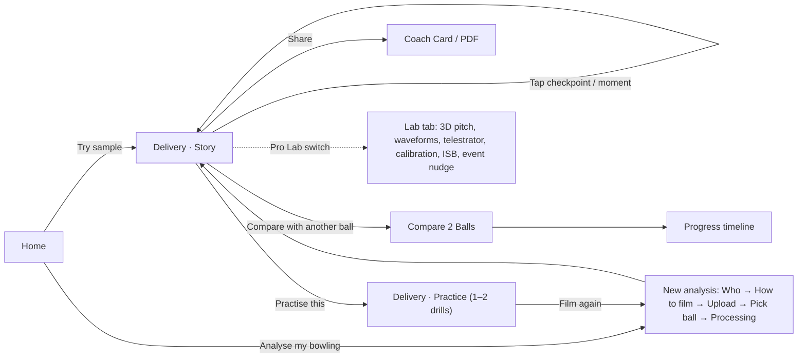

# Studio v4 — UX Blueprint & Frontend↔Backend Contract

Owner: `ux-director` · Status: proposal for `coordinator` + `backend-intel` · Target: React + Tailwind (`web/src`) + FastAPI (`src/bowling_biomech/server`)

> Design north star: a club bowler who has never heard of "FFC" opens the app, and **within 2 clicks** is watching their own (or a sample) delivery with one plain-English takeaway, five body checkpoints they can tap, and a drill to try. Every lab tool from v3 still exists — behind an opt-in **Pro Lab** switch.

Reference patterns borrowed: **Mustard / Ochy** (one hero takeaway + 1–2 drills, never a wall of numbers), **OnForm / SwingVision** (big video, chapter-style key moments, side-by-side compare synced to a moment), **Linear / Vercel** (calm hairline cards, 3 nav items, mono numbers, no shadows/dark mode).

---

## 1. Information Architecture

### 1.1 Top-level nav (3 items + 1 action)

```
[● SportsPostureAnalysis]   Home   Deliveries   Progress            How to film (?)   [ + New analysis ]
```

| Nav | Purpose |
|---|---|
| **Home** | Start hub. First run: "Analyse my bowling" / "Try a sample". Returning: latest delivery card + recent grid. |
| **Deliveries** | Library of every analysed ball (cards: thumbnail, headline, 5 status dots), filter by bowler. Opens the **Delivery** page. |
| **Progress** | Per-bowler checkpoint timeline across deliveries + Compare 2 Balls + workload guidance. |
| `+ New analysis` | Full-page guided upload flow (not a modal). |
| `How to film` | Opens the filming guide as a side sheet (also embedded in step 2 of upload). |

Removed from the top bar: session dropdown, engine/GPU pill, ICC red pill, recompute ms. "Session" becomes an internal grouping (bowler + date); users never manage sessions explicitly. Engine status → a small dot inside the `+ New analysis` flow and a footer line ("Fast GPU analysis ready" / "Demo mode — samples only").

### 1.2 Routes (hash router in `store.ts`, no new dependency)

| Route | View |
|---|---|
| `#/` | `HomeView` |
| `#/deliveries` | `DeliveriesView` |
| `#/d/:id` | `DeliveryView` → tab `Story` (default) |
| `#/d/:id/practice` · `#/d/:id/details` · `#/d/:id/lab` | other tabs (`lab` only when Pro Lab is on) |
| `#/d/:id/card` | `CoachCardView` (print / share) |
| `#/progress?bowler=` | `ProgressView` |
| `#/compare?a=&b=` | `CompareView` |
| `#/new` | `UploadFlowView` |

Pro Lab toggle is persisted in `localStorage("spa.proLab")`.

### 1.3 The 3-second journey

**First-time bowler (no user uploads, `overview.is_first_run = true`) sees:**

```
┌──────────────────────────────────────────────────────────────┐
│  See what your bowling action is really doing.                 │
│  Film one ball on your phone. Get 5 body checkpoints, one      │
│  clear takeaway and a drill — with honest ranges, no guesses.  │
│                                                                │
│  [ Analyse my bowling → ]   [ ▶ Try a sample: Dale Steyn ]     │
│                                                                │
│  ① Film from the side or behind  ② Upload  ③ Understand & practise │
└──────────────────────────────────────────────────────────────┘
  Sample deliveries:  [Steyn — real net video] [240 fps side-on demo] ...
```

One click on **Try a sample** → `#/d/del_real_steyn` Story tab, video auto-plays once at 0.5× and pauses on **Ball release** with the #1 takeaway visible. Total: 1 click to insight.

**Returning user** sees "Your latest ball" hero (thumbnail + headline + top takeaway + `Continue →`) and a "Recent deliveries" grid, plus `Compare last 2 balls` shortcut when ≥2 exist.

### 1.4 Core flow



---

## 2. Screen-by-screen blueprint

### 2.1 Delivery page — Story tab (the heart)

Desktop (≥1280): 12-col grid. Mobile: single column, video sticky at top (≈42vh).

```
Header:  Dale Steyn · Net session · 27 Nov        [Story] [Practice] [Details] (+[Lab])     Pro Lab ◯  ·  Share ⤴
──────────────────────────────────────────────────────────────────────────────────────────────
 LEFT (7 cols)                                      │ RIGHT (5 cols)
 ┌──────────────────────────────────────────────┐   │ Headline (20px, 450):
 │  REAL VIDEO (fills card, aspect-preserved)   │   │ "Your front leg stays firm at release — your
 │  subtle skeleton; active checkpoint joints   │   │  side-bend is the thing to keep an eye on."
 │  drawn in green with angle arc + "171°"      │   │
 │  caption: "Front foot plants — does the knee │   │ (◐ Partial view · Behind the bowler · 30 fps · 9 of 22 checks) ⌄  ← Camera Angle Coach
 │  stay firm?"                                 │   │
 └──────────────────────────────────────────────┘   │ ┌ YOUR #1 TAKEAWAY ───────────────────────┐
  ▶  0.5×  ◯ Skeleton                                │ │ Side-bend at release is borderline      │
 Key Moments (story chips with thumbnails):          │ │ plain explanation (2 lines)             │
 [Back foot lands]→[Front foot plants]→[Arm level]→[Ball release] │ Try: "Chest tall over front knee"  [See the moment] [Practise →] │
                                                     │ └─────────────────────────────────────────┘
                                                     │ Body Checkpoints   [Body map SVG | list of 5]
                                                     │  ● Front-Leg Brace   Strong       171°  161°–180°
                                                     │  ◐ Side-Bend Load    Borderline    38°   30°–46°
                                                     │  ○ Trunk Whip        On Track      41°   33°–49°
                                                     │  ◌ Shoulder Alignment Needs Better Angle  📷
                                                     │  ◌ Run-Up & Stride   Not Visible
                                                     │ Headline stats (only if measured): Release speed 138 km/h (131–145)
 ───────────────────────────────────────────────────────────────────────────────────────────
 About these results (always visible, full text, 12px, #4d4d4d):
  ⓘ Elbow legality (ICC 15° rule) — never judged here. <full body>
  ⓘ Not medical advice — <full body>
```

Interactions:
- **Tap a checkpoint (row or body-map zone)** → video seeks to `checkpoint.frame_idx`, pauses, highlights `highlight_joints` + draws `angle_joints` arc with `value_text`; row expands to show `plain_meaning`, `why_it_matters`, `reference` (research group, with source), `supporting` metrics, or `how_to_unlock` for not-visible.
- **Tap a key moment chip** → seek + pause + caption overlay `plain_tip`; chips light up the checkpoints in `checkpoint_ids`.
- **Camera Angle Coach pill** expands to: mini top-down pitch SVG with a camera icon at `camera_azimuth_deg`, "This angle could see: …", "Couldn't see: … (why)", and `next_clip_tip` with a `How to film` link.
- **Skeleton toggle** default ON (subtle 1.5px white w/ ink outline, 70% opacity). Player shows time only; frame numbers only in Pro Lab.
- Playback default 0.5× for ≥120 fps clips, 1× otherwise; loop between Back foot lands − 0.3 s and Ball release + 0.4 s ("Loop the action" toggle).

### 2.2 Status vocabulary (single source of truth)

| `status` | Label | Visual (text always shown, never color-only) | Derivation (backend, interval-based only) |
|---|---|---|---|
| `strong` | **Strong** | green `#297a3a` filled dot, green label | primary metric is cited in `fact_sheet.strengths` (interval-cleared) |
| `on_track` | **On Track** | ink hollow dot | measured, not suppressed, no cue triggered ("Measured — nothing flagged") |
| `watch` | **Borderline** | ink half-filled dot | metric in `inconclusive_observations` (range straddles threshold) — copy: "The range crosses the line, so we can't call it yet." |
| `focus` | **Needs Focus** | ink filled dot + 500 weight | metric in `fact_sheet.limiters` (interval clears threshold) |
| `not_visible` + `unlock_reason ∈ {angle, frame_rate}` | **Needs Better Angle** | dashed grey dot + camera icon | suppressed because of view/fps |
| `not_visible` + other reasons | **Not Visible** | dashed grey dot | suppressed: out of frame / incomplete / timing / calibration |

Priority when multiple apply: `focus > watch > strong > on_track`. **Never** derived from a point value alone. No red anywhere, no scores, no percentages of "goodness".

Number formatting (backend produces strings so the copilot verifier & UI agree): degrees → integer `171°`; range `161°–180°` (en dash, already clamped to physical bounds); km/h integer; `% of height` integer; metres 2 dp; °/s rounded to 10. Value in Geist Mono 500, range in 12px `#8f8f8f` prefixed with "likely".

### 2.3 Practice tab

- 1–2 `DrillCard`s (only from `corrective_drills` → only exist when an interval-cleared limiter exists). Each: title, "For: Front-Leg Brace" chip, `why_plain`, numbered steps with tick-boxes (local state), one-line `cue` in large type, `caution`, `source` (small), `[See your moment]`.
- If no drills: honest empty state — "Nothing in this clip clearly needs fixing." + borderline items ("Keep an eye on…") + capture tip to unlock more checks. Never invent generic drills.
- Footer CTA: `[ Film another ball → ]` (opens `#/new` with bowler preselected) and `[ Compare with last ball ]`.

### 2.4 Details tab

Plain-language table of **all 22 measurements**, grouped by the 5 checkpoints + "Other": friendly label, value, likely range, how-clear (Clear / Fair / Rough view from observability), status, info-tooltip with definition + literature source. Suppressed rows show reason in plain English. Includes Coach Notes (timestamped, existing API) and the two notices.

### 2.5 Lab tab (Pro Lab ON only)

Hosts v3 components unchanged: `PitchViewport3D`, `WaveformPanel`, `LabTelemetryPanel` (calibration 4-click, pan tracking, ISB markers, fps override), telestrator, event nudge, retrack bowler, frame counter, raw jargon (BFC/FFC/UAH/BR with a glossary tooltip). This is the *only* place acronyms appear.

### 2.6 Compare 2 Balls (`#/compare?a=&b=`)

- Pickers: two delivery cards (default: last two for this bowler).
- Mode switch: **Side by side** (default) | **Overlay** (B's skeleton as dashed ghost on A's video).
- Both videos synced to **Front foot plants**; shared moment chips seek both.
- Table per checkpoint: A status/value/range · B status/value/range · **Change**: `Clearly higher` / `Clearly lower` (only when ranges don't overlap) / `Within measurement noise` / `Can't compare (not visible in one clip)`. Descriptive, not "better/worse".
- Summary sentence from backend, plus caveat when views differ ("Ball A was filmed side-on and Ball B from behind, so only 2 checkpoints can be compared.").

### 2.7 Progress (`#/progress?bowler=`)

- Bowler switcher (chips). Dot-matrix: rows = 5 checkpoints, columns = deliveries by date, each cell the status dot (click → delivery). Under it, small per-checkpoint value chart with range whiskers (only measured points).
- Workload card from `WorkloadGuidance` (ECB 2024 / CA 2026) with the age band; existing workload log API.

### 2.8 Coach Card / PDF (`#/d/:id/card`)

Print-optimized white card (1080×1350 social-share export via `window.print` / CSS page) : bowler, date, headline, 4 key-moment thumbnails, 5 checkpoint rows (status + value + range), #1 takeaway, drills, capture line, and **both notices in full** (non-truncating — card grows, text never clips). Existing 9:16 Reel export remains as a secondary "Export video reel" button.

### 2.9 Guided New Analysis flow (`#/new`, full page stepper)

1. **Who's bowling?** Pick bowler or "New bowler": name, arm (right/left illustrations), age band (needed for workload guidance).
2. **How to film** (skippable, remembered): 3 camera-placement cards with top-down diagrams — *Side-on* (unlocks Front-Leg Brace, Trunk Whip, Stride), *Behind* (unlocks Side-Bend, Shoulder Alignment), *Both phones* (unlocks everything via 3D fusion). Checklist: whole body in frame from run-up to follow-through · phone steady (tripod/fence) · slow-mo 120/240 fps · good light.
3. **Upload**: drag-drop / pick file. If net-session (multi-ball) → auto-clip results as thumbnail grid "We found 6 balls — pick the ones to analyse".
4. **Processing**: friendly staged progress — Finding the bowler → Spotting key moments → Measuring body positions → Writing your story — driven by job status; on failure, plain reason + fix ("We couldn't see the bowler's feet — film a little wider").
5. Lands on Story tab.

If no pose engine is available (`overview.health.can_analyse_new_video = false`), step 3 explains calmly: "Analysing new videos needs the pose engine, which isn't connected. You can explore the samples meanwhile." — no developer terms.

### 2.10 Copy rules (all prose generated by backend; UI adds no numbers)

- Acronym map: BFC → **Back foot lands**, FFC → **Front foot plants**, UAH → **Arm level**, BR → **Ball release**, FT → **Follow-through**.
- Observability → "Clear view" (high) / "Fair view" (moderate) / "Rough view" (low).
- Banned on non-Lab screens: frame numbers, `ms rel FFC`, `σ`, `CI`, `observability`, snake_case, ALL-CAPS eyebrows with underscores, the word "unverified" as a badge.
- ICC notice copy (full, always visible on Story, Details, Compare, Card):
  > **Elbow legality (ICC 15° rule): not assessed — ever.** Judging elbow straightening against the ICC 15° limit requires accredited laboratory testing with high-speed (≥250 Hz) 3D motion capture. Phone or casual multi-camera video cannot measure it reliably, so this app always declines to give a verdict.
- Medical notice copy:
  > **Not medical advice.** These are movement measurements from a single delivery, not an injury diagnosis. Injury risk also depends on workload, age and growth, and physical conditioning. If you have pain or concerns, speak to a qualified physiotherapist or doctor.

### 2.11 Visual system

`#fafafa` canvas · `#ffffff` cards with `1px #ebebeb` hairline, radius 8 · ink `#171717` (primary buttons, text) · secondary text `#4d4d4d` / `#8f8f8f` · single accent `#297a3a` (Strong status, active checkpoint highlight, success) · Geist Sans 400/450/500, Geist Mono for numbers · no shadows, no gradients, no dark mode · motion: 150 ms ease-out on expand/seek highlight only.

---

## 3. JSON contract (backend-intel ↔ frontend)

All prose is deterministic (template-based, from non-suppressed `BiomechanicalFactSheet` keys only), and every number in prose must equal the corresponding `value_text`/`range_text` so `verify_coach_response` passes.

### 3.1 `CoachingStory` — added as `story` to `GET /api/deliveries/{id}` and every recompute/retrack response

```ts
type CheckpointId = "front_leg_brace" | "trunk_whip" | "side_bend" | "shoulder_alignment" | "runup_stride";
type BodyZone = "knee" | "trunk" | "spine" | "shoulders" | "approach";
type CheckpointStatus = "strong" | "on_track" | "watch" | "focus" | "not_visible";
type UnlockReason = "angle" | "frame_rate" | "out_of_frame" | "incomplete_delivery" | "timing_unreliable" | "calibration";
type MomentId = "back_foot_land" | "front_foot_plant" | "arm_horizontal" | "ball_release";

interface CoachingStory {
  schema_version: "coaching_story/1";
  delivery_id: string;
  headline: string;                 // ≤ 120 chars, no jargon, no numbers required
  subhead: string;                  // "Right-arm · Filmed from behind · 30 fps"
  is_complete_delivery: boolean;
  is_sample: boolean;
  sample_kind: "real" | "synthetic" | null;
  capture: CaptureQuality;
  top_takeaway: Takeaway;
  checkpoints: BodyCheckpoint[];    // exactly 5, fixed order as CheckpointId above
  key_moments: KeyMoment[];         // 0–4; [] when incomplete delivery
  headline_stats: HeadlineStat[];   // 0–2: ball_release_speed_kph, release_height_m — only if not suppressed
  drills: DrillCard[];              // 0–2, mapped 1:1 from fact_sheet.corrective_drills
  notices: { icc: Notice; medical: Notice; extra: Notice[] };   // extra: timebase/panning/self-cal caveats in plain English
}

interface CaptureQuality {
  grade: "great" | "partial" | "limited" | "unusable";
  label: string;                    // "Great view" | "Partial view" | "Limited view" | "Couldn't analyse"
  summary: string;                  // 1 sentence: what this clip could & couldn't see
  view: "side_on" | "rear_on" | "front_on" | "oblique" | "unknown";
  view_label: string;               // "Side-on" | "Filmed from behind" | ...
  camera_azimuth_deg: number | null;
  fps: number;
  fps_label: string;                // "240 fps slow-mo" | "30 fps (normal speed)"
  measured_count: number;           // non-suppressed metrics
  total_count: number;              // 22
  can_see: CheckpointId[];
  cannot_see: Array<{ checkpoint_id: CheckpointId; reason: UnlockReason; reason_plain: string }>;
  next_clip_tip: string | null;     // "Add a side-on camera to unlock Front-Leg Brace and Stride."
}

interface Takeaway {
  kind: "focus" | "watch" | "strength" | "capture" | "all_clear";
  title: string;
  plain_explanation: string;
  what_to_try: string;
  checkpoint_id: CheckpointId | null;
  moment_id: MomentId | null;
  frame_idx: number | null;         // analysis index into telemetry arrays
  linked_drill_id: string | null;
}

interface BodyCheckpoint {
  id: CheckpointId;
  body_zone: BodyZone;
  title: string;                    // "Front-Leg Brace"
  moment_id: MomentId | null;
  moment_label: string;             // "At ball release" | "Front foot plants → ball release" | "Back foot → front foot"
  frame_idx: number | null;
  status: CheckpointStatus;
  status_label: "Strong" | "On Track" | "Borderline" | "Needs Focus" | "Needs Better Angle" | "Not Visible";
  unlock_reason: UnlockReason | null;   // set iff status == not_visible
  metric_key: string;               // primary key in fact_sheet.metrics
  value: number | null; ci_low: number | null; ci_high: number | null;
  unit: string;
  view_clarity: "clear" | "fair" | "rough" | null;   // from observability high/moderate/low
  value_text: string | null;        // "171°"
  range_text: string | null;        // "161°–180°"
  reference: { text: string; source: string; definition_match: string } | null;  // ONLY from definition-matched cohort_comparisons
  plain_meaning: string;
  why_it_matters: string;
  how_to_unlock: string | null;
  highlight_joints: string[];       // names from telemetry.joint_names, arm/leg side resolved for bowling arm
  angle_joints: [string, string, string] | null;   // [a, vertex, b] for arc overlay
  supporting: Array<{ metric_key: string; label_plain: string; value_text: string | null; range_text: string | null; suppressed: boolean }>;
}

interface KeyMoment {
  id: MomentId;
  label: string;                    // "Back foot lands"
  frame_idx: number;                // analysis index
  source_frame_idx: number;
  time_s: number;
  timing_uncertainty_ms: number;
  plain_tip: string;                // caption overlay
  what_to_look_for: string;
  checkpoint_ids: CheckpointId[];
  thumbnail_url: string | null;     // /api/deliveries/{id}/frame/{frame_idx}.jpg
}

interface HeadlineStat { metric_key: string; label: string; value_text: string; range_text: string; view_clarity: string }
interface DrillCard { id: string; title: string; for_checkpoint_id: CheckpointId | null; why_plain: string; cue: string; steps: string[]; caution: string; source: string; moment_id: MomentId | null; frame_idx: number | null }
interface Notice { id: string; title: string; body: string }   // body is the full text; UI never truncates
```

Checkpoint → metric mapping (primary first):

| Checkpoint | Zone | Primary | Supporting | Moment |
|---|---|---|---|---|
| Front-Leg Brace | knee | `front_knee_br_deg` | `front_knee_ffc_deg`, `front_knee_change_deg` | ball_release |
| Trunk Whip | trunk | `trunk_flexion_delta_deg` | `trunk_flexion_br_deg` | front_foot_plant → ball_release (frame = BR) |
| Side-Bend Load | spine | `thorax_lat_flex_br_deg` | `pelvic_drop_ffc_deg` | ball_release |
| Shoulder Alignment | shoulders | `shoulder_counter_rotation_deg` | `shoulder_alignment_bfc_deg`, `pelvis_alignment_bfc_deg`, `hip_shoulder_sep_bfc_deg`, `max_hip_shoulder_sep_deg` | back_foot_land |
| Run-Up & Stride | approach | `stride_length_pct_stature` | `runup_speed_mps` | front_foot_plant |

Takeaway priority: first `focus` checkpoint (with linked drill) → first `watch` → `capture` (if `measured_count/total_count < 0.4` or any checkpoint `not_visible` by angle and nothing else to say) → first `strong` → `all_clear`. Action-type wording ("mixed action") only when `action_class` is not gated to UNKNOWN. ICC metric never appears in checkpoints.

### 3.2 `GET /api/overview` (one call powers Home + Deliveries)

```ts
interface OverviewResponse {
  is_first_run: boolean;            // no user-uploaded deliveries yet
  health: { pose_engine: string; engine_label: string; can_analyse_new_video: boolean; reason_plain: string | null };
  bowlers: Array<{ id: string; name: string; bowling_arm: "right" | "left"; age_band: string; delivery_count: number; last_delivery_at: string | null }>;
  samples: Array<{ delivery_id: string; title: string; subtitle: string; kind: "real" | "synthetic"; thumbnail_url: string | null; capture_grade: CaptureQuality["grade"] }>;
  recent_deliveries: DeliveryCard[];   // newest first, ≤ 24
}
interface DeliveryCard {
  id: string; session_id: string; bowler_id: string; bowler_name: string;
  label: string; created_at: string; thumbnail_url: string | null;
  kind: "upload" | "sample_real" | "sample_demo" | "fused_3d";
  headline: string; top_takeaway_title: string;
  capture_grade: CaptureQuality["grade"]; view_label: string;
  checkpoint_statuses: Record<CheckpointId, CheckpointStatus>;
}
```

### 3.3 Other endpoints

| Method & path | Body / response |
|---|---|
| `PATCH /api/deliveries/{id}` | `{label?: string}` → `DeliveryCard` |
| `GET /api/deliveries/{id}/frame/{frame_idx}.jpg?w=480` | JPEG from proxy (analysis index → source frame), cached |
| `GET /api/compare?a=&b=` | `CompareStory` (below) |
| `GET /api/bowlers/{id}/progress` | `{bowler, deliveries:[{id,label,created_at,thumbnail_url}], series:[{checkpoint_id,title,points:[{delivery_id,status,value,ci_low,ci_high,value_text,range_text}]}], workload: WorkloadGuidance \| null, summary_plain}` |
| `POST /api/sessions/{sid}/deliveries/upload` (+ `from-scan`) | additionally returns `job_id` |
| `GET /api/jobs/{job_id}` | `{status:"queued"\|"running"\|"done"\|"failed", stage:"finding_bowler"\|"spotting_moments"\|"measuring"\|"writing_story", progress:0..1, message_plain, delivery_id \| null, error_plain \| null}` (nice-to-have; UI falls back to indeterminate stages) |
| `POST /api/bowlers` *(optional)* | create bowler without exposing sessions; server auto-creates a dated session per upload day |

```ts
interface CompareStory {
  a: DeliveryCard; b: DeliveryCard;
  sync_moment: "front_foot_plant";
  sync_frames: { a: number | null; b: number | null };
  comparable: boolean;
  summary: string;
  caveat_plain: string | null;      // differing views / fps / one incomplete
  rows: Array<{
    checkpoint_id: CheckpointId; title: string;
    a: { status: CheckpointStatus; value_text: string | null; range_text: string | null };
    b: { status: CheckpointStatus; value_text: string | null; range_text: string | null };
    difference: "clearly_higher" | "clearly_lower" | "within_noise" | "not_comparable";  // clearly_* only if intervals don't overlap
    difference_plain: string;
  }>;
}
```

---

### 3.4 Agreed refinements (backend-intel #34, frozen)

- `CaptureQuality.view` adds `"dual_fused"` (`view_label: "Dual-camera 3D"`).
- Checkpoint `shoulder_alignment` displays `title: "Action Alignment"`. `trunk_whip.supporting` includes `delayed_arm_ffc_deg`. `runup_stride` falls back to `runup_speed_mps` as `metric_key` when stride is suppressed (stride listed in `supporting` with `suppressed: true`).
- `CoachingStory.detail_rows: StoryMetricRow[]` — `{metric_key, group: CheckpointId | "other", label_plain, value_text, range_text, view_clarity, status, suppressed, suppression_plain, plain_note, definition_note, literature_source}` for all 22 metrics (Details tab).
- `CoachingStory.action_style: {code, label, plain_summary} | null` — `null` whenever `action_class` is gated to UNKNOWN; descriptive wording only.
- GPU auto-detection only when explicitly configured (`GPU_WORKER_URL` or documented opt-in), never silent port scanning.

## 4. Frontend build plan (file ownership)

| File | Notes |
|---|---|
| `web/src/store.ts` | add `route` + `navigate()`, `proLab` (localStorage) |
| `web/src/types.ts` | add §3 types; `DeliveryDetailResponse.story` |
| `web/src/api.ts` | `overview`, `compare`, `progress`, `patchDelivery`, `job`, `frameUrl` |
| `web/src/App.tsx` | shell + router only |
| `components/TopNav.tsx` | rewrite to §1.1 |
| `views/HomeView.tsx`, `DeliveriesView.tsx`, `DeliveryView.tsx`, `CompareView.tsx`, `ProgressView.tsx`, `CoachCardView.tsx`, `UploadFlowView.tsx` | new |
| `components/story/StoryPlayer.tsx` | wraps/extends `VideoCanvasPlayer` with `simple` mode (no frame counter, highlight joints + angle arc, caption overlay) |
| `components/story/{MomentsScrubber,BodyMap,CheckpointList,TakeawayCard,CameraCoachPill,StatusBadge,NoticeFooter,DrillCard}.tsx` | new |
| `components/LabTab.tsx` | hosts unchanged v3 lab components |

Acceptance checks: (1) first-run user reaches a takeaway in ≤2 clicks; (2) zero acronyms/frame numbers outside Lab (grep-able copy); (3) both notices fully visible on Story, Details, Compare, Card at 375 px width; (4) every displayed number has its range; (5) no status derived client-side — UI renders `story` only; (6) all v3 tools reachable via Pro Lab; (7) `npm run build` 0 errors, 0 console errors.
