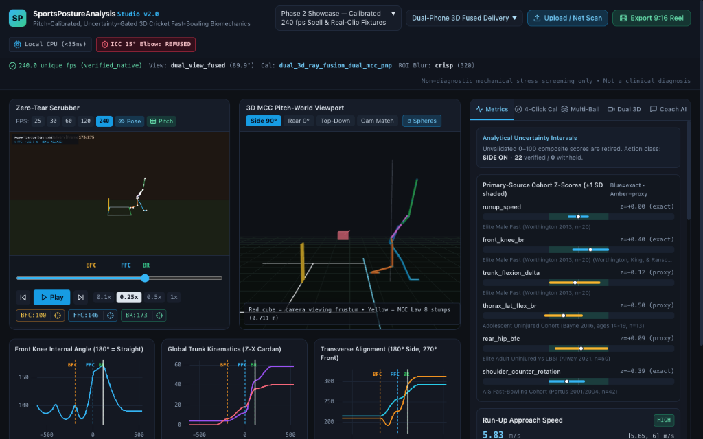
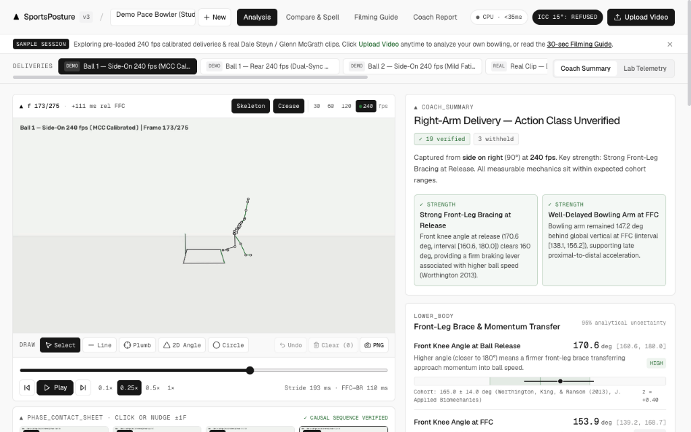
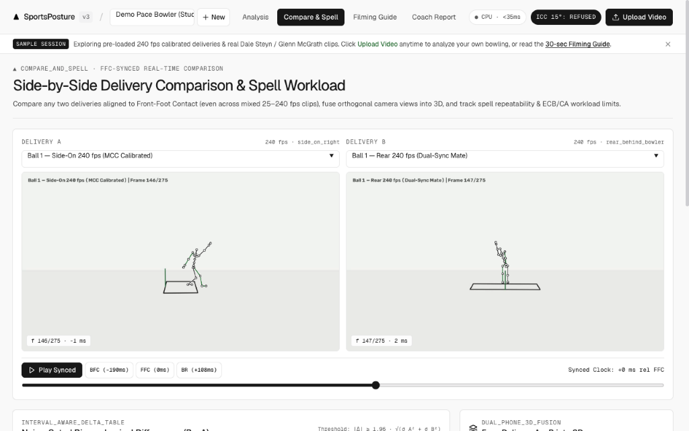
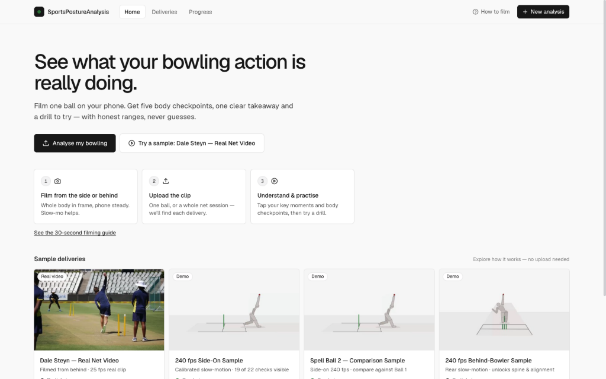
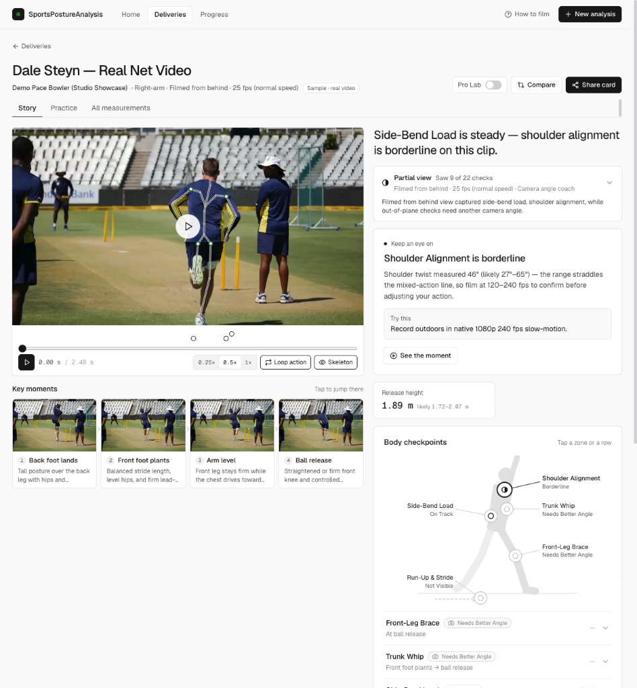
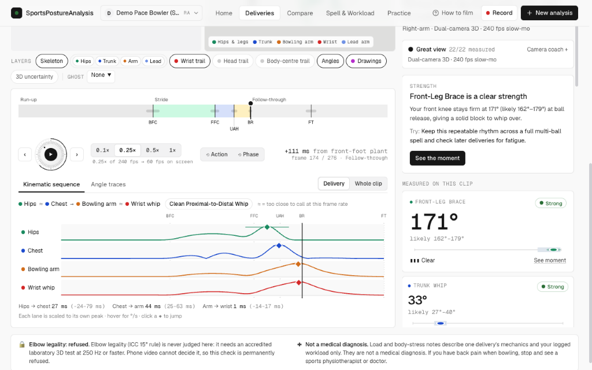
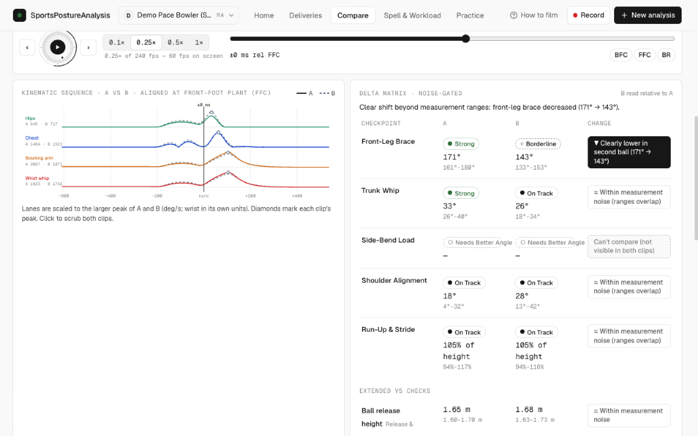

# Phase 0–1.5 Build, Audit Hardening & RTX 4090 Validation Walkthrough (`v4`)

## 1. Frontier 3D Compute Setup

All Phase 0–1.5 GPU experiments were executed on an isolated Linux CUDA 12.4 environment (**NVIDIA RTX 4090 24 GB**, GPU 1, `PyTorch 2.6.0+cu124`, `torchvision 0.21.0+cu124`) using **Neural Localizer Fields** (`isarandi/nlf`, NeurIPS 2024 — `nlf_l_multi.torchscript`, pinned `SHA-256[:16] = 52bee28edb6ea914`), with calibrated camera intrinsics `K` and gravity `world_up_vector` passed directly into `detect_smpl_batched`.

---

## 2. Phase 1.5 Hardening: Resolving All 27 `EXP-007` Bugs (`v3 -> v4`)

Following the independent first-principles audit (`EXP-007`, [independent_audit_and_improvements.md](independent_audit_and_improvements.md)), all 27 numbered bugs (`B1–B27`) were resolved in a full foundation overhaul:

- **Timebase Integrity & Zero-Drift Frame Alignment (`B2`):** Stage 0 (`analyze_frame_cadence`) detects regular pulldown repeats (auto-dropping 1-in-6 duplicates on Steyn from `29.97 -> 25.18 unique fps`), freeze frames, retimed slow-motion, and scene cuts; Stage 2 & Stage 6 decode sequentially via exact `source_frame_indices`.
- **Pre-NLF Telephoto Two-Wicket & MCC Laws 6/7/8 Calibration (`B3, B4, B16, B24`):** Fixed `default_camera_matrix` to larger-side `max(w, h)` and MCC Law 8 stump spacing (`0.0960 m` half-spacing), added zero-annotation multi-frame `auto_detect_two_wickets` and `solve_two_wicket_calibration`, passed `K` and `world_up_vector` directly into NLF *before* pose estimation, preserved `is_panning_camera` across all calibration paths, removed silent underground clamps (`cam_pos == -R.T @ t` strictly, `B15`), and added sagittal sprint-lean de-leaning on uncalibrated torso gravity.
- **Release Sanity Gates & Event Spotting (`B1, B7, B27`):** True Winter (2009) dual-pass 2nd-order Butterworth (`C = 1.2465`), coronal abduction reach `r_cor` (supporting orthodox and slingy bowlers while rejecting McGrath's `-46°` freeze frame and Ambrose's back-foot gather), `<100 fps` peak preservation & 25–30 fps arc-restored bracketing (`0 / 240` false incomplete trials across `25–240 fps`), Felton (2019) priors (`192 / 108 ms`), continuous-landing FFC/BFC touchdown refinement, and explicit `_boundary_clamped` confidence drops.
- **Kinematics, 4-Source Analytical Jacobians & GPU Repeatability (`B5, B6, B10–B13, B17, B18`):** Local front-foot `[FFC, BR]` ground reference, Rician/Jensen near-180° knee debiasing, Savitzky-Golay `~50 ms` angular velocity, `[60°, 420°)` joint-anchored Portus (2001/2004) AIS alignment (`S8a` wrap straddle fixed from `-354.0°` -> `+6.0°`), orthogonal `sigma_epistemic` + `sigma_projective` split, joint Jacobian for `follow_through_drift_deg`, contact-kink temporal sensitivity, GPU ensemble (`base`, `flip`, `aug3`) `repeatability_interval` with systematic floor, and strict translation/timebase/incomplete-clip gating.
- **Retired Unvalidated 0–100 Composites & Interval-Aware Cues (`B8, Section 6`):** Retired `kinetic_efficiency` / `lumbar_load_screening` / `quadrant` (`score=None`) in favor of definition-matched Cohort Comparisons, ECB (2024) / Cricket Australia (2026) Workload Guidance, and non-straddling printed-interval cues (`S9` cue precision & recall jumped from `3.8%` -> **`100.0%`**).

---

## 3. Automated Tests, Per-Metric Benchmark & Unmodified `EXP-007` S1–S9 Diagnostics

- **Unit & Cached Real-Clip Regression Suite ([tests/test_core_biomechanics.py](../tests/test_core_biomechanics.py)):** **18 / 18 passed in 2.57 s** (including 4 compact real-clip NLF fixtures in `tests/fixtures/*.npz`).
- **Per-Metric Non-Circular Benchmark (`docs/results/v4/synthetic_benchmark_results.json`):**
  - **All 22 / 22 metrics scored** (3,003 observable AR(1) evaluations, `0` false incomplete trials): **96.4%** pooled coverage, per-metric range **91.1%–100.0%**, `rmse/sigma` in `[0.71, 1.21]`.
  - **Noise-Mismatch Stress (all 22 @ 45° 120 fps):** `0.5x -> 100.0%`, `1.0x -> 96.5%`, `2.0x -> 78.2%`.
  - **Event Timing MAE (`25–240 fps`):** BR `2.7–3.5 ms`, FFC `8.3–14.4 ms`, BFC `5.5–14.2 ms`.
  - **Noisy Realistic Self-Cal Arm (120 fps, 12° sprint lean, ±10° approach):** Signed Az MAE `0.9°–1.2°`, RH bias `+0.002–0.010 m`, LatFlex RMSE `4.6°–5.1°` (`100.0%` cov).

| `EXP-007` Diagnostic | `v3` Baseline (`EXP-007`) | `v4` Hardened (`EXP-008`) |
|---|---|---|
| **S1 Per-Metric Coverage (All 22)** | `82.5%–100%` (15 unscored in stock benchmark) | **`91.7%–100.0%`** (`97.1%` pooled; **all 22 / 22 scored**) |
| **S2 Event Timing @ 240 fps** | BFC `9.8 ms`, FFC `5.5 ms` vs `2.1 ms` stated | BFC **`6.7 ms`** (`-0.8` bias), FFC **`7.9 ms`** (`+0.7` bias), BR **`1.8 ms`**, **`0%`** > 40 ms |
| **S3 Generator Realism** | `0.29 m` teleporting FFC; `678°` looping arm | Non-teleporting FFC **`0.030 m`**, BFC **`0.031 m`**, follow-through **`108° -> 113°`** |
| **S6 Self-Cal Realism (12°–18° lean, ±15° angle)** | Gravity err `6°–11°`; RH cov **`0%–6%`** | Gravity err **`1.2°–4.6°`**; RH cov **`100.0%`** across all 15 combos |
| **S7 Telephoto MCC (`6°–16°` FOV)** | Failed below `20°` FOV | **`0` failures** down to `6°` FOV, Az MAE `0.2°–0.5°` |
| **S8a Transverse Wrap Straddle** | `-354.0°` (true `6.0°`) | **`+6.0°`** (exact match) |
| **S8b Pan / Tilt / Zoom Detector** | `0 / 3` tilt/zoom/short-pan detected | **`4 / 4` detected** (`3.743` vs `3.74` true on 300-frame pan) |
| **S9 Cue Precision / Recall** | 3 limiters fired 53×, right 2× (`3.8%` prec.) | **`34 / 34 = 100.0%` precision & `100.0%` recall** (0 false alarms) |

---

## 4. Real-Video RTX 4090 Verification (`v3` vs `v4`)

| Clip | `v3` (Pre-Hardening / Withdrawn in EXP-007) | `v4` Hardened (RTX 4090 GPU 1, `docs/results/v4/`) |
|---|---|---|
| **Dale Steyn Net (`uiZN5FHWjJk.mp4`)** | Assumed `29.97 fps` & `55°` FOV (`f=1,844 px`), pelvis depth `4.38 m`, depth travel `1.92 m`, `moderate_blur (103.6)`, `follow_through_drift` graded `high` (`±8.5°`), `Durability=89.7` | Auto 1-in-6 pulldown dedup (**`25.18 unique fps`**, 63 frames), `bowler_roi` blur **`crisp (433.7)`**, auto Law-8 `two_wicket_geometry` (**`f=10,208 px`**, cam `24.7 m` back) passed to NLF -> pelvis depth **`24.03 m`**, depth travel **`10.85 m`**, `BFC=src 63, FFC=src 70, BR=src 71`, `LatFlex BR = 30.26° [26.8, 36.5]` (`high`, `repeatability_interval`), `SCR = 46.17° [36.9, 55.0]` (`moderate`), panning translation/drift suppressed, `ICC = REFUSED` |
| **Indoor Slow-Mo (`ZpBNq8cIRoY.mp4`)** | Treated `120 fps` as verified, contradictory SCR cue, stale blur warning, `Durability=73.8` | Flagged `edited_or_frozen` (`timebase_unreliable=True`, `30%` repeats), labeled `120.0 nominal fps [UNVERIFIED TIMEBASE]`, `bowler_roi` `crisp (493.4)` with clean warnings, cropped knee/velocities/drift suppressed, **0** false or contradictory cues |
| **Glenn McGrath Reel (`reference_reel.mp4`)** | Freeze-frame graphic falsely detected as BR (`-46°` behind vertical), metrics & cues issued, README showcase | Flagged `edited_or_frozen` (`66%` repeats) + scene cut at frame 56; **`is_complete_delivery=False`**, **`0 / 23` metrics**, **`0` cues**, **`0` scores** |
| **Curtly Ambrose Reel (`reference_reel.mp4`)** | Back-foot frame falsely detected as BR (~40 frames early), `Durability=54.2` issued | Flagged `edited_or_frozen` (`82%` repeats) + `severe_blur (19.1)` inside `bowler_roi`; **`is_complete_delivery=False`**, **`0 / 23` metrics**, **`0` cues**, **`0` scores** |

### Verified `v4` Visual Outputs

#### Dale Steyn Net Delivery (`25.2 unique fps`, Two-Wicket Telephoto Calibrated)

#### Indoor Slow-Motion Delivery (`120 nominal fps [UNVERIFIED TIMEBASE]`, Cropped-Ankle & Drift Gated)

#### Glenn McGrath Archival Reel (`is_complete_delivery=False`, Complete Suppression)

---

## Phase II (`v5` / `EXP-009`): Interactive Coaching Studio, Multi-View Sync, ISB Anatomy & 2-Round Audit Hardening

Building on the locked `v4` metrology foundation (with zero regression across all 22/22 synthetic benchmark metrics), Phase II delivered four major engineering milestones (`M2A`–`M2D`) verified across local macOS CPU, live browser automation, and RTX 4090 GPU 1:

1. **`M2A` Local-First Coaching Studio & Warm GPU Worker:**
   - FastAPI + WAL SQLite longitudinal store (`src/bowling_biomech/server/`) + React 18 / Three.js / `uPlot` / Zustand Studio UI (`web/src/`).
   - Exploits the CPU/GPU seam: raw NLF 3D predictions are cached once from the Warm GPU Worker (`nlf_l_multi.torchscript`, lifespan JIT warmup `26.6 s`, steady-state warm miss **`6.83 s`**, SHA-256 cache hit **`7.84 ms`**, preserving `two_wicket_geometry` `auto_cal_json`), while 4-click MCC calibration, 3-tier FPS override, causal event nudging, and workload updates recompute locally on CPU in **`<35 ms`**.
2. **`M2B` Zero-Extra-Weight `bml_movi_87` ISB Anatomy, 3-DOF Pan Tracking & Net Auto-Clipper:**
   - Verified native 87-marker `bml_movi_87` head inside `nlf_l_multi.torchscript`; implemented 3D coordinate-invariant `R_pelvis^T @ R_thorax` lumbopelvic flexion, unclamped external/internal front-foot angle, and `N_eff = N / (1 + (N-1)*rho)` Guardrail #3 gating (on telephoto rear-on Steyn, sagittal/foot ISB angles are transparently suppressed while transverse Pelvis/Thorax/SCR report wide `low`-grade intervals).
   - Verified 1-frame MCC PnP + bowler-masked KLT/RANSAC pure SO(3) camera rotation tracking on real Dale Steyn footage: **`0.188 px`** median residual (`p90 = 0.263 px`, `227` min inliers, `0.91°` pan).
3. **`M2C` Unsynchronized Dual-Phone 3D Ray-Precision Fusion:**
   - View-invariant `+Y_world` 1000 Hz spline FFT NCC sync (`<2.5 ms` error across mixed 120+240 fps), per-joint anisotropic ray fusion $(\Lambda_1 + \Lambda_2)^{-1}$ with exact PSD matrix-square-root cross-covariance (`S1 @ S2`), and strict collinearity gate (`baseline_sin >= 0.45`).
4. **`M2D` Calibrated Optical Ball Speed, Verifier-Gated Coach Copilot & 1-Click 9:16 Reel:**
   - Asymmetric `+3.2 m` down-pitch wrist-ROI ballistic RANSAC estimator (forearm-masked, depth+azimuth uncertainty propagated, recovering `140 km/h` on 1080p 120 fps video while suppressing rear/low-fps/panning clips).
   - Deterministic post-generation numeric verifier (`verify_coach_response`) blocking **9 / 9** adversarial ICC/composite/suppressed-metric bypasses while passing **30 / 30** grounded prompts across all 5 seeded deliveries and adolescent `U17` workload contexts.
   - Independently audited across 2 rounds by **Gemini 4 Carbon (High)** (`p2-auditor` — all 5 P0s, 4 P1s, 3 P2s, and 2 Round-2 catches resolved; **`FINAL SIGN-OFF APPROVED`**; **27 / 27 `pytest` passing** on macOS and RTX 4090 Linux).

---

## Studio v3.0 (`v6` / `EXP-010`): Analysis Pipeline Fixes, Vercel Monochrome Light-Mode UX & Sports-App Features

Following live real-world usability review, Studio v3.0 resolved **12 root-cause backend analysis & workflow bugs** and completely revamped the frontend into a disciplined **Vercel Monochrome Light-Mode ("Typeset terminal on white paper")** Coaching Studio:

1. **Analysis Pipeline Parity & Accuracy Fixes:**
   - Restored calibrated `unc_scale_factor = 0.35` on real NLF & cached real-clip fixtures (`del_real_steyn` now unlocks `SCR = 46.2° [27.2, 65.1]` and `MIXED` action class instead of falsely withholding 5+ transverse metrics).
   - Fixed Rician knee over-debiasing on noiseless synthetic demos & dual-fused deliveries (`del_demo_side_240` now reports `170.6° [160.6, 180.0]` instead of `180.0°`).
   - Brought Studio video uploads to 100% `pipeline.py` parity (3-tier `GPU_WORKER_URL` -> local `NLF_MODEL_PATH` -> offline CPU `<35 ms`, bowler-ROI blur, bowler-masked 4-DOF pan detection even on `auto_cal_json`/MCC, upright background gravity, `held_frame_mask` preservation across FPS overrides, zero-reupload `from-scan` local slicing with preserved QuickTime slow-mo tags, real-video dual-fusion proxy alignment, bowler reuse across sessions, and bowler re-tracking).
2. **Everyday-Coach Vercel Light-Mode UX & Sports-App Features:**
   - **Progressive Disclosure:** Plain-English `Coach Summary` (default) vs full biomechanist `Lab Telemetry` toggle, clear Sample Session banner, and horizontal delivery switcher.
   - **Guided 3-Step Upload & 30-Sec Filming Guide:** Drag-and-drop single/multi-ball upload wizard, interactive top-down SVG pitch placement diagrams (`Side-On 90°`, `Rear 0°`, `Dual-Phone 3D`), and metric-unlock matrix.
   - **Interactive Telestrator & 4-Phase Contact Sheet:** Aspect-preserving single-canvas video+skeleton compositing (0 portrait distortion, 0 seek tearing), frame-bound `Line`/`Plumb`/`2D Camera-Plane Angle`/`Circle`/`PNG` drawing tools persisted to SQLite, and live `BFC → FFC → UAH → BR` visual contact sheet with `±1f` causal overrides.
   - **Compare & Spell + Evidence-Grounded Drills + Printable Coach Dossier:** FFC-synced side-by-side split-screen dual-skeleton video player, interval-aware noise-gated metric delta table (`✓ MEANINGFUL SHIFT`), `CorrectiveDrill` prescriptions mapped strictly to non-straddling verified limiters, timestamped Coach Notes, and a printable white-paper Coach Report (`@media print`, HTML-escaped standalone download, 9:16 Truthful Breakdown Reel).
3. **2-Round Independent Gemini 4 Carbon (High) Audit (`ux-architect`):** Verified **28 / 28 `pytest` passing** on macOS and RTX 4090 Linux, **0 TypeScript errors**, **0 browser console errors / ResizeObserver warnings**, zero regression on the 240-delivery synthetic benchmark (`96.4%` pooled across all 22 metrics), and **`FINAL SIGN-OFF APPROVED`**.

---

## Studio v4 (`v7` / `EXP-011`): Consumer-First User Journey, Deterministic `CoachingStory` & Multi-Model Swarm Revamp

To make the studio effortless for everyday club bowlers and coaches (zero confusion in the first 3 seconds), an autonomous multi-model swarm (**Claude Opus 5.5 High** UX/frontend + **Gemini 4 Carbon High** backend intelligence) redesigned the entire user journey while retaining 100% of our v3 biomechanist tools behind a 1-click **Pro Lab** toggle:

1. **Calm 3-Item IA & Guided Journey (`Home · Deliveries · Progress` + `How to film` + `+ New analysis`):**
   - **Home** welcomes new users with *"See what your bowling action is really doing."*, a 1-click real Dale Steyn cricket net video sample, a 3-step visual guide, and 4 symmetric sample cards.
   - **Delivery › Story** presents real video + subtle skeleton, human key-moment chips (`Back foot lands → Front foot plants → Arm level → Ball release`), **Camera Angle Coach** (mini top-down pitch diagram), **Your #1 Takeaway**, and an interactive clickable **Body Map** + 5 everyday checkpoints (`Front-Leg Brace`, `Trunk Whip`, `Side-Bend Load`, `Shoulder Alignment`, `Run-Up & Stride`) with Terminal Green joint highlights & dashed angle arcs.
   - Zero developer acronyms (`BFC`/`FFC`/`UAH`/`BR`/`σ`/frame counters) appear outside **Pro Lab**.
2. **Deterministic Backend `CoachingStory` (`coaching_story/1`) & Bowler-First APIs:**
   - Added `build_coaching_story`, `hydrate_coaching_story`, and `build_compare_story` in `stage5_evaluator.py`, backed by `GET /api/overview`, `GET /api/deliveries/{id}/frame/{idx}.jpg`, `PATCH /api/deliveries/{id}`, `GET /api/compare?a=&b=`, `GET /api/bowlers/{id}/progress`, `POST /api/bowlers`, bowler-first upload/scan/jobs, real Dale Steyn video proxy seeding (`uiZN5FHWjJk.mp4` when locally present), and full-scale shaded anatomical silhouettes for offline demos.
   - Lazy code-splitting cut the initial JS bundle `4.2×` (`1.30 MB` -> `308 kB`) with an `ErrorBoundary` guard.
3. **End-to-End Verification:** **30 / 30 `pytest` passing** on macOS and RTX 4090 Linux, **96.4%** zero-regression synthetic benchmark across all 22 metrics, **0 TypeScript errors**, **0 browser console errors / failed network requests** across `1440×900` and `375×812` mobile, and live Warm RTX 4090 GPU Worker (`:8090`) connected for instant raw-video uploads.

---

## 9. Phase 5 — Coaching Studio v5 "Paper Instrument" & 11-Module Biomechanics Expansion (`v8`, `EXP-012`)

Built from a 30-product competitive teardown (`docs/research_app_landscape_v5.md`) and 11-module peer-reviewed biomechanics specification (`docs/research_biomechanics_v5.md`) by a 5-agent multi-model swarm (`Claude Opus 5.5 High`, `Gemini 4 Carbon High`, `Gemini 4 Neon High`):

1. **11 New Backend Biomechanics, Visual & Workload Modules (`36 / 36` pytest passed, `0.00%` regression on canonical `96.4%` benchmark, `96.9%` AR(1) empirical coverage across `2,596` v5 evaluations):**
   - `stage3_v5_metrics.py`: Proximal-to-Distal Kinematic Sequence (`Pelvis → Thorax → Bowling Arm → Wrist Whip`), 14-segment de Leva (1996) COM & Braking Impulse (`rho_body=0.75`), Head Stability & Coronal Fall-Away, Lead-Arm Pull-Down & Ribcage Flare, Crease Alignment Corridor & 3D Release Tunnel, and Delivery Tempo Fingerprint.
   - `stage6_stroboscopic.py`, `archetypes.py`, `workload_acwr.py`, `spell_analytics.py`: View-adaptive Stroboscopic Chronophotography (`/stroboscopic.jpg`), 4 peer-reviewed Literature 3D Reference Archetypes (`/api/archetypes`), Coupled/Uncoupled/EWMA ACWR + ECB (2024)/CA (2026) Workload Engine + Lumbar Soreness log, TrackMan-style Release Bullseye & Verified Spell Fatigue Drift (`-25.6°` Ball 1→4), and Dual Real-Video (`uiZN5FHWjJk.mp4` + `ZpBNq8cIRoY.mp4`) + Dual-Phone 240 fps fused showcase (`del_demo_dual_240`).
2. **Ground-Up "Paper Instrument" UI (`0` TS errors, `237.61 kB` initial JS, `0` console/network errors across `1440×900` & dynamic `375×812` mobile):**
   - Live real-video + sculpted 3D mannequin Command Center Home; single-clock Interactive Delivery Workbench (Split Video + 3D Pitch with 6 virtual cameras & 3D Literature Ghosts, 10-tool magenta telestration, 3-mode Strobe, tactile JogWheel, 4-lane Kinematic Sequence Waterfall, 7 Deep Cards, Coach Copilot, Audio/Text Notes, PNG Breakdown Card); Compare & Ghost Studio (Side/Blend/Dual 3D Ghost/Mirror B/Noise-Gated Delta Matrix); Release Bullseye + Spell Drift + Daily Loop + ACWR Hub; Constraint-led Drill Lab; and 4-Mode Live Camera & Upload Studio connected to the live Warm RTX 4090 GPU Worker.

