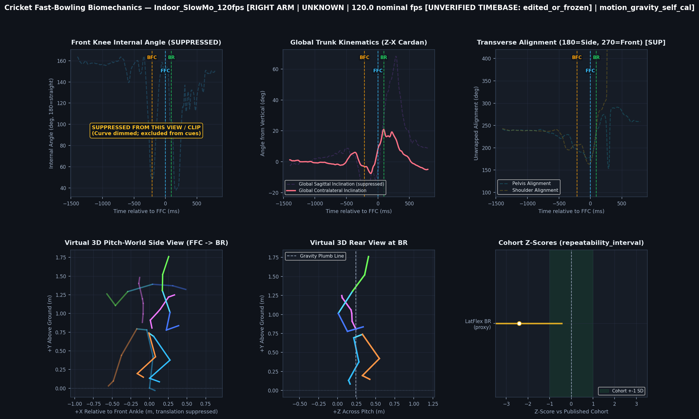
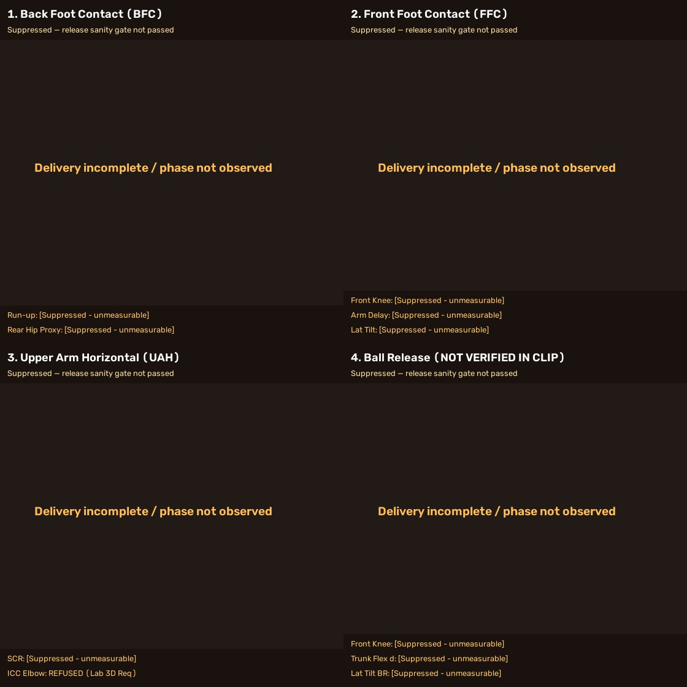

# Phase 0–1.5 Build, Audit Hardening & RTX 4090 Validation Walkthrough (`v4`)

## 1. Frontier 3D Compute Setup

All Phase 0–1.5 GPU experiments were executed on an isolated Linux CUDA 12.4 environment (**NVIDIA RTX 4090 24 GB**, GPU 1, `PyTorch 2.6.0+cu124`, `torchvision 0.21.0+cu124`) using **Neural Localizer Fields** (`isarandi/nlf`, NeurIPS 2024 — `nlf_l_multi.torchscript`, pinned `SHA-256[:16] = 52bee28edb6ea914`), with calibrated camera intrinsics `K` and gravity `world_up_vector` passed directly into `detect_smpl_batched`.

---

## 2. Phase 1.5 Hardening: Resolving All 27 `EXP-007` Bugs (`v3 -> v4`)

Following the independent first-principles audit (`EXP-007`, [independent_audit_and_improvements.md](independent_audit_and_improvements.md)), all 27 numbered bugs (`B1–B27`) were resolved in a full foundation overhaul:

- **Timebase Integrity & Zero-Drift Frame Alignment (`B2`):** Stage 0 (`analyze_frame_cadence`) detects regular pulldown repeats (auto-dropping 1-in-6 duplicates on Steyn from `29.97 -> 25.18 unique fps`), freeze frames, retimed slow-motion, and scene cuts; Stage 2 & Stage 6 decode sequentially via exact `source_frame_indices`.
- **Pre-NLF Telephoto Two-Wicket & MCC Laws 6/7/8 Calibration (`B3, B4, B16, B24`):** Fixed `default_camera_matrix` to larger-side `max(w, h)` and MCC Law 8 stump spacing (`0.0960 m` half-spacing), added zero-annotation multi-frame `auto_detect_two_wickets` and `solve_two_wicket_calibration`, passed `K` and `world_up_vector` directly into NLF *before* pose estimation, preserved `is_panning_camera` across all calibration paths, removed silent underground clamps (`cam_pos == -R.T @ t` strictly, `B15`), and added sagittal sprint-lean de-leaning on uncalibrated torso gravity.
- **Release Sanity Gates & Event Spotting (`B1, B7, B27`):** True Winter (2009) dual-pass 2nd-order Butterworth (`C = 1.2465`), coronal abduction reach `r_cor` (supporting orthodox and slingy bowlers while rejecting McGrath's `-46°` freeze frame and Ambrose's back-foot gather), `<100 fps` peak preservation & 25–30 fps arc-restored bracketing (`0 / 240` false incomplete trials across `25–240 fps`), Felton (2019) priors (`192 / 108 ms`), continuous-landing FFC/BFC touchdown refinement, and explicit `_boundary_clamped` confidence drops.
- **Kinematics, 4-Source Analytical Jacobians & GPU Repeatability (`B5, B6, B10–B13, B17, B18`):** Local front-foot `[FFC, BR]` ground reference, Rician/Jensen near-180° knee debiasing, Savitzky-Golay `~50 ms` angular velocity, `[60°, 420°)` joint-anchored Portus (2001/2004) AIS alignment (`S8a` wrap straddle fixed from `-354.0°` -> `+6.0°`), orthogonal `sigma_epistemic` + `sigma_projective` split, joint Jacobian for `follow_through_drift_deg`, contact-kink temporal sensitivity, GPU ensemble (`base`, `flip`, `aug3`) `repeatability_interval` with systematic floor, and strict translation/timebase/incomplete-clip gating.
- **Retired Unvalidated 0–100 Composites & Interval-Aware Cues (`B8, Section 6`):** Retired `kinetic_efficiency` / `lumbar_load_screening` / `quadrant` (`score=None`) in favor of definition-matched Cohort Comparisons, ECB (2024) / Cricket Australia (2026) Workload Guidance, and non-straddling printed-interval cues (`S9` cue precision & recall jumped from `3.8%` -> **`100.0%`**).

---

## 3. Automated Tests, Per-Metric Benchmark & Unmodified `EXP-007` S1–S9 Diagnostics

- **Unit & Cached Real-Clip Regression Suite ([tests/test_core_biomechanics.py](../tests/test_core_biomechanics.py)):** **18 / 18 passed in 2.57 s** (including 4 compact real-clip NLF fixtures in `tests/fixtures/*.npz`).
- **Per-Metric Non-Circular Benchmark (`docs/results/v4/synthetic_benchmark_results.json`):**
  - **All 22 / 22 metrics scored** (3,003 observable AR(1) evaluations, `0` false incomplete trials): **96.4%** pooled coverage, per-metric range **91.1%–100.0%**, `rmse/sigma` in `[0.71, 1.21]`.
  - **Noise-Mismatch Stress (all 22 @ 45° 120 fps):** `0.5x -> 100.0%`, `1.0x -> 96.5%`, `2.0x -> 78.2%`.
  - **Event Timing MAE (`25–240 fps`):** BR `2.7–3.5 ms`, FFC `8.3–14.4 ms`, BFC `5.5–14.2 ms`.
  - **Noisy Realistic Self-Cal Arm (120 fps, 12° sprint lean, ±10° approach):** Signed Az MAE `0.9°–1.2°`, RH bias `+0.002–0.010 m`, LatFlex RMSE `4.6°–5.1°` (`100.0%` cov).

| `EXP-007` Diagnostic | `v3` Baseline (`EXP-007`) | `v4` Hardened (`EXP-008`) |
|---|---|---|
| **S1 Per-Metric Coverage (All 22)** | `82.5%–100%` (15 unscored in stock benchmark) | **`91.7%–100.0%`** (`97.1%` pooled; **all 22 / 22 scored**) |
| **S2 Event Timing @ 240 fps** | BFC `9.8 ms`, FFC `5.5 ms` vs `2.1 ms` stated | BFC **`6.7 ms`** (`-0.8` bias), FFC **`7.9 ms`** (`+0.7` bias), BR **`1.8 ms`**, **`0%`** > 40 ms |
| **S3 Generator Realism** | `0.29 m` teleporting FFC; `678°` looping arm | Non-teleporting FFC **`0.030 m`**, BFC **`0.031 m`**, follow-through **`108° -> 113°`** |
| **S6 Self-Cal Realism (12°–18° lean, ±15° angle)** | Gravity err `6°–11°`; RH cov **`0%–6%`** | Gravity err **`1.2°–4.6°`**; RH cov **`100.0%`** across all 15 combos |
| **S7 Telephoto MCC (`6°–16°` FOV)** | Failed below `20°` FOV | **`0` failures** down to `6°` FOV, Az MAE `0.2°–0.5°` |
| **S8a Transverse Wrap Straddle** | `-354.0°` (true `6.0°`) | **`+6.0°`** (exact match) |
| **S8b Pan / Tilt / Zoom Detector** | `0 / 3` tilt/zoom/short-pan detected | **`4 / 4` detected** (`3.743` vs `3.74` true on 300-frame pan) |
| **S9 Cue Precision / Recall** | 3 limiters fired 53×, right 2× (`3.8%` prec.) | **`34 / 34 = 100.0%` precision & `100.0%` recall** (0 false alarms) |

---

## 4. Real-Video RTX 4090 Verification (`v3` vs `v4`)

| Clip | `v3` (Pre-Hardening / Withdrawn in EXP-007) | `v4` Hardened (RTX 4090 GPU 1, `docs/results/v4/`) |
|---|---|---|
| **Dale Steyn Net (`uiZN5FHWjJk.mp4`)** | Assumed `29.97 fps` & `55°` FOV (`f=1,844 px`), pelvis depth `4.38 m`, depth travel `1.92 m`, `moderate_blur (103.6)`, `follow_through_drift` graded `high` (`±8.5°`), `Durability=89.7` | Auto 1-in-6 pulldown dedup (**`25.18 unique fps`**, 63 frames), `bowler_roi` blur **`crisp (433.7)`**, auto Law-8 `two_wicket_geometry` (**`f=10,208 px`**, cam `24.7 m` back) passed to NLF -> pelvis depth **`24.03 m`**, depth travel **`10.85 m`**, `BFC=src 63, FFC=src 70, BR=src 71`, `LatFlex BR = 30.26° [26.8, 36.5]` (`high`, `repeatability_interval`), `SCR = 46.17° [36.9, 55.0]` (`moderate`), panning translation/drift suppressed, `ICC = REFUSED` |
| **Indoor Slow-Mo (`ZpBNq8cIRoY.mp4`)** | Treated `120 fps` as verified, contradictory SCR cue, stale blur warning, `Durability=73.8` | Flagged `edited_or_frozen` (`timebase_unreliable=True`, `30%` repeats), labeled `120.0 nominal fps [UNVERIFIED TIMEBASE]`, `bowler_roi` `crisp (493.4)` with clean warnings, cropped knee/velocities/drift suppressed, **0** false or contradictory cues |
| **Glenn McGrath Reel (`reference_reel.mp4`)** | Freeze-frame graphic falsely detected as BR (`-46°` behind vertical), metrics & cues issued, README showcase | Flagged `edited_or_frozen` (`66%` repeats) + scene cut at frame 56; **`is_complete_delivery=False`**, **`0 / 23` metrics**, **`0` cues**, **`0` scores** |
| **Curtly Ambrose Reel (`reference_reel.mp4`)** | Back-foot frame falsely detected as BR (~40 frames early), `Durability=54.2` issued | Flagged `edited_or_frozen` (`82%` repeats) + `severe_blur (19.1)` inside `bowler_roi`; **`is_complete_delivery=False`**, **`0 / 23` metrics**, **`0` cues**, **`0` scores** |

### Verified `v4` Visual Outputs

#### Dale Steyn Net Delivery (`25.2 unique fps`, Two-Wicket Telephoto Calibrated)

#### Indoor Slow-Motion Delivery (`120 nominal fps [UNVERIFIED TIMEBASE]`, Cropped-Ankle & Drift Gated)

#### Glenn McGrath Archival Reel (`is_complete_delivery=False`, Complete Suppression)

