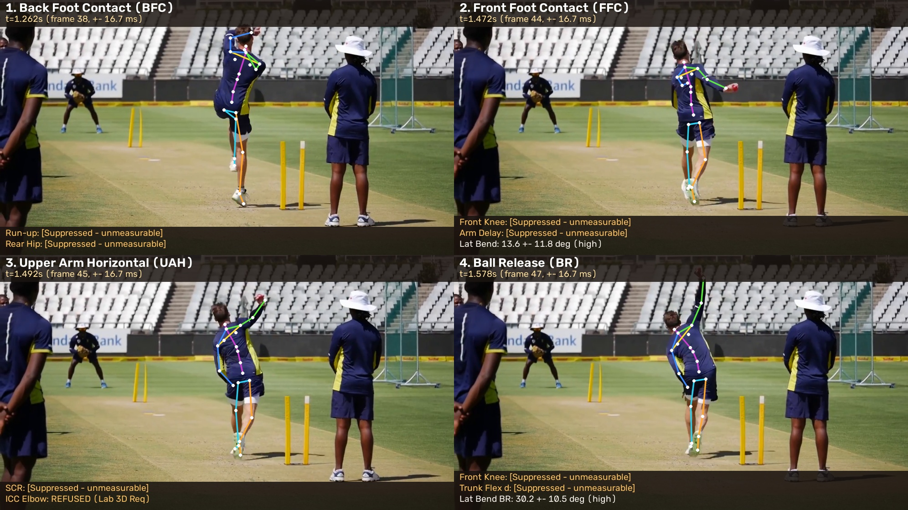
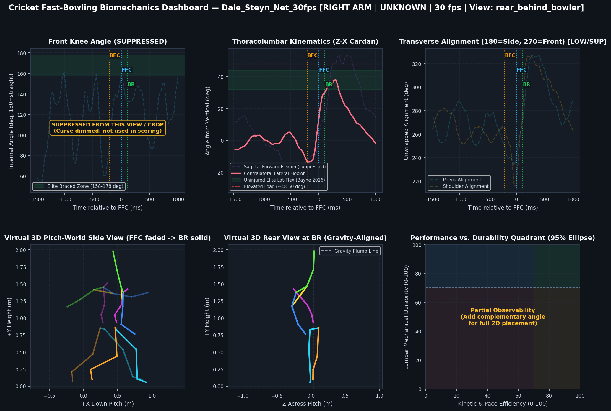
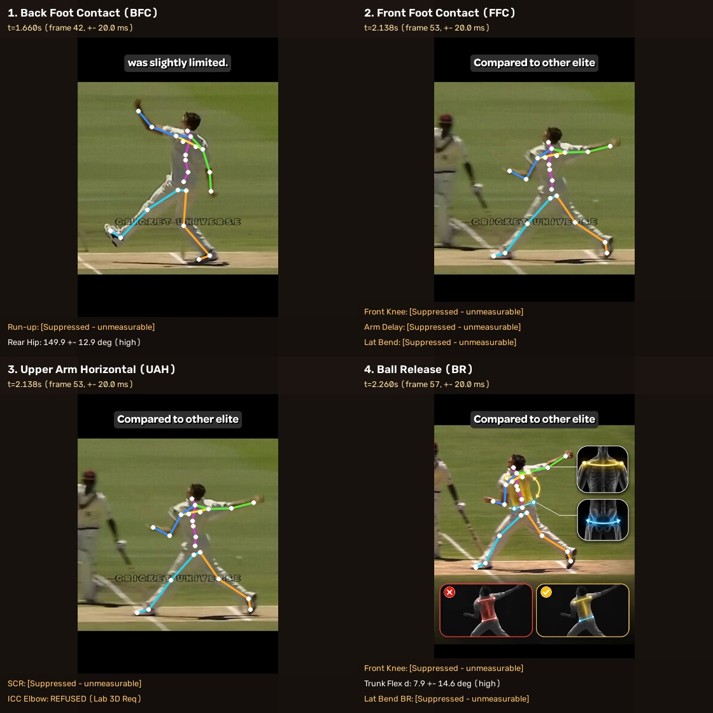
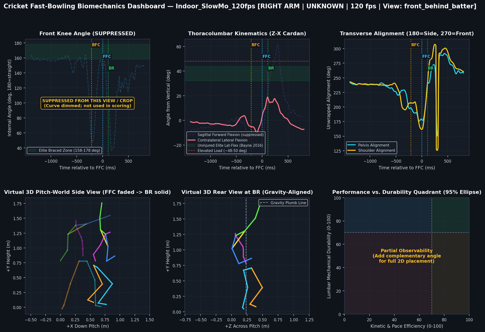

# Phase 0–1 Build, Audit Hardening & RTX 4090 Validation Walkthrough

## 1. Frontier 3D Compute Setup

All Phase 0–1 GPU validation experiments were executed on an isolated Linux CUDA 12.4 environment (**NVIDIA RTX 4090 24 GB**, `PyTorch 2.6.0+cu124`, `torchvision 0.21.0+cu124`) using the official **Neural Localizer Fields** (`isarandi/nlf`, NeurIPS 2024 — `nlf_l_multi.torchscript`, 471 MB), which predicts metric 3D SMPL-24 & BML-MoVi-87 anatomical landmarks alongside native per-joint 3D localization uncertainties.

---

## 2. Automated Tests & Upgraded AR(1) Synthetic Metrology Benchmark

Running `pytest -v` and `validation/run_synthetic_benchmark.py` (4 camera viewpoints × 5 frame rates × right & left arms under **temporally correlated AR(1) depth-drift noise, $\tau = 80\text{ ms}$**, plus an **uncalibrated self-calibration arm** with no oracle camera intrinsics or MCC landmarks) verified:

- **Unit & Integration Suite ([tests/test_core_biomechanics.py](../tests/test_core_biomechanics.py)):** **13 / 13 passed in 1.26 s**
  - Non-circular right- and left-arm 3D transverse alignment & SCR vector checks (`arctan2(sign_arm * lr[:, 0], lr[:, 2])` + BFC-anchored unwrapping).
  - MCC Law 7 PnP calibration across `0°`, `45°`, `90°`, `24° elevated broadcast`, and **coplanar 5-point creases-only `SOLVEPNP_IPPE`** with cheirality + above-ground checks.
  - Standing-background & pre-delivery gravity self-calibration (non-metric gated, underground `el < -1°` clamped).
  - Sub-frame causal `BFC < FFC <= UAH < BR < FT` event spotting, truncated-clip detection (`is_complete_delivery`), and 3D Z–X Cardan kinematics recovery for both right- and left-arm bowlers.
  - Cropped-ankle (`joint_in_frame`), static vs. panning optical-flow detection, `<90 fps` high-velocity arm suppression, physical CI clamping (`[0°, 180°]`), azimuth-gated capture upgrades, two-sided durability curves, dual-view arm-mismatch guarding, and **permanent `REFUSED` status on ICC 15-degree elbow legality** (preserved from truncation).
- **Empirical 95% Confidence Interval Calibration (AR(1) Correlated Noise, Right + Left Arms):** **97.0% coverage** across 912 observable evaluations (`docs/results/v3/synthetic_benchmark_results.json`):

| Viewpoint | 240 fps BR MAE | 240 fps Front-Knee BR RMSE | 240 fps Lat-Flex BR RMSE | 60 fps Arm Delay | 240 fps 95% CI Coverage | Uncalibrated Self-Cal (120 fps, No Oracle `K`) |
|---|---|---|---|---|---|---|
| **Side-On (`90°`)** | `0.6 ms` | **`6.10°`** | *Suppressed* | *Suppressed* | `94.4%` | `Az MAE = 4.58°`, `FK = 0.03°`, `LatFlex = 4.47°` |
| **45° Open-Side** | `1.4 ms` | **`5.38°`** | **`3.84°`** | *Suppressed* | `97.6%` | `Az MAE = 4.49°`, `FK = 0.03°`, `LatFlex = 4.48°` |
| **Rear Behind Bowler (`0°`)** | `2.2 ms` | *Suppressed* | **`2.79°`** | *Suppressed* | `100.0%` | `Az MAE = 4.56°`, `FK = 0.03°`, `LatFlex = 2.99°` |
| **Broadcast Elevated (`24°`)** | `1.8 ms` | *Suppressed* | **`2.81°`** | *Suppressed* | `100.0%` | *(Broadcast elevated PnP)* |

---

## 3. Independent Audit Hardening & Real-Video RTX 4090 Verification (`v3`)

An independent end-to-end audit reviewed all 14 modules, the synthetic benchmark, documentation, and real-video GPU runs start-to-end, resulting in comprehensive P0/P1/P2 hardening and clean final sign-off:

### Before vs. After Audit Comparison (All 4 Real RTX 4090 Clips)

| Clip | Before Audit (`v1/v2`) | After Audit Hardening (`v3`) |
|---|---|---|
| **Dale Steyn Net (`30 fps`, rear)** | `el = -14.4°` (underground), `stature = 1.56 m`, inverted transverse yaw, uncalibrated run-up leaked | `11` standing-umpire gravity frames (rejected squatting keeper/batter), `az = -2.9°`, `el = -1.0°`, **`stature = 1.80 m`** (actual `1.79 m`), causal `BFC=38, FFC=44, UAH=45, BR=47`, true SCR curve (`212° -> 270° -> 325°`), `LatFlex BR = 30.25° [19.7, 40.8] (high)`, `Durability = 89.7`, handheld pan (`bg_pan = 0.0805`) & sagittal knee suppressed, `ICC = REFUSED` |
| **Indoor Slow-Mo (`120 fps`, front)** | Sofa-cropped ankle hallucinated `front_knee = 94.9°`; `372°` yaw wrap spike; `63°` lateral-flex blowup | `front_behind_batter (az = 177.3°, el = 9.9°)`, cropped ankle caught -> `front_knee`, `stride`, `release_height` cleanly `[UNMEASURABLE]`, zero yaw/lat-flex spikes, `LatFlex BR = 18.51°`, `Durability = 73.8`, handheld pan (`bg_pan = 0.211`) detected |
| **Glenn McGrath (`25 fps` portrait Reel)** | `front_knee_ffc` CI hit `189.4°` (`>180°`); unreadable portrait text; smooth-turf pan missed | Geometric pan override locked `side_on_left (az = -98.9°, el = 2.4°, pan = True)`, causal `BFC=42, FFC=53, UAH=53, BR=57`, blurry 25 fps `front_knee` & panning `runup`/`stride` suppressed, legible portrait 9:16 strip with warm amber warnings |
| **Curtly Ambrose (`25 fps` rear broadcast)** | One-sided durability curve scored ipsilateral bend `84.8`; rear clip told user to "Add a Rear Camera" | Static `broadcast_elevated (az = 2.5°, el = 20.4°, bg_pan = 0.0001)`, clean `UAH = None` placeholder, two-sided knots flagged `Durability = 54.2`, upgrades strictly recommend `120–240 fps` and `Side-On (90 deg)` |

### Verified Visual Outputs (`v3`)

#### Dale Steyn Net Delivery (`30 fps`, Rear View)

#### Glenn McGrath Archival Portrait Clip (`25 fps`, Side-On Panning)

#### Indoor Slow-Motion Delivery (`120 fps`, Cropped-Ankle Protection)

